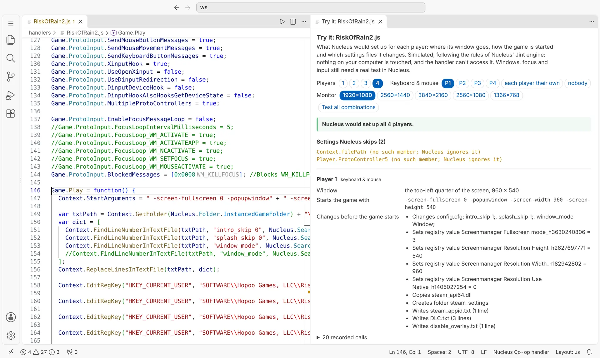
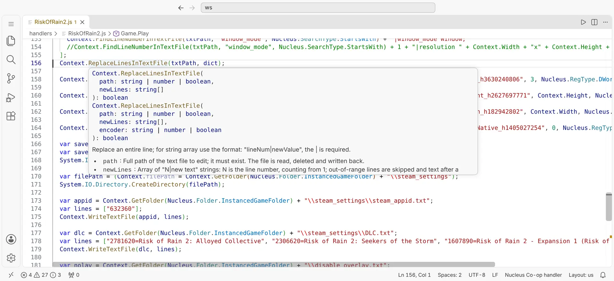
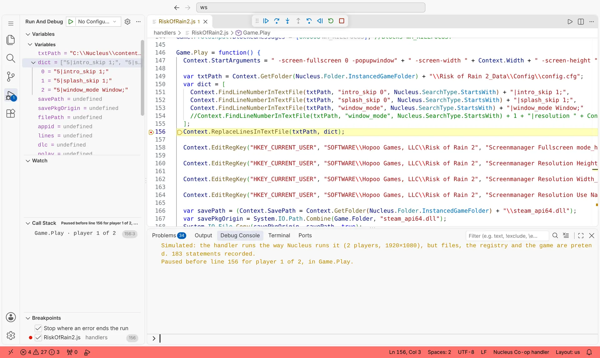
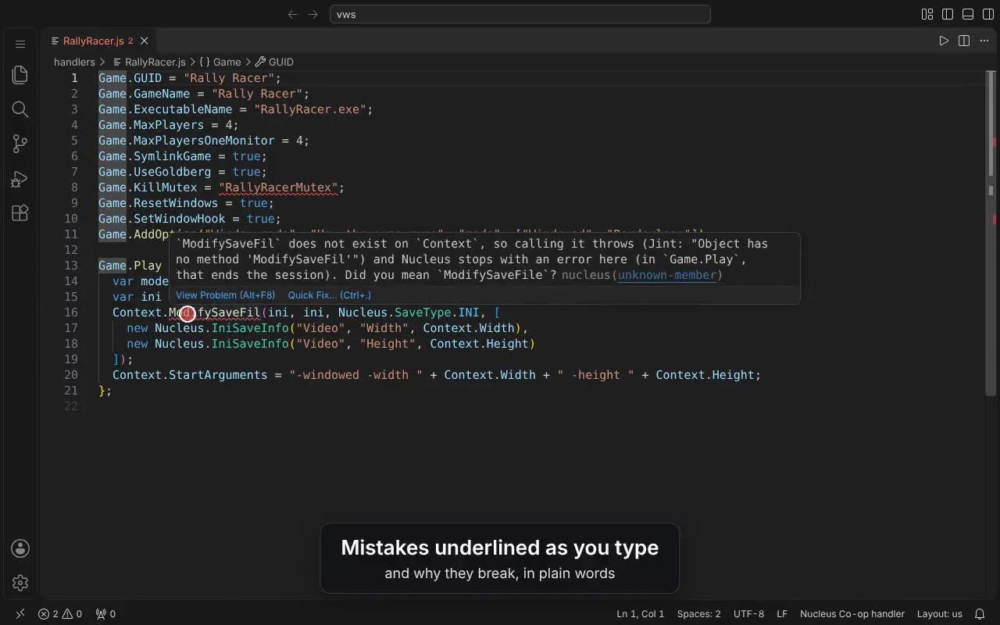
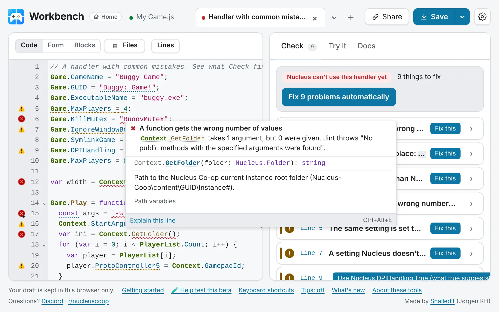
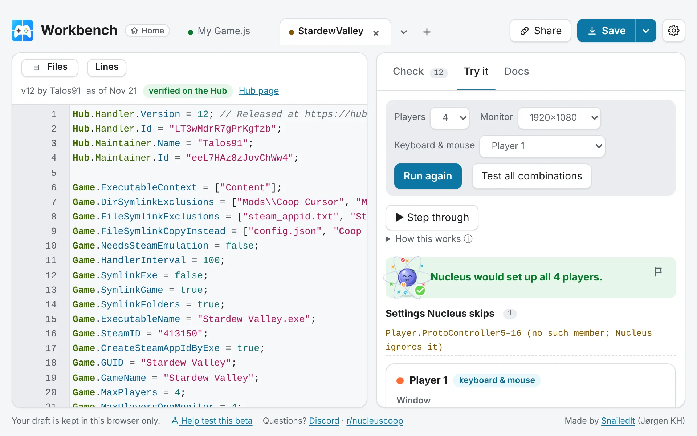
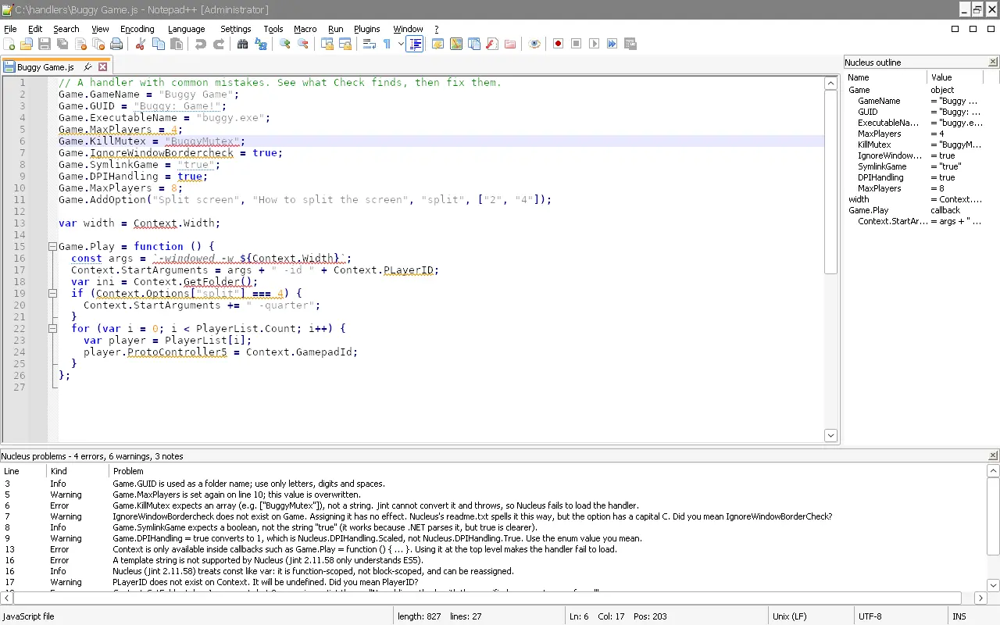

# Nucleus devtools

Tools for making [Nucleus Co-op](https://github.com/SplitScreen-Me/splitscreenme-nucleus) handlers. A handler is the small JavaScript file that tells Nucleus Co-op how to run several copies of a game side by side, so friends can play split screen on one PC. These tools check a handler as you write it, explain every option, show what Nucleus would set up for each player and package it for the [Hub](https://hub.splitscreen.me). They work in the browser, VS Code, Notepad++, any editor with LSP, on the command line and with AI agents: one engine, the same checks everywhere. Part of [SplitScreen.Me](https://www.splitscreen.me).

> **Beta, testers wanted.** Intro, screenshots and a 5-minute install: **https://snailedlt.github.io/nucleus-devtools/start/?ref=readme-md**

<p>
  <picture><source media="(prefers-color-scheme: dark)" srcset="docs/images/gallery/vscode-problems-quickfix-dark.webp"></picture>
  <picture><source media="(prefers-color-scheme: dark)" srcset="docs/images/gallery/vscode-try-it-dark.webp"></picture>
</p>
<p>
  <picture><source media="(prefers-color-scheme: dark)" srcset="docs/images/gallery/vscode-hover-docs-dark.webp"></picture>
  <picture><source media="(prefers-color-scheme: dark)" srcset="docs/images/gallery/vscode-completion-dark.webp"></picture>
  <picture><source media="(prefers-color-scheme: dark)" srcset="docs/images/gallery/vscode-debugger-dark.webp"></picture>
</p>

*Problems and quick fixes, the **Try it** panel, hover, completion and the debugger, in VS Code (the status bar shows the handler's own language mode, **Nucleus Co-op handler**). The same checks run in the [browser workbench](https://snailedlt.github.io/nucleus-devtools/?ref=readme-md). Testing it? See [TESTING.md](TESTING.md).*

**In motion** (a minute or two each, captioned, no sound; click to play):

<p>
  <a href="docs/videos/vscode.mp4"></a>
  <a href="docs/videos/notepadpp.mp4"></a>
</p>

The browser workbench has [its own](workbench/docs/videos/workbench.mp4).

## Who it's for

- **You'd like split screen in a game that has no handler yet.** Start with **[Learn](https://snailedlt.github.io/nucleus-devtools/learn/?ref=readme-md)**: lessons in the browser that build a working handler for a free game, step by step, and test it in Nucleus Co-op. Nothing to install. Also check the [Hub](https://hub.splitscreen.me) (someone may have made one already), the official [guide to creating handlers](https://www.splitscreen.me/docs/create-handlers) and the [Discord](https://discord.gg/XxGMkqCf4r).
- **You write or fix handlers.** Pick the tool that fits how you work: [Pick a tool](#pick-a-tool) below. They all run the same checks, so you can switch any time.
- **You'd like to work on the tools with us**, with code or without: [Work on the tools with us](#work-on-the-tools-with-us).

## Pick a tool

| | Best for | Get it |
| --- | --- | --- |
| **[Browser workbench](#the-browser-workbench)** | Trying it out, learning, quick fixes; nothing to install | [Open it](https://snailedlt.github.io/nucleus-devtools/?ref=readme-md) |
| **[VS Code](#vs-code)** | Writing handlers every day (also VSCodium) | the `.vsix` from the [releases](https://github.com/Snailedlt/nucleus-devtools/releases) |
| **[Notepad++](#notepad)** | Authors who already use Notepad++ (Windows) | `ncdev.exe` from the releases, then *Set up Notepad++* |
| **[`ncdev`](#the-command-line-tool-ncdev)** | The command line, scripts and CI | `ncdev.exe`, or `nucleus.js` with Node.js |
| **[Other editors](#your-own-editor-for-experienced-developers)** | Neovim, Helix, Sublime Text, Emacs, Kate, JetBrains, Zed | `ncdev lsp` |
| **[AI agents](#ai-agents)** | Claude Code, Copilot, Cursor, Codex and other agents | the plugin, the MCP server or the agent kit |

Every tool is on one page, with the install steps: **[the tools page](https://snailedlt.github.io/nucleus-devtools/tools/?ref=readme-md)**. They're in beta: what's new is in [CHANGELOG.md](CHANGELOG.md) (the editors and ncdev) and [workbench/CHANGELOG.md](workbench/CHANGELOG.md) (the workbench and the site).

**What they all do:**
- **Problems as you type, with the why**: the mistakes that make handlers fail, often silently (syntax Nucleus' engine can't read, options that don't exist, wrong types, Hub install traps). Each check has [its own page](https://snailedlt.github.io/nucleus-devtools/rules/). See [Lint rules](#lint-rules).
- **Fixes**: one-click quick fixes, and *Fix all*, which only applies fixes that keep what the handler does.
- **Docs for every option and function**, in hovers, suggestions and a page each, with examples from real Hub handlers.
- **Try it**: what Nucleus would set up for each player (windows, launch arguments, the files it changes), without Nucleus or the game; and a **debugger** that steps through the handler per player. See [Try it](#try-it).
- **Hub handlers**: search every handler on the Hub and open any of them, to see how others solved a problem.
- **New handler, package, install**: a handler from a template, the `.nc` package for the Hub, and on Windows, install it and start Nucleus Co-op with the game selected.

## Every editor, side by side

One engine runs underneath all of them, so the checks, suggestions and docs are the same; what differs is what each editor can show.

<!-- generated:compare -->
| | [VS Code](#vs-code) | [Notepad++](#notepad) | [Workbench](https://snailedlt.github.io/nucleus-devtools/?ref=readme-md) | [Other editors (LSP)](#your-own-editor-for-experienced-developers) |
|---|:-:|:-:|:-:|:-:|
| Problems as you type, with the why | ✅ | ✅ | ✅ | ✅ |
| Quick fixes and Fix all | ✅ | ✅ | ✅ | ✅ |
| Suggestions, snippets, New handler | ✅ | ✅ | ✅ | ✅ |
| Hover docs and parameter hints | ✅ | ✅ | ✅ | ✅ |
| Docs for every option and function | ✅ panel | ✅ API reference | ✅ Docs tab | ✅ links to the docs |
| Explain this line | ✅ | ✅ | ✅ | ✅ |
| Format (never moves a line) | ✅ | ✅ | ✅ | ✅ |
| Go to definition, references, rename | ✅ | ✅ | ✅ | ✅ |
| Outline | ✅ | ✅ panel | — | ✅ |
| Try it (each player's setup) | ✅ | ✅ | ✅ | ✅ command |
| Debugger, per player | ✅ | — | ✅ | ✅ `ncdev dap` |
| Lines (every name, one click to insert) | — | — | ✅ | — |
| Checks against the game's folder | ✅ | ✅ | ✅ | ✅ |
| Browse and open Hub handlers | ✅ | ✅ | ✅ | `ncdev hub` |
| Package as .nc for the Hub | ✅ | ✅ | ✅ | ✅ command |
| Install into Nucleus Co-op | ✅ | ✅ | ✅ Chrome, Edge | ✅ command |
| Test in Nucleus Co-op (starts it) | ✅ | ✅ | — a browser can't | ✅ command |
| AI help | ✅ its agents get the tools | — | ✅ Fix with AI | `ncdev mcp` for agents |
| What to install | the extension | `ncdev setup notepad++` | nothing | `ncdev` |
<!-- /generated:compare -->

## The browser workbench

**https://snailedlt.github.io/nucleus-devtools/?ref=readme-md**: the same checks, Try it, docs and debugger in the browser, with Learn (lessons for a first handler), the docs and check pages, and nothing to install. Open a Hub handler or your own (a `.js`, or a whole `.zip`/`.nc` package), then save it or share it with a link. Its changes are in [workbench/CHANGELOG.md](workbench/CHANGELOG.md); it updates whenever `main` changes.

<p>
  <picture><source media="(prefers-color-scheme: dark)" srcset="workbench/docs/images/gallery/workbench-check-dark.webp"></picture>
  <picture><source media="(prefers-color-scheme: dark)" srcset="workbench/docs/images/gallery/workbench-try-it-dark.webp"></picture>
</p>

## VS Code

The extension for VS Code (and VSCodium).

- **Its own language mode.** Handlers open as **Nucleus Co-op handler**: JavaScript's colours, brackets and folding, but only the suggestions Nucleus can use (no browser globals, no newer methods its engine lacks). See [Handler language mode](#handler-language-mode).
- **Colours that tell Nucleus names apart**, in your theme's own JavaScript colours: option groups (`Game.Hook`), fixed choices (`Nucleus.Folder.InstancedGameFolder`) and callbacks (`Game.Play`) each get one, so a name Nucleus doesn't know stands out.
- **IntelliSense** for `Game`, `Game.Hook`, `Game.ProtoInput`, `Context`, `Player`, `PlayerList`, `ProtoInput`, `Hub` and the `Nucleus.*` enums. Completion lists every option Nucleus actually has, with types, defaults and docs. On an empty line, `Game.` completes the whole assignment, e.g. `Game.SymlinkGame = true|false;`. After `=`, the values the option takes.
- **Suggestions that know your handler:** `Context.Options["` suggests the keys your `Game.AddOption` lines add, and `== "` their choices; what your own functions return is understood after a dot.
- **Hover docs** and **signature help** for every method and its overloads, saying what to pass for each parameter of the most used ones. API names in them are links to the **Docs** panel.
- **Snippets** for what most handlers do (`iniset`, `replacelines`, `regkey`, `startargs`, `ifoption`, `eachplayer`…), offered where a statement starts; in an empty file, `handler` writes the whole template.
- **Linting** for the mistakes that make handlers fail, often silently. See [Lint rules](#lint-rules).
- **Fix all**, deterministic and offline: applies every fix that keeps the handler's behaviour or repairs code Nucleus can't load. It runs as a command, on save, or as `ncdev lint --fix`. Fixes that change behaviour or need your input stay one-click quick fixes. On the engine probes (`workbench/probes`), it turns most of those that fail in Jint 2.11.58 into working code.
- **Format Document** (also a selection, and as you type): indentation, spacing, double quotes and semicolons (both [configurable](#settings)). No line moves (Nucleus runs handlers line by line), and the result is checked to parse to exactly the same program, so formatting never changes what the handler does. Also `ncdev format`.
- **Quick fixes**: did-you-mean for typos, `"true"` → `true`, template string → concatenation, wrap a value in an array, add missing required options, and more.
- **New Handler** wizard that generates a handler which passes the linter, with optional Proto Input, Goldberg, INI resolution and user-option sections.
- **Package for the Hub**: builds a `.nc` package laid out the way Nucleus' installer expects.
- **Install into Nucleus**: copies the handler and its asset folder into your Nucleus `handlers` folder.
- **Test in Nucleus Co-op** (Windows): the Run button (▷) above a handler installs it and starts Nucleus Co-op with its game selected. The same button's menu has **Try It** and **Debug**.
- **Go to definition** (F12) and the **Outline** of the handler's options, functions and variables.
- **Checks against the game's folder**: link the game's install folder and `ExecutableName`, `BinariesFolder` and the symlink lists are checked against the real files (only names and sizes are read).
- **A getting-started guide**: *Help › Welcome › Make a Nucleus Co-op handler* walks from an empty file to the Hub.
- **Browse the Hub**: search every handler on [hub.splitscreen.me](https://hub.splitscreen.me) and open any handler's source, which is handy for seeing how others solved a problem.
- **Type definitions** (`nucleus.d.ts`), so you can opt into full TypeScript checking with `// @ts-check`.
- More snippets (`nc-…`) for INI/XML edits, copying files from the handler folder, Goldberg and Proto Input.
- **The `ncdev` CLI** runs the same checks in CI, and much more: see [below](#the-command-line-tool-ncdev).

The API model is **generated from the Nucleus C# sources** (`GenericGameInfo`, `GameHookInfo`, `GenericContext`, `ProtoInputOptions`, …) and the [splitscreen.me docs](https://www.splitscreen.me/docs/handler-api), so it reflects what Nucleus really accepts rather than a hand-maintained list.

### Install and first steps

1. Install the extension. Until it is on the Marketplace, download the `.vsix` from the [releases](https://github.com/Snailedlt/nucleus-devtools/releases) (or run `npm ci && npm run package`), then **Extensions: Install from VSIX…**. Testing it? See [TESTING.md](TESTING.md).
2. Open the folder where you keep your handlers. Any `.js` file that sets `Game.GUID`, `Game.GameName`, `Game.ExecutableName` or `Game.Play`, or lives in a `handlers` folder, opens as **Nucleus Co-op handler** (shown in the status bar) and gets handler features. Other JavaScript files are left alone.
3. Run **Nucleus: New Handler…** from the Command Palette, or type `handler` in an empty `.js` file. New to handlers? *Help › Welcome › Make a Nucleus Co-op handler* walks you through it.

#### Commands

<!-- generated:vscode-commands -->
| Command | Keys |
| --- | --- |
| **Nucleus: What's New** |  |
| **Nucleus: New Handler…** |  |
| **Nucleus: Try It (Simulate Each Player)** |  |
| **Nucleus: Try It: Change Settings** |  |
| **Nucleus: Try It: Test All Combinations (Players, Input, Monitors)** |  |
| **Nucleus: Debug Handler (Step Through, Simulated)** |  |
| **Nucleus: Explain This Line** | Ctrl+Alt+E (Mac: Cmd+Alt+E) |
| **Nucleus: Fix All Problems That Can Be Fixed** |  |
| **Nucleus: Format Handler** | Shift+Alt+F |
| **Nucleus: Package Handler for the Hub (.nc)** |  |
| **Nucleus: Install Handler into Nucleus Co-op** |  |
| **Nucleus: Test in Nucleus Co-op** |  |
| **Nucleus: Open Nucleus Co-op's Debug Log** |  |
| **Nucleus: Browse Handlers on the Hub…** |  |
| **Nucleus: Set Up Type Definitions (jsconfig.json + .d.ts)** |  |
| **Nucleus: Set Up AI Agent Support (AGENTS.md, skill, CLI)** |  |
| **Nucleus: Check All Handlers in the Workspace** |  |
| **Nucleus: Docs: Web Links…** |  |
| **Nucleus: Open in the Browser Workbench** |  |
| **Nucleus: Game Folder: Link…** |  |
| **Nucleus: Game Folder: Unlink** |  |
| **Nucleus: Docs: Open (Every Option and Function)** |  |
| **Nucleus: Docs: Search…** |  |
| **Nucleus: Docs: Back** |  |
| **Nucleus: Docs: Vote** |  |
| **Nucleus: Report a Problem…** |  |
| **Nucleus: Request a Feature…** |  |
| **Nucleus: This Check Is Wrong…** |  |
| **Nucleus: Try It: Nucleus Did Something Different…** |  |
<!-- /generated:vscode-commands -->

On any problem, **Ctrl+.** (the light bulb) also has **This check is wrong (rule)…**, after the fixes, and the Try it panel's report button (*Nucleus did something different*) sends what Try it showed next to what really happened.

Package and Install both refuse to continue if the handler has lint errors, unless you confirm.

Hover the language in the status bar (**{} Nucleus Co-op handler**) for the handler's status: its checks (the problem count, or OK), its game folder, with *Link…* or *Unlink*, and *Feedback* (Report a problem…). What the extension did, and any error, goes to **View › Output › Nucleus**; quiet results such as "nothing to fix" show briefly in the status bar instead of a notification.

#### Handler asset folder

Nucleus sets `Game.Folder` to `handlers/<handler file name without .js>/`. Keep files your handler copies (DLLs, configs, …) in a folder with the same name next to the handler:

```
MyGame.js
MyGame/
  steam_api64.dll
```

Package and Install both pick this folder up automatically.

### Settings

<!-- generated:settings -->
| Setting | Default | |
| --- | --- | --- |
| `splitscreenme.detection` | `"auto"` | Which JavaScript files are treated as Nucleus Co-op handlers (and get the checks, suggestions and commands). |
| `splitscreenme.languageMode` | `"handler"` | The language mode Nucleus Co-op handlers open in. The language shows in the status bar; click it to switch one file. |
| `splitscreenme.completion.enable` | `true` | Provide completion, hover and signature help for the Nucleus Co-op handler API. Turned off automatically by "Set Up Type Definitions", since TypeScript then provides them. |
| `splitscreenme.showWhatsNew` | `true` | After an update of the Nucleus Co-op handler tools, show a short note with what's new (the full list is in Nucleus: What's New). |
| `splitscreenme.lint.enable` | `true` | Report problems in Nucleus Co-op handlers (ES5-only syntax, unknown options, type mismatches, Hub install pitfalls, …). |
| `splitscreenme.lint.packageChecks` | `true` | Check the files in a Nucleus Co-op handler's folder (`<Name>/` next to `<Name>.js`) as they'd go into the .nc: names Windows can't install, files that overwrite each other, broken INI/JSON, very large files, and files the handler uses (Game.Folder + "\\x") that aren't there. |
| `splitscreenme.lint.compareWithHub` | `true` | For a Nucleus Co-op handler with a Hub.Handler.Id line, compare Game.GUID with the version published on hub.splitscreen.me (guid-changed). Downloads that version once and keeps it in the cache. |
| `splitscreenme.gameFolders` | `{}` | The game's install folder for each Nucleus Co-op handler (file name → folder), set by hand. **Nucleus: Game Folder: Link…** keeps its links on this PC instead (not in a settings file), and they come first. The handler is then checked against the real files (`ExecutableName`, `BinariesFolder`, the symlink and copy lists…), and those lists suggest the game's files. File names and sizes are read, and the game's .exe and DLLs are analysed on your PC (their import tables and names in them, never run) for hook hints; nothing leaves your PC. |
| `splitscreenme.lint.rules` | `{}` | Override the severity of individual checks on Nucleus Co-op handlers, e.g. `{ "deprecated": "off", "unknown-member": "error" }`. See the [rule list](https://github.com/Snailedlt/nucleus-devtools#lint-rules). |
| `splitscreenme.format.quotes` | `"double"` | Quotes around strings when formatting a Nucleus Co-op handler. A string that contains the chosen quote keeps its own, so no escapes are added. |
| `splitscreenme.format.semicolons` | `"add"` | Semicolons when formatting a Nucleus Co-op handler. Either way the program stays exactly the same: the formatter checks that it parses to the same code before changing anything. |
| `splitscreenme.nucleusPath` |  | Nucleus Co-op installation folder (contains NucleusCoop.exe and "handlers"). Used by "Install Handler into Nucleus Co-op" and "Test in Nucleus Co-op". |
<!-- /generated:settings -->

#### Handler language mode

Handlers open in a language mode of their own, **Nucleus Co-op handler**. It uses JavaScript's grammar, so colours, brackets, comments and folding look the same as in any `.js` file. VS Code's built-in JavaScript and TypeScript features don't run on it, though: their suggestions would otherwise mix with the handler's, and many of them are wrong for Nucleus (browser globals like `document`, and newer methods such as `Array.prototype.includes` that Nucleus' engine, Jint 2.11.58, doesn't have).

- Handler files get their own file icon, Nucleus Co-op's logo with a JS tag, in the Explorer, tabs and breadcrumbs. It shows with VS Code's default file icons (Seti) and icon themes that don't claim `.js` files themselves; Material Icon Theme and vscode-icons pick an icon by file extension first, so there a handler keeps their JavaScript icon (the status bar still says **Nucleus Co-op handler**). The status bar shows the mode. Click it to switch one file back to JavaScript; that file stays JavaScript for the session.
- `"splitscreenme.languageMode": "javascript"` keeps all handlers as JavaScript.
- **Nucleus: Set Up Type Definitions** sets that for its folder, because `// @ts-check` needs the TypeScript service.
- Formatters, linters, snippets and keybindings you set up for `javascript` (Prettier, ESLint, …) don't apply to handler files. Add `nucleus-handler` to their languages, or use JavaScript mode. The extension's own formatter, snippets and debugger work in both.

**What the Hub sees.** The Hub's handler list comes from our daily copy on GitHub, checked at most once an hour; hub.splitscreen.me is asked only when that copy is missing or out of date, and each package is downloaded once per version. Every request says it comes from these devtools, which tool and which feature sent it (`User-Agent: SplitScreenMe-DevTools/<version> (ncdev-cli; hub-search; +https://github.com/Snailedlt/nucleus-devtools)` and the same in `X-Requested-With`), and nothing else: no search text, file names, code, user or computer names.

## Other editors

Most people are best served by **VS Code**, **[Notepad++](#notepad)** or the **[browser workbench](https://snailedlt.github.io/nucleus-devtools/?ref=readme-md)**: they're set up in a few clicks and tested before every release. If you already live in another editor, read on.

### Notepad++

1. Download `ncdev.exe` from the [newest release](https://github.com/Snailedlt/nucleus-devtools/releases).
2. Close Notepad++, double-click `ncdev.exe` and choose **1 Set up Notepad++**. When Windows asks for permission (Notepad++ is in Program Files), allow it.
3. Start Notepad++ and open a handler.

From a terminal instead, in the folder with `ncdev.exe` (it asks for the same permission when it needs it):

```
ncdev setup notepad++
```

A portable Notepad++ needs no permission: add `--path "C:\path\to\Notepad++"`.

<p>
  <picture><source media="(prefers-color-scheme: dark)" srcset="docs/images/gallery/notepadpp-panels-dark.webp"></picture>
  <picture><source media="(prefers-color-scheme: dark)" srcset="docs/images/gallery/notepadpp-menu-dark.webp"></picture>
</p>

This installs the **Nucleus Co-op handlers** plugin and puts `ncdev` in `%LOCALAPPDATA%\ncdev`, where the plugin finds it. In a handler:

- **Problems are underlined** as you type (red: Nucleus would fail; orange: probably wrong; dotted: worth knowing). Hover one, or any name, for an explanation and the docs.
- **Suggestions as you type** after a dot, `=`, a quote…: the members that exist there, the values an option takes (`true`/`false`, `Nucleus.DPIHandling.True`…), the game's own files once its folder is linked. The selected one's type and docs show in the status bar. Parameter hints after `(`.
- **The handler's own functions and variables** are suggested too, with the comment above them as their docs, and their parameters show after `(`. `Context.Options["` suggests the keys your `Game.AddOption` lines add, and `== "` their choices.
- **Go to definition**: where a function, variable or option is defined; *Find references* lists every use; *Rename…* changes a variable or function everywhere in the handler.
- **Quick fix**: the fixes for the line. **Plugins › Nucleus Co-op handlers** has *Fix all*, *Format handler*, *Try it* (what Nucleus would set up for 1–4 players, in a new tab), a *Problems panel* (double-click to jump, right-click for the fixes), *Link the game's folder…*, *Open in the browser workbench* (this handler, in the workbench, with Test all), the *API reference*, *Check for updates*, and *Report a problem…* / *Request a feature…* (the quick fix on a problem also has *This check is wrong*). Every command can get a shortcut in *Settings › Shortcut Mapper*.
- **New handler…** asks the game's name, its .exe and what to start with, then creates and opens the handler. **Install to Nucleus Co-op** copies it (and its `<Name>/` folder) into Nucleus' `handlers` folder, asking first if it has errors or is already installed. The **Outline panel** lists the handler's options, functions and variables; click one to jump there.
- **Test in Nucleus Co-op** installs the handler and starts Nucleus with its game selected (restarting an open one, with your OK); **Open Nucleus' debug log** shows what happened.
- **Browse the Hub…** lists the Hub's handlers (most downloaded first, or search by game), and downloads one with its files and opens it. **Package as .nc…** makes the file to upload to the Hub.
- **Settings…**: how each check is shown (error, warning, info, hint or off), and the format style (quotes, semicolons).
- A **Run › Nucleus: check this handler** entry runs `ncdev lint` on the open file in a console.
- Every menu entry and its keys: [Tools › Notepad++](https://snailedlt.github.io/nucleus-devtools/docs/tools/notepadpp/).

`ncdev update` keeps the tool current (the plugin's menu says when there's a new one). `ncdev setup notepad++ --check` says what's installed and `--remove` takes it all out again. Without the standalone `ncdev` (e.g. `node nucleus.js setup notepad++`), the setup adds the Nucleus names and call tips to Notepad++'s own JavaScript suggestions instead (no plugin).

### Your own editor (for experienced developers)

`ncdev lsp` is a Language Server with the same features: problems and quick fixes, hover, completion with your own names and snippets, signature help, go to definition, rename, outline, Format Document, window-message hints, Try it, and *Package*, *Install*, *New handler* and *Test in Nucleus* as code actions and commands. `ncdev dap` brings the debugger. Any editor with an LSP client can use it; most need only a few lines of config.

1. **Get the server.** `ncdev.exe` (Windows) or `ncdev-linux-x64` (Linux: `chmod +x` it and put it on your PATH as `ncdev`) from the [newest release](https://github.com/Snailedlt/nucleus-devtools/releases); no Node needed, and `ncdev update` keeps it current. Elsewhere (macOS, for one), `nucleus.js` from a release with Node.js 18+ does the same.
2. **Point your editor's LSP client at it** for JavaScript files, over stdio: `ncdev lsp` (or `node /path/to/nucleus.js lsp` without a standalone `ncdev`). It only answers for handler files, so your usual JavaScript server keeps working beside it. The examples below start it by name, so `ncdev` must be on your `PATH`; otherwise use its full path (e.g. `C:\Tools\ncdev.exe`).
3. **Open a handler.** Problems should show within a second.

<!-- generated:editors -->
| Editor | Setup | Tested by people | Tested by AI |
| --- | --- | --- | --- |
| Neovim | a few lines of Lua ([below](#neovim)) | not yet | ✅ Neovim 0.9 (the 0.11 config is from its docs) |
| Helix | 6 lines in `languages.toml` ([below](#helix)) | not yet | not yet |
| Sublime Text | the [LSP](https://packagecontrol.io/packages/LSP) package + one client entry ([PORTING.md](PORTING.md#sublime-text-lsp-package-preferences--package-settings--lsp--settings)) | not yet | not yet |
| Emacs 29+ | one `eglot-server-programs` line ([PORTING.md](PORTING.md#emacs-eglot-built-in-since-emacs-29)) | not yet | ✅ Emacs 29.3 (eglot) |
| Kate | one entry in LSP Client settings ([PORTING.md](PORTING.md#kate-settings--configure-kate--lsp-client--user-server-settings)) | not yet | not yet |
| JetBrains IDEs | the [LSP4IJ](https://plugins.jetbrains.com/plugin/23257-lsp4ij) plugin, a server added in Settings ([PORTING.md](PORTING.md#jetbrains-ides-lsp4ij)) | not yet | not yet |
| Zed | needs a small Zed extension first ([PORTING.md](PORTING.md#zed-settingsjson)) | not yet | not yet |
<!-- /generated:editors -->

*Tested by AI* means an AI agent ran the editor with this setup and checked that problems, hovers and quick fixes come through; *tested by people* means a handler author used it for real. Tried one? A line in the [feedback form](https://github.com/Snailedlt/nucleus-devtools/issues/new?template=tester-feedback.yml) (it worked, or what didn't) helps the next person.

#### Neovim

<!-- generated:snippet-neovim -->
```lua
vim.lsp.config('nucleus', {
  cmd = { 'ncdev', 'lsp' },
  filetypes = { 'javascript' },
  root_markers = { 'handlers', '.git' },
  init_options = { lint = { compareWithHub = true } },
})
vim.lsp.enable('nucleus')
-- Inlay hints (window-message names): vim.lsp.inlay_hint.enable(true)
-- Fix all: vim.lsp.buf.code_action({ context = { only = { 'source.fixAll' } }, apply = true })
-- Try it: vim.lsp.buf_request(0, 'workspace/executeCommand',
--   { command = 'nucleus.tryIt', arguments = { { uri = vim.uri_from_bufnr(0), players = 2 } } },
--   function(_, text) if text then print(text) end end)
```
<!-- /generated:snippet-neovim -->

Older Neovim, the colour links for Nucleus names, Fix all and Try it: [PORTING.md](PORTING.md#neovim-011-built-in).

#### Helix

In `languages.toml`:

<!-- generated:snippet-helix -->
```toml
[language-server.nucleus]
command = "ncdev"
args = ["lsp"]

[[language]]
name = "javascript"
language-servers = ["typescript-language-server", "nucleus"]
```
<!-- /generated:snippet-helix -->

Settings (which checks to show, the format style, your Nucleus folder), Fix all, Try it and the debugger for each editor are in [PORTING.md](PORTING.md), which also explains how the code is split, for anyone (or any AI agent) building a proper extension for their editor.

## The command-line tool: `ncdev`

`ncdev` (Nucleus Co-op dev tools) is the same engine as the extension, on the command line: lint, fix, format, Try it (`simulate`), the debugger (`debug`), API lookup, Hub search, new handlers from templates, packages, and the servers for other editors and AI agents (`lsp`, `dap`, `mcp`). `ncdev --help` lists everything. `nucleus` is its old name and still works.

**Standalone (Windows and Linux, nothing else to install):** download `ncdev.exe` or `ncdev-linux-x64` from the [newest release](https://github.com/Snailedlt/nucleus-devtools/releases) (on Linux, `chmod +x` it and put it on your PATH as `ncdev`) and run it from a terminal:

```
ncdev lint MyGame.js
```

`ncdev update` replaces it with the newest release (checked against the release's SHA-256 sums); `ncdev --version` says when there is one. It's large because Node.js is inside. It isn't code-signed yet, so Windows SmartScreen may ask once ("More info › Run anyway").

**Elsewhere, with Node.js 18+:** `nucleus.js` from a release (`node nucleus.js lint MyGame.js`), or from the repository:

```bash
npm ci && npm run build
node dist/cli.js path/to/handlers   # or `ncdev` / `nucleus-lint` once the package is installed
```

`ncdev report` opens a report from the command line: `ncdev report` (a problem), `ncdev report feature`, `ncdev report tryit MyGame.js`, or `ncdev report --check unknown-member MyGame.js` (this check is wrong: the flagged line only, `--no-code` leaves it out). It prints the prefilled form's link and open reports that may be the same; `--open` opens it, `--text` prints it to paste in the testers' Discord thread.

`--fix` applies every safe automatic fix and saves the files, and `--fix-dry-run` shows what it would change. `format` re-indents and spaces handlers (`--write` saves, `--check` exits 1 when a file isn't formatted), and `--hub` compares `Game.GUID` with the Hub version. Lint options: `--json`, `--rule unknown-member=error`, `--quiet` (errors only), `--verbose` (include hints), `--all` (lint every `.js`, not just handler-looking ones), `--list-rules`. The exit code is 1 when there are errors.

## Try it

**Nucleus: Try It** and `ncdev simulate` load the handler and run `Game.Play` once per player, the way Nucleus does, without Nucleus or the game. They emulate the rules of Nucleus' engine (Jint 2.11.58): unknown options are skipped, only the first letter of a name is case-insensitive, list and enum values are converted the same way, wrong argument counts throw, and ES2015+ built-ins such as `.includes()` fail. The emulation is checked against the real engine: it predicts the same outcome on all 121 probes of the [testbench](https://github.com/Snailedlt/nucleus-devtools), launch arguments included.

It also follows Nucleus' session flow: an error in `Game.Play` ends the session (later players are never set up), `Game.OnFinishedSetup` and `Game.OnStop` run with the last player's `Context`, `Game.GamePlayAfterLaunch` makes `Context.StartArguments` irrelevant, and paths (`Context.ExePath`, `GetFolder`, ...) depend on `Game.SymlinkGame`/`HardcopyGame`/`HardlinkGame` and `Game.BinariesFolder` as in Nucleus. Plugin globals listed in the handler folder's `pluginsInfo.txt` record their calls.

File, registry and process calls are recorded, never performed. The handler runs in a separate JavaScript realm with no access to Node, VS Code or your files (only text goes in and out), and a time limit stops endless loops, so trying a handler you downloaded is safe. Window placement, focus, input and the game itself still need a real test in Nucleus.

```bash
node dist/cli.js simulate MyGame.js --players 4 --keyboard none --resolution 2560x1440   # --json for scripts and agents
```

The exit code is 1 when the handler fails to load or a player's setup fails.

`ncdev debug` runs the handler the same way and stops where you ask: at a line (`--break 14`), at a line for one player (`--break "14 if Context.PlayerID == 1"`) and wherever an error ends a phase. Each stop says where it is (the top of the file, `Game.Play` for player 2 of 4, `Game.OnStop`, ...) and shows the variables, the call stack, any `--watch` values and what the handler did so far; `--step` lists every line it runs. It records the run and reads values without running anything of the handler's, so the result is the same as without it.

```bash
node dist/cli.js debug MyGame.js --break "14 if Context.PlayerID == 1" --watch Context.StartArguments
```

## Lint rules

Every check has its own page, with why it matters, a wrong and a right example and the fix: [all checks](https://snailedlt.github.io/nucleus-devtools/rules/). Each problem in VS Code and other editors links to its page.

<!-- generated:rules -->
| Rule | Default | What it catches |
| --- | --- | --- |
| [`syntax-error`](https://snailedlt.github.io/nucleus-devtools/rules/syntax-error/?ref=readme-md) | error | Code that can't be read |
| [`es5-only`](https://snailedlt.github.io/nucleus-devtools/rules/es5-only/?ref=readme-md) | error | Newer JavaScript than Nucleus understands |
| [`let-const-semantics`](https://snailedlt.github.io/nucleus-devtools/rules/let-const-semantics/?ref=readme-md) | info | `let` and `const` work like `var` here |
| [`unknown-member`](https://snailedlt.github.io/nucleus-devtools/rules/unknown-member/?ref=readme-md) | warning | A name Nucleus doesn't have |
| [`readonly-member`](https://snailedlt.github.io/nucleus-devtools/rules/readonly-member/?ref=readme-md) | warning | A value Nucleus sets itself |
| [`type-mismatch`](https://snailedlt.github.io/nucleus-devtools/rules/type-mismatch/?ref=readme-md) | warning | The wrong kind of value |
| [`value-format`](https://snailedlt.github.io/nucleus-devtools/rules/value-format/?ref=readme-md) | error | The value has the wrong form |
| [`wrong-arguments`](https://snailedlt.github.io/nucleus-devtools/rules/wrong-arguments/?ref=readme-md) | error | A call with the wrong number of values |
| [`missing-required`](https://snailedlt.github.io/nucleus-devtools/rules/missing-required/?ref=readme-md) | error | A required option is missing |
| [`replaces-nucleus-object`](https://snailedlt.github.io/nucleus-devtools/rules/replaces-nucleus-object/?ref=readme-md) | error | Game or Context replaced |
| [`callback-only-global`](https://snailedlt.github.io/nucleus-devtools/rules/callback-only-global/?ref=readme-md) | error | Code in the wrong place |
| [`too-late`](https://snailedlt.github.io/nucleus-devtools/rules/too-late/?ref=readme-md) | warning | An option set too late |
| [`duplicate-assignment`](https://snailedlt.github.io/nucleus-devtools/rules/duplicate-assignment/?ref=readme-md) | warning | The same option set twice |
| [`hub-install-parse`](https://snailedlt.github.io/nucleus-devtools/rules/hub-install-parse/?ref=readme-md) | warning | A line the Hub install misreads |
| [`guid-characters`](https://snailedlt.github.io/nucleus-devtools/rules/guid-characters/?ref=readme-md) | info | Characters a folder name can't have |
| [`protoinput-legacy-hooks`](https://snailedlt.github.io/nucleus-devtools/rules/protoinput-legacy-hooks/?ref=readme-md) | warning | Old input options fighting Proto Input |
| [`protoinput-inactive`](https://snailedlt.github.io/nucleus-devtools/rules/protoinput-inactive/?ref=readme-md) | warning | Proto Input options that never start |
| [`protoinput-needs-hook`](https://snailedlt.github.io/nucleus-devtools/rules/protoinput-needs-hook/?ref=readme-md) | warning | A message filter without its hook |
| [`blocked-message`](https://snailedlt.github.io/nucleus-devtools/rules/blocked-message/?ref=readme-md) | warning | A message Proto Input can't block |
| [`protoinput-needs-raw-input`](https://snailedlt.github.io/nucleus-devtools/rules/protoinput-needs-raw-input/?ref=readme-md) | info | Key or cursor hooks without raw input |
| [`needs-option`](https://snailedlt.github.io/nucleus-devtools/rules/needs-option/?ref=readme-md) | warning | An option that needs another one |
| [`guid-changed`](https://snailedlt.github.io/nucleus-devtools/rules/guid-changed/?ref=readme-md) | warning | A GUID that differs from the Hub |
| [`file-encoding`](https://snailedlt.github.io/nucleus-devtools/rules/file-encoding/?ref=readme-md) | warning | A file that isn't UTF-8 |
| [`undefined-name`](https://snailedlt.github.io/nucleus-devtools/rules/undefined-name/?ref=readme-md) | error | A name that doesn't exist |
| [`missing-builtin`](https://snailedlt.github.io/nucleus-devtools/rules/missing-builtin/?ref=readme-md) | error | A JavaScript function Nucleus doesn't have |
| [`callback-misuse`](https://snailedlt.github.io/nucleus-devtools/rules/callback-misuse/?ref=readme-md) | warning | A callback Nucleus never runs |
| [`option-compare`](https://snailedlt.github.io/nucleus-devtools/rules/option-compare/?ref=readme-md) | warning | An option compared as a number or boolean |
| [`unused-option`](https://snailedlt.github.io/nucleus-devtools/rules/unused-option/?ref=readme-md) | hint | An option nothing reads |
| [`deprecated`](https://snailedlt.github.io/nucleus-devtools/rules/deprecated/?ref=readme-md) | hint | A deprecated option |
<!-- /generated:rules -->

General JavaScript mistakes are checked with [ESLint](https://eslint.org)'s own rules (run inside the tools, no setup), only the ones that catch real bugs and were checked against every Hub handler:

<!-- generated:js-rules -->
| Rule | Default | What it catches |
| --- | --- | --- |
| [`no-cond-assign`](https://snailedlt.github.io/nucleus-devtools/rules/no-cond-assign/?ref=readme-md) | warning | An assignment where a comparison was meant? |
| [`no-constant-condition`](https://snailedlt.github.io/nucleus-devtools/rules/no-constant-condition/?ref=readme-md) | warning | A condition that is always the same |
| [`no-dupe-keys`](https://snailedlt.github.io/nucleus-devtools/rules/no-dupe-keys/?ref=readme-md) | warning | The same key twice in an object |
| [`no-duplicate-case`](https://snailedlt.github.io/nucleus-devtools/rules/no-duplicate-case/?ref=readme-md) | warning | The same case twice |
| [`no-dupe-else-if`](https://snailedlt.github.io/nucleus-devtools/rules/no-dupe-else-if/?ref=readme-md) | warning | An else-if that can never run |
| [`no-dupe-args`](https://snailedlt.github.io/nucleus-devtools/rules/no-dupe-args/?ref=readme-md) | warning | Two parameters with the same name |
| [`use-isnan`](https://snailedlt.github.io/nucleus-devtools/rules/use-isnan/?ref=readme-md) | warning | A comparison with NaN |
| [`valid-typeof`](https://snailedlt.github.io/nucleus-devtools/rules/valid-typeof/?ref=readme-md) | warning | A typeof check that is never true |
| [`no-unreachable`](https://snailedlt.github.io/nucleus-devtools/rules/no-unreachable/?ref=readme-md) | warning | Code that never runs |
| [`no-unused-expressions`](https://snailedlt.github.io/nucleus-devtools/rules/no-unused-expressions/?ref=readme-md) | warning | A line that does nothing |
| [`no-self-assign`](https://snailedlt.github.io/nucleus-devtools/rules/no-self-assign/?ref=readme-md) | warning | A value assigned to itself |
| [`no-self-compare`](https://snailedlt.github.io/nucleus-devtools/rules/no-self-compare/?ref=readme-md) | warning | A value compared with itself |
| [`no-unsafe-negation`](https://snailedlt.github.io/nucleus-devtools/rules/no-unsafe-negation/?ref=readme-md) | warning | A ! in the wrong place |
| [`no-compare-neg-zero`](https://snailedlt.github.io/nucleus-devtools/rules/no-compare-neg-zero/?ref=readme-md) | info | A comparison with -0 |
| [`no-invalid-regexp`](https://snailedlt.github.io/nucleus-devtools/rules/no-invalid-regexp/?ref=readme-md) | error | An invalid regular expression |
| [`no-empty-character-class`](https://snailedlt.github.io/nucleus-devtools/rules/no-empty-character-class/?ref=readme-md) | warning | A regular expression that never matches |
| [`no-control-regex`](https://snailedlt.github.io/nucleus-devtools/rules/no-control-regex/?ref=readme-md) | info | A control character in a regular expression |
| [`no-sparse-arrays`](https://snailedlt.github.io/nucleus-devtools/rules/no-sparse-arrays/?ref=readme-md) | warning | A hole in a list |
| [`no-useless-escape`](https://snailedlt.github.io/nucleus-devtools/rules/no-useless-escape/?ref=readme-md) | warning | A backslash that disappears |
| [`no-octal-escape`](https://snailedlt.github.io/nucleus-devtools/rules/no-octal-escape/?ref=readme-md) | warning | A backslash before a number |
| [`no-loss-of-precision`](https://snailedlt.github.io/nucleus-devtools/rules/no-loss-of-precision/?ref=readme-md) | warning | A number too precise for JavaScript |
| [`for-direction`](https://snailedlt.github.io/nucleus-devtools/rules/for-direction/?ref=readme-md) | warning | A loop that counts the wrong way |
| [`no-unsafe-finally`](https://snailedlt.github.io/nucleus-devtools/rules/no-unsafe-finally/?ref=readme-md) | warning | A return inside finally |
| [`no-func-assign`](https://snailedlt.github.io/nucleus-devtools/rules/no-func-assign/?ref=readme-md) | warning | A function overwritten |
| [`no-ex-assign`](https://snailedlt.github.io/nucleus-devtools/rules/no-ex-assign/?ref=readme-md) | warning | A caught error overwritten |
| [`no-obj-calls`](https://snailedlt.github.io/nucleus-devtools/rules/no-obj-calls/?ref=readme-md) | error | Math or JSON called as a function |
| [`no-shadow-restricted-names`](https://snailedlt.github.io/nucleus-devtools/rules/no-shadow-restricted-names/?ref=readme-md) | warning | A variable named undefined, NaN or Infinity |
<!-- /generated:js-rules -->

Change severities with the `splitscreenme.lint.rules` setting, e.g. `{ "deprecated": "off" }`, or with comments:

```js
// nucleus-lint-disable-next-line unknown-member
Game.SomethingNucleusWillAddLater = true;
Game.Other = 1; // nucleus-lint-disable-line
/* nucleus-lint-disable deprecated */   // whole file
```

### How the rules were validated

The linter runs over the most-downloaded handlers on the Hub with **no errors**. The warnings it reports there are real defects: typos such as `Context.PLayerID` and `Game.IgnoreWindowBordercheck`, options that don't exist (`Game.ForceFinishOnPlay`, `Player.ProtoController5`–`17`), and a find-and-replace accident (`Game.PauseEscapeTheBackroomsweenStarts`). The engine behaviours behind the rules were confirmed against Jint 2.11.58 itself: 41 probe handlers were run with Nucleus' engine setup, and the linter reports an error for exactly the probes that fail to load or fail in `Game.Play`.

## AI agents

The repo also ships an agent kit, so coding agents (Claude Code, Copilot, Codex, Cursor, …) write handlers that load and work, instead of guessing option names from memory.

Setting up an AI for handlers? [Make a handler with AI](https://snailedlt.github.io/nucleus-devtools/ai/) has a prompt to paste for Claude Code, one for other agents (they add the MCP server themselves) and one for chatbots (ChatGPT, Claude, Gemini, …) without tools.

- **The `nucleus-handler` skill** (`plugin/skills/nucleus-handler/`) contains:
  - the hard rules: ES5 only, real options only, `Context` only inside callbacks, Hub line format, …;
  - a research → reference handlers → scaffold → lint → test-plan workflow;
  - a symptom-to-option troubleshooting table;
  - lint-clean recipes;
  - a generated, greppable API reference.
- **A bundled CLI** at `plugin/skills/nucleus-handler/scripts/nucleus.js` is a single file with no dependencies; it needs Node. Agents can't see squiggles or hovers, so this gives them the same checks:

  | Command | What it does |
  | --- | --- |
  | `ncdev lint <file> --json` | Diagnostics and available fixes |
  | `ncdev format <file> --write` | Indentation, spacing, quotes and semicolons; never what the code does |
  | `ncdev api Game.KillMutex` / `ncdev api --search mutex` | The "hover": type, default and docs |
  | `ncdev hub search <game>` / `ncdev hub fetch <id>` | Study how existing handlers solved the same problem |
  | `ncdev new …` / `ncdev install …` / `ncdev package …` | Scaffold a handler / copy it into Nucleus' `handlers` folder / build the `.nc` package |
  | `ncdev imports <game folder>` | What the game's `.exe` and DLLs use (controllers, cursor, keys, focus, windows) and the Proto Input hooks and Nucleus options that match, with the lines to add; follows a launcher to the game it starts (`--list` prints every import and export) |

### Claude Code

<!-- generated:claude-plugin -->
```
/plugin marketplace add Snailedlt/nucleus-devtools
/plugin install nucleus-coop@splitscreenme
```
<!-- /generated:claude-plugin -->

The skill loads automatically when you ask about Nucleus handlers.

### MCP server (Claude Desktop, Cursor, VS Code Copilot, …)

`ncdev mcp` serves the same tools over the [Model Context Protocol](https://modelcontextprotocol.io), for agents that can't run shell commands. Handler code only runs in the isolated simulator.

<!-- generated:mcp-tools -->
| Tool | What it does |
| --- | --- |
| `nucleus_lint` | Check a handler |
| `nucleus_fix` | Fix a handler automatically |
| `nucleus_format` | Format a handler |
| `nucleus_simulate` | Try a handler (simulated) |
| `nucleus_debug` | Debug a handler (simulated) |
| `nucleus_explain` | Explain a line |
| `nucleus_api` | Look up the handler API |
| `nucleus_api_search` | Search the handler API |
| `nucleus_vote_doc` | Vote on a doc (as an AI) |
| `nucleus_new_handler` | Start a handler from a template |
| `nucleus_hub_search` | Search Hub handlers |
| `nucleus_hub_handler` | Read a Hub handler |
| `nucleus_game_imports` | What a game's files use |
| `nucleus_rules` | List the checks |
<!-- /generated:mcp-tools -->

It also offers the skill's guide as the `nucleus-handler` prompt, and gives every client the hard rules (ES5, real option names, callbacks, types) in its instructions: the same rules the workbench's Fix with AI and Explain with AI use (`src/core/airules.ts`).

- **VS Code (Copilot agent mode):** nothing to set up. The extension registers the server (VS Code 1.101 or newer); turn it on under **MCP Servers** in the Extensions view or in the agent's tool picker.
- **Anywhere else:** download `nucleus.js` from the [latest release](https://github.com/Snailedlt/nucleus-devtools/releases) (one file, needs Node 18+), and add it to your client. For Claude Desktop (`claude_desktop_config.json`) or Cursor (`.cursor/mcp.json`):

  ```json
  { "mcpServers": { "nucleus": { "command": "node", "args": ["/path/to/nucleus.js", "mcp"] } } }
  ```

  Claude Code: `claude mcp add nucleus -- node /path/to/nucleus.js mcp` (or install the plugin above).

### Does the skill help? (evals)

`plugin/evals/` holds six cases built from mistakes found in real handlers: write a UE4 handler from facts, fix a handler that doesn't load, the nonexistent `ProtoController5`+, `.includes()` in `Game.Play`, a review where `DPIHandling = true` hides a bug, and Hub-install lines. `claude plugin eval` runs each with and without the plugin. Its graders can only be regexes and model judges, so `scripts/eval-grade.mjs` then grades every handler the agent wrote with the real linter and Try it.

```bash
claude plugin eval ./plugin --trust-plugin --scaffold --allow-tools Write Edit --runs 2 --keep-temp -j 4 > eval.log 2>&1
node scripts/eval-grade.mjs eval.log --cleanup
```

First run (2 runs per case per arm, $1.48): every case scored 1.00 with the plugin; without it, the agent missed the `DPIHandling` bug, told the user to set `ProtoController5`–`8`, and left a handler that still didn't load. Handlers that load and run in Try it: 10/10 with the plugin, 7/10 without. The **Agent evals** workflow runs the same by hand (it needs an `ANTHROPIC_API_KEY` secret).

### Any agent, in your handler folder

Run **Nucleus: Set Up AI Agent Support** in VS Code, or:

```bash
node path/to/nucleus.js init-agent .
```

This writes three things:
- `.claude/skills/nucleus-handler/`: the skill and the CLI;
- a marked section in `AGENTS.md`, which most agents read;
- `CLAUDE.md`, containing `@AGENTS.md`.

Existing `AGENTS.md`/`CLAUDE.md` content is kept, and re-running only refreshes the kit.

Agents can't run Nucleus or the game, so the skill tells them to finish with a concrete test plan and to ask for Nucleus' `debug-log.txt`.

Contributors' agents: see [AGENTS.md](AGENTS.md).

## Reporting problems and asking for features

Every tool knows which form its report belongs in, so you never pick one: the workbench, Learn, checks, Try it, the docs, VS Code, Notepad++, ncdev and other editors all open this repository's forms, with the right one and its *Where* filled in. Each report is filled in with what the tool knows (versions, the check, where the handler came from: a Hub id and version, an example or your own code) and you see all of it before you submit. Code is only included when it's the flagged line(s) of a check, and you can leave it out.

- **Report a problem**: VS Code's command palette or the language status (*Feedback*), Notepad++'s plugin menu, `ncdev report`, the workbench's menu.
- **This check is wrong**: on every check's problem (not on the game folder's or package's): the quick fixes in VS Code (Ctrl+.), Notepad++ and any LSP editor, `ncdev report --check <rule> <file>`, the problem's flag in the workbench.
- **Nucleus did something different**: the report button in the Try it panel (VS Code and the workbench), `ncdev report tryit <file>`.
- **I want to do…**: a feature request that starts from the problem: what you're trying to do and what's in the way (*Request a Feature…*, `ncdev report feature`).
- **A problem with one Hub handler** (the game doesn't start, splits wrong)? That's for the handler's author and the community, not these tools: the report flows ask, and point to its Hub page, the [Discord](https://discord.gg/XxGMkqCf4r) and [r/nucleuscoop](https://www.reddit.com/r/nucleuscoop/).

Before a new report opens, the tools look for open reports that may be the same (GitHub's search, no sign-in): add a 👍 there instead. GitHub is the way we prefer, since issues are easiest for us to work with; **no GitHub account?** *Copy the report* and paste it in the [testers' Discord thread](https://discord.com/channels/142649962839277568/1568403337613680650/1568777762221588531). When a release fixes your report, the release says so on it.

## Work on the tools with us

We'd love the help. Handler authors know Nucleus Co-op better than any check, so much of the most useful help needs no code: tell us when a check is wrong, check the AI-written docs against Nucleus, suggest a check for a mistake you keep seeing, or test a beta ([TESTING.md](TESTING.md)). [CONTRIBUTING.md](CONTRIBUTING.md) has every way to help, and how to send a pull request. Questions: the [Discord](https://discord.gg/XxGMkqCf4r).

### What's in this repository

One engine, `src/core/` (plain TypeScript, no editor code), is shared by every tool, so a check written once shows up everywhere:

| Folder | What it is |
| --- | --- |
| `src/core/` | The checks, fixes, formatter, Try it and the debugger, the API model, the Hub client, the editor features as plain data |
| `src/` | The VS Code extension, the `ncdev` CLI, `ncdev lsp` (other editors), `ncdev dap` (the debugger), `ncdev mcp` (AI agents) |
| `npp-plugin/` | The Notepad++ plugin, a thin C++ client of `ncdev lsp` |
| `plugin/` | The Claude Code plugin and the `nucleus-handler` skill for AI agents |
| `data/`, `types/`, `scripts/` | The API model generated from Nucleus' C# source and docs, and the scripts that build it |
| `workbench/playground/` | The browser workbench, Learn, and the start, tools, docs and check pages ([workbench/README.md](workbench/README.md)) |
| `workbench/src/`, `workbench/probes/` | The Jint testbench: runs handlers in Nucleus' real script engine (Jint 2.11.58), with probes that pin down how it behaves; Try it is checked against them |

[AGENTS.md](AGENTS.md) is the full map: the layout, the conventions and the facts about Nucleus the checks rely on. It's written for AI agents, and it's the best guide for people too.

### Build and test

You need Git and Node.js 22 or newer.

```bash
npm ci
npm run build      # bundle dist/extension.js and dist/cli.js with esbuild
npm test           # node:test suite (linter, completion, zip/packaging, templates, extension glue)
npm run typecheck
npm run package    # build a .vsix
```

Press <kbd>F5</kbd> in VS Code to launch an Extension Development Host.

The workbench uses the core at the root, so run `npm ci` there first:

```bash
cd workbench/playground && npm ci
node build.mjs --preview   # the site in dist/pages
npm test                   # unit tests and every published link
npx playwright install chromium   # once: the browser smoke.mjs uses
node smoke.mjs             # the site in a real browser, light and dark, with accessibility checks
```

### Regenerating the API model

`data/nucleus-api.json` and `types/nucleus.d.ts` are generated. Do not edit them by hand. To update them after Nucleus changes:

```bash
git clone --depth 1 https://github.com/SplitScreen-Me/splitscreenme-nucleus ../splitscreenme-nucleus
git clone --depth 1 https://github.com/SplitScreen-Me/splitscreenme-www ../splitscreenme-www
npm run generate   # or: node scripts/generate-api.mjs --nucleus <path> --www <path>
```

The generator parses the public members of the C# classes exposed to handlers, with their types and defaults. It then merges descriptions from `docs/handler-api.mdx`, `docs/create-handlers.md`, `docs/protoinput.md` and `MasterHandler.js`. The Sync workflow (`.github/workflows/sync-sources.yml`) checks daily and opens (or updates) a PR when Nucleus or its docs changed.

### Where the code is

```
src/core/api.ts         typed access to the API model, member resolution, suggestions
src/core/lint.ts        the linter (acorn AST, no VS Code dependency)
src/core/scopes.ts      the handler's own variables and what's assigned to them (option-compare)
src/core/features.ts    hover, completion, quick fixes, formatting edits as plain data for every editor
src/core/complete.ts    text-based resolution for completion/hover/signature help
src/core/sim.ts         "Try it": runs a handler per player, emulating Jint (also used by the browser workbench)
src/sandbox.ts          runs sim.ts isolated in a vm context for Node hosts (CLI, extension)
src/tryit.ts            the Try it panel
src/core/templates.ts   New Handler templates
src/core/zip.ts         dependency-free zip reader/writer for .nc packages
src/core/hub.ts         hub.splitscreen.me client
src/extension.ts        VS Code providers
src/handlermode.ts      the Nucleus Co-op handler language mode
src/commands.ts         VS Code commands
src/cli.ts              the ncdev CLI (nucleus is its old name, nucleus-lint an alias of ncdev lint)
src/lsp.ts              ncdev lsp: the Language Server for other editors
src/mcp.ts              ncdev mcp: the tools as an MCP server
scripts/generate-api.mjs
workbench/              the browser workbench and site (playground/) and the Jint testbench (src/, probes/): workbench/README.md
```

## Credits

The handler file icon (`media/nucleus-handler.svg`) is [Nucleus Co-op](https://github.com/SplitScreen-Me/splitscreenme-nucleus)'s logo with a JS tag. The logo (`media/nucleus-original.svg`, with one-colour `nucleus-plain.svg` and `nucleus-line.svg`) is redrawn as a vector from Nucleus Co-op's `icon.ico` and theme `logo.png` (`scripts/nucleus-logo/`).

## Links

[Handler API](https://www.splitscreen.me/docs/handler-api) · [Creating handlers](https://www.splitscreen.me/docs/create-handlers) · [Proto Input](https://www.splitscreen.me/docs/proto) · [Hub](https://hub.splitscreen.me) · [Nucleus Co-op](https://github.com/SplitScreen-Me/splitscreenme-nucleus) · [r/nucleuscoop](https://www.reddit.com/r/nucleuscoop/) · [Discord](https://discord.gg/XxGMkqCf4r)
