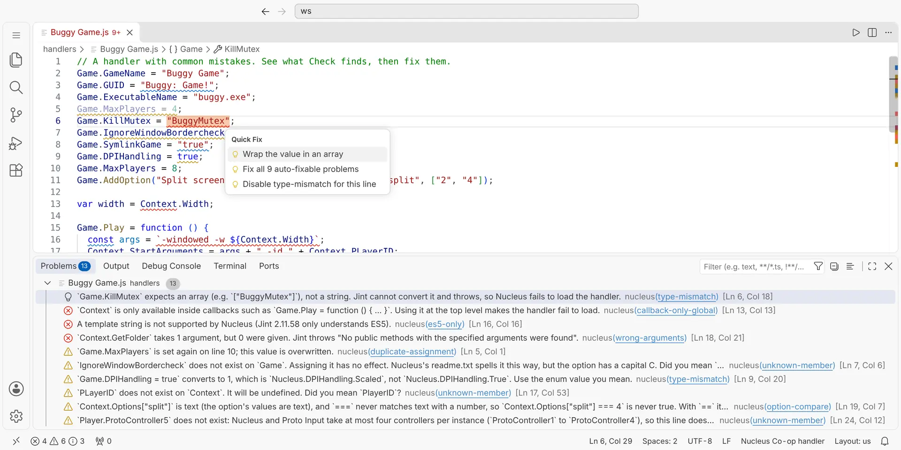
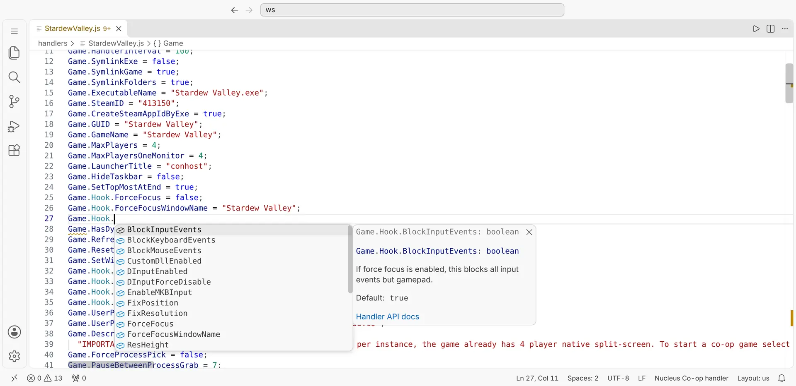
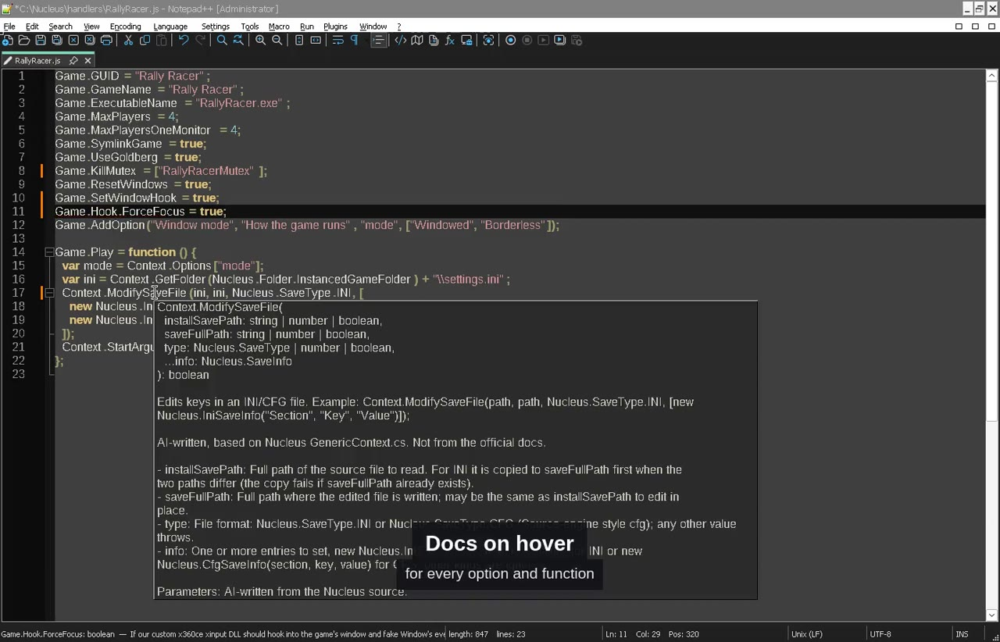
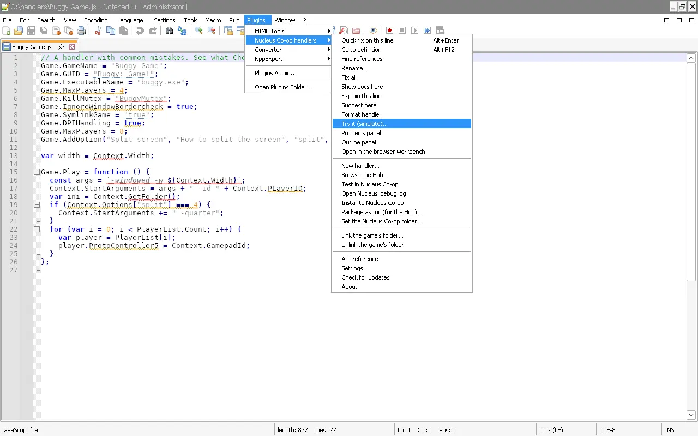

# SplitScreen.Me / Nucleus Co-op Handler Tools for VS Code

Tooling for writing [Nucleus Co-op](https://github.com/SplitScreen-Me/splitscreenme-nucleus) game handlers: the JavaScript files that tell Nucleus how to run several copies of a game side by side. In VS Code, [Notepad++](#notepad), [any editor with LSP](#other-editors), on the [command line](#the-command-line-tool-ncdev) and in the [browser workbench](https://snailedlt.github.io/nucleus-devtools/?ref=vscode-readme-md): one engine, the same checks everywhere.

> **Beta, testers wanted.** Intro, screenshots and a 5-minute install: **https://snailedlt.github.io/nucleus-devtools/start/?ref=vscode-readme-md**

<p>
  <picture><source media="(prefers-color-scheme: dark)" srcset="docs/images/gallery/vscode-problems-quickfix-dark.webp"></picture>
  <picture><source media="(prefers-color-scheme: dark)" srcset="docs/images/gallery/vscode-try-it-dark.webp"></picture>
</p>
<p>
  <picture><source media="(prefers-color-scheme: dark)" srcset="docs/images/gallery/vscode-hover-docs-dark.webp"></picture>
  <picture><source media="(prefers-color-scheme: dark)" srcset="docs/images/gallery/vscode-completion-dark.webp"></picture>
  <picture><source media="(prefers-color-scheme: dark)" srcset="docs/images/gallery/vscode-debugger-dark.webp"></picture>
</p>

*Problems and quick fixes, the **Try it** panel, hover, completion and the debugger, in VS Code (the status bar shows the handler's own language mode, **Nucleus Co-op handler**). The same checks run in the [browser workbench](https://snailedlt.github.io/nucleus-devtools/?ref=vscode-readme-md). Testing it? See [TESTING.md](TESTING.md).*

**In motion** (a minute or two each, captioned, no sound; click to play):

<p>
  <a href="docs/videos/vscode.mp4"></a>
  <a href="docs/videos/notepadpp.mp4"></a>
</p>

The browser workbench has [its own](https://github.com/Snailedlt/nucleus-devtools/blob/main/workbench/docs/videos/workbench.mp4).

- **Its own language mode.** Handlers open as **Nucleus Co-op handler**: JavaScript's colours, brackets and folding, but only the suggestions Nucleus can use (no browser globals, no newer methods its engine lacks). See [Handler language mode](#handler-language-mode).
- **Colours that tell Nucleus names apart**, in your theme's own JavaScript colours: option groups (`Game.Hook`), fixed choices (`Nucleus.Folder.InstancedGameFolder`) and callbacks (`Game.Play`) each get one, so a name Nucleus doesn't know stands out.
- **IntelliSense** for `Game`, `Game.Hook`, `Game.ProtoInput`, `Context`, `Player`, `PlayerList`, `ProtoInput`, `Hub` and the `Nucleus.*` enums. Completion lists every option Nucleus actually has, with types, defaults and docs. On an empty line, `Game.` completes the whole assignment, e.g. `Game.SymlinkGame = true|false;`. After `=`, the values the option takes.
- **Suggestions that know your handler:** `Context.Options["` suggests the keys your `Game.AddOption` lines add, and `== "` their choices; what your own functions return is understood after a dot.
- **Hover docs** and **signature help** for every method and its overloads, saying what to pass for each parameter of the most used ones. API names in them are links to the **Docs** panel.
- **Snippets** for what most handlers do (`iniset`, `replacelines`, `regkey`, `startargs`, `ifoption`, `eachplayer`…), offered where a statement starts; in an empty file, `handler` writes the whole template.
- **Linting** for the mistakes that make handlers fail, often silently. See [Lint rules](#lint-rules).
- **Fix all**, deterministic and offline: applies every fix that keeps the handler's behaviour or repairs code Nucleus can't load. It runs as a command, on save, or as `ncdev lint --fix`. Fixes that change behaviour or need your input stay one-click quick fixes. On the 41 engine probes, it takes 11 of the 16 that fail in Jint 2.11.58 to working.
- **Format Document** (Shift+Alt+F, also a selection, and as you type): indentation, spacing, double quotes and semicolons (both [configurable](#settings)). No line moves (Nucleus runs handlers line by line), and the result is checked to parse to exactly the same program, so formatting never changes what the handler does. Also `ncdev format`.
- **Quick fixes**: did-you-mean for typos, `"true"` → `true`, template string → concatenation, wrap a value in an array, add missing required options, and more.
- **New Handler** wizard that generates a handler which passes the linter, with optional Proto Input, Goldberg, INI resolution and user-option sections.
- **Package for the Hub**: builds a `.nc` package laid out the way Nucleus' installer expects.
- **Install into Nucleus**: copies the handler and its asset folder into your Nucleus `handlers` folder.
- **Test in Nucleus Co-op** (Windows): the Run button (▷) above a handler installs it and starts Nucleus Co-op with its game selected. The same button's menu has **Try It** and **Debug**.
- **Go to definition** (F12) and the **Outline** of the handler's options, functions and variables.
- **Checks against the game's folder**: link the game's install folder and `ExecutableName`, `BinariesFolder` and the symlink lists are checked against the real files (only names and sizes are read).
- **A getting-started guide**: *Help › Welcome › Make a Nucleus Co-op handler* walks from an empty file to the Hub.
- **Browse the Hub**: search the almost 900 handlers on [hub.splitscreen.me](https://hub.splitscreen.me) and open any handler's source, which is handy for seeing how others solved a problem.
- **Type definitions** (`nucleus.d.ts`), so you can opt into full TypeScript checking with `// @ts-check`.
- More snippets (`nc-…`) for INI/XML edits, copying files from the handler folder, Goldberg and Proto Input.
- **The `ncdev` CLI** runs the same checks in CI, and much more: see [below](#the-command-line-tool-ncdev).

The API model is **generated from the Nucleus C# sources** (`GenericGameInfo`, `GameHookInfo`, `GenericContext`, `ProtoInputOptions`, …) and the [splitscreen.me docs](https://www.splitscreen.me/docs/handler-api), so it reflects what Nucleus really accepts rather than a hand-maintained list.

## Every editor, side by side

One engine runs underneath all of them, so the checks, suggestions and docs are the same; what differs is what each editor can show.

| | VS Code | [Notepad++](#notepad) | [Browser workbench](https://snailedlt.github.io/nucleus-devtools/?ref=vscode-readme-md) | [Other editors (LSP)](#your-own-editor-for-experienced-developers) |
|---|:-:|:-:|:-:|:-:|
| Problems as you type, with the why | ✅ | ✅ | ✅ | ✅ |
| Quick fixes and Fix all | ✅ | ✅ Alt+Enter | ✅ | ✅ |
| Suggestions, snippets, the New Handler template | ✅ | ✅ | ✅ | ✅ |
| Hover docs and parameter hints | ✅ | ✅ | ✅ | ✅ |
| Docs for every option and function | ✅ panel | ✅ API reference | ✅ Docs tab | ✅ links to the workbench |
| Format (never moves a line) | ✅ | ✅ | ✅ | ✅ |
| Go to definition, references, rename | ✅ | ✅ | ✅ | ✅ |
| Outline | ✅ | ✅ panel | — | ✅ |
| Try it (what Nucleus does per player) | ✅ | ✅ | ✅ | ✅ command |
| Debugger (step through, per player) | ✅ | — | ✅ | ✅ `ncdev dap` |
| Visual editor (Form, Blocks, Lines) | — | — | ✅ | — |
| Checks against the game's folder | ✅ | ✅ | ✅ | ✅ |
| Browse and open Hub handlers | ✅ | ✅ | ✅ | `ncdev hub` |
| Package as `.nc` for the Hub | ✅ | ✅ | ✅ | ✅ command |
| Install into Nucleus Co-op (Windows) | ✅ | ✅ | ✅ Chrome, Edge | ✅ command |
| Test in Nucleus Co-op (starts it) | ✅ | ✅ | — (a browser can't) | ✅ command |
| Install needed | the extension | `ncdev setup notepad++` | nothing | `ncdev` |

## Getting started

1. Install the extension. Until it is on the Marketplace, download the `.vsix` from the [releases](https://github.com/Snailedlt/nucleus-devtools/releases) (or run `npm ci && npm run package`), then **Extensions: Install from VSIX…**. Testing it? See [TESTING.md](TESTING.md).
2. Open the folder where you keep your handlers. Any `.js` file that sets `Game.GUID`, `Game.GameName`, `Game.ExecutableName` or `Game.Play`, or lives in a `handlers` folder, opens as **Nucleus Co-op handler** (shown in the status bar) and gets handler features. Other JavaScript files are left alone.
3. Run **Nucleus: New Handler…** from the Command Palette, or type `handler` in an empty `.js` file. New to handlers? *Help › Welcome › Make a Nucleus Co-op handler* walks you through it.

### Commands

| Command | What it does |
| --- | --- |
| **Nucleus: New Handler…** | One guided flow (step 1 of 5, with Back): the game name, executable, Steam app ID, optional features and the folder to save in. Writes a ready-to-edit `<Name>.js` and its `<Name>/` folder (`Game.Folder`). |
| **Nucleus: Try It (Simulate Each Player)** | Opens a panel beside the editor showing what Nucleus would set up for each player: window position and size, launch arguments, the settings files it changes, options Nucleus skips, and errors a player would hit. It updates as you type; pick 1–4 players, the keyboard & mouse player and the monitor size in the panel. Also in the Run button (▷) above a handler. **Nucleus: Try It: Test All Combinations** runs every player count, input setup and monitor size. See [Try it](#try-it). |
| **Nucleus: Package Handler for the Hub (.nc)** | Zips `Game.js` as `handler.js`, plus the `Game/` asset folder next to it. Also available in the Explorer context menu. |
| **Nucleus: Test in Nucleus Co-op** (the Run button ▷ above a handler, Windows) | Installs the handler and starts Nucleus Co-op with its game selected: pick the players and press Play. Restarts an open Nucleus (with your OK; it reads handlers when it starts) and offers to turn on its debug log once. **Nucleus: Open Nucleus Co-op's Debug Log** opens `debug-log.txt`. Also `ncdev test` and in Notepad++. |
| **Nucleus: Install Handler into Nucleus Co-op** | Copies `Game.js` and `Game/` into `<Nucleus>/handlers/`. Asks for your Nucleus folder once (`splitscreenme.nucleusPath`). |
| **Nucleus: Browse Handlers on the Hub…** | Searches hub.splitscreen.me; opens a handler's source or its Hub page. |
| **Nucleus: Set Up Type Definitions** | Writes `.vscode/nucleus.d.ts` and a `jsconfig.json` (ES5 lib), then hands completion over to the TypeScript service and keeps the folder's handlers in JavaScript mode. Add `// @ts-check` to a handler for type errors. |
| **Nucleus: Fix All Problems That Can Be Fixed** | Applies every safe fix to the open handler. To run it on save, add `"editor.codeActionsOnSave": { "source.fixAll.nucleus": "explicit" }`. |
| **Nucleus: Check All Handlers in the Workspace** | Checks every handler in the workspace, not just open files. |
| **Nucleus: Docs: Open (Every Option and Function)** | Opens the **Docs** beside the editor: every option and function with its docs, by group or by search (**Nucleus: Docs: Search…**), and on its main page the links to the guides, Proto Input, FAQ, Hub, PCGamingWiki and where to ask for help. API names in hovers, parameter hints and suggestions open their page here; *Open on the web* shows the same page in the browser. |
| **Nucleus: Debug Handler** | Steps through the handler the way Nucleus Co-op runs it, simulated (also F5, and Debug in the Run button). Without a breakpoint it pauses on the first line. |
| **Nucleus: Report a Problem…** / **Request a Feature…** | Opens the right GitHub form, filled in (versions, where the handler is from, never its code), after showing open reports that may be the same. No GitHub account? *Copy the report* and paste it in the testers' Discord thread. See [Reporting problems and asking for features](#reporting-problems-and-asking-for-features). |
| **Nucleus: Open in the Browser Workbench** | The handler you're editing, in the [browser workbench](https://snailedlt.github.io/nucleus-devtools/?ref=vscode-readme-md) (its visual editor, Lines, Test all), through a share link. |

On any problem, **Ctrl+.** (the light bulb) also has **This check is wrong (rule)…**, after the fixes, and the Try it panel's report button (*Nucleus did something different*) sends what Try it showed next to what really happened.

Package and Install both refuse to continue if the handler has lint errors, unless you confirm.

Hover the language in the status bar (**{} Nucleus Co-op handler**) for the handler's status: its checks (the problem count, or OK), its game folder, with *Link…* or *Unlink*, and *Feedback* (Report a problem…). What the extension did, and any error, goes to **View › Output › Nucleus**; quiet results such as "nothing to fix" show briefly in the status bar instead of a notification.

### Handler asset folder

Nucleus sets `Game.Folder` to `handlers/<handler file name without .js>/`. Keep files your handler copies (DLLs, configs, …) in a folder with the same name next to the handler:

```
MyGame.js
MyGame/
  steam_api64.dll
```

Package and Install both pick this folder up automatically.

## AI agents

The repo also ships an agent kit, so coding agents (Claude Code, Copilot, Codex, Cursor, …) write handlers that load and work, instead of guessing option names from memory.

- **The `nucleus-handler` skill** (`plugin/skills/nucleus-handler/`) contains:
  - the hard rules: ES5 only, real options only, `Context` only inside callbacks, Hub line format, …;
  - a research → reference handlers → scaffold → lint → test-plan workflow;
  - a symptom-to-option troubleshooting table;
  - lint-clean recipes;
  - a generated, greppable API reference.
- **A bundled CLI** at `plugin/skills/nucleus-handler/scripts/nucleus.js` is a single file with no dependencies; it needs Node. Agents can't see squiggles or hovers, so this gives them the same checks:

  | Command | What it does |
  | --- | --- |
  | `ncdev lint <file> --json` | Diagnostics and available fixes |
  | `ncdev format <file> --write` | Indentation, spacing, quotes and semicolons; never what the code does |
  | `ncdev api Game.KillMutex` / `ncdev api --search mutex` | The "hover": type, default and docs |
  | `ncdev hub search <game>` / `ncdev hub fetch <id>` | Study how existing handlers solved the same problem |
  | `ncdev new …` / `ncdev install …` / `ncdev package …` | Scaffold a handler / copy it into Nucleus' `handlers` folder / build the `.nc` package |
  | `ncdev imports <game folder>` | What the game's `.exe` and DLLs use (controllers, cursor, keys, focus, windows) and the Proto Input hooks and Nucleus options that match, with the lines to add; follows a launcher to the game it starts (`--list` prints every import and export) |

### Claude Code

```
/plugin marketplace add Snailedlt/nucleus-devtools
/plugin install nucleus-coop@splitscreenme
```

The skill loads automatically when you ask about Nucleus handlers.

### MCP server (Claude Desktop, Cursor, VS Code Copilot, …)

`ncdev mcp` serves the same tools over the [Model Context Protocol](https://modelcontextprotocol.io), for agents that can't run shell commands. Handler code only runs in the isolated simulator.

| Tool | What it does |
| --- | --- |
| `nucleus_lint` | Every problem, with line, rule, available fixes and a docs link; with a path, also the files in the handler's folder |
| `nucleus_fix` | Apply the safe automatic fixes; returns the fixed source (or saves it) |
| `nucleus_format` | Indentation and spacing only; never moves a line |
| `nucleus_simulate` | Try it: each player's window, launch arguments and file changes |
| `nucleus_debug` | Stop at breakpoints (with conditions) and errors: variables, call stack, watches |
| `nucleus_explain` | What one line does: its names' docs and its problems |
| `nucleus_api` / `nucleus_api_search` | Type, default and docs of an option (the doc, its AI-written "In practice" part, an example); search by words |
| `nucleus_vote_doc` | Say whether a doc is right after checking it against Nucleus' source; counted as an AI vote, apart from people's (also `ncdev docs vote`) |
| `nucleus_new_handler` | A lint-clean handler from the templates |
| `nucleus_hub_search` / `nucleus_hub_handler` | Find Hub handlers; read a verified one as an example |
| `nucleus_rules` | What each check does; with a rule id, why it matters, the fix and examples |

It also offers the skill's guide as the `nucleus-handler` prompt, and gives every client the hard rules (ES5, real option names, callbacks, types) in its instructions: the same rules the workbench's Fix with AI and Explain with AI use (`src/core/airules.ts`).

- **VS Code (Copilot agent mode):** nothing to set up. The extension registers the server (VS Code 1.101 or newer); turn it on under **MCP Servers** in the Extensions view or in the agent's tool picker.
- **Anywhere else:** download `nucleus.js` from the [latest release](https://github.com/Snailedlt/nucleus-devtools/releases) (one file, needs Node 18+), and add it to your client. For Claude Desktop (`claude_desktop_config.json`) or Cursor (`.cursor/mcp.json`):

  ```json
  { "mcpServers": { "nucleus": { "command": "node", "args": ["/path/to/nucleus.js", "mcp"] } } }
  ```

  Claude Code: `claude mcp add nucleus -- node /path/to/nucleus.js mcp` (or install the plugin above).

### Does the skill help? (evals)

`plugin/evals/` holds six cases built from mistakes found in real handlers: write a UE4 handler from facts, fix a handler that doesn't load, the nonexistent `ProtoController5`+, `.includes()` in `Game.Play`, a review where `DPIHandling = true` hides a bug, and Hub-install lines. `claude plugin eval` runs each with and without the plugin. Its graders can only be regexes and model judges, so `scripts/eval-grade.mjs` then grades every handler the agent wrote with the real linter and Try it.

```bash
claude plugin eval ./plugin --trust-plugin --scaffold --allow-tools Write Edit --runs 2 --keep-temp -j 4 > eval.log 2>&1
node scripts/eval-grade.mjs eval.log --cleanup
```

First run (2 runs per case per arm, $1.48): every case scored 1.00 with the plugin; without it, the agent missed the `DPIHandling` bug, told the user to set `ProtoController5`–`8`, and left a handler that still didn't load. Handlers that load and run in Try it: 10/10 with the plugin, 7/10 without. The **Agent evals** workflow runs the same by hand (it needs an `ANTHROPIC_API_KEY` secret).

### Any agent, in your handler folder

Run **Nucleus: Set Up AI Agent Support** in VS Code, or:

```bash
node path/to/nucleus.js init-agent .
```

This writes three things:
- `.claude/skills/nucleus-handler/`: the skill and the CLI;
- a marked section in `AGENTS.md`, which most agents read;
- `CLAUDE.md`, containing `@AGENTS.md`.

Existing `AGENTS.md`/`CLAUDE.md` content is kept, and re-running only refreshes the kit.

Agents can't run Nucleus or the game, so the skill tells them to finish with a concrete test plan and to ask for Nucleus' `debug-log.txt`.

Contributors' agents: see [AGENTS.md](AGENTS.md).

## Lint rules

Every check has its own page, with why it matters, a wrong and a right example and the fix: [all checks](https://snailedlt.github.io/nucleus-devtools/rules/). Each problem in VS Code and other editors links to its page.

| Rule | Default | What it catches |
| --- | --- | --- |
| `syntax-error` | error | The file does not parse. |
| `es5-only` | error | Syntax Jint 2.x cannot parse: arrow functions, template strings, classes, spread/rest, destructuring, default parameters, `for…of`, `?.`, `??`, `**`, trailing commas in calls, `const` in a `for` head, … The handler would not load. Fixes are offered where mechanical. |
| `let-const-semantics` | info | `let`/`const` *are* accepted by Jint 2.x, but behave exactly like `var`: function-scoped and reassignable. |
| `unknown-member` | warning | `Game.IgnoreWindowBordercheck`, `Context.PLayerID`, `player.ProtoController5`, … Jint silently ignores writes to unknown properties of Nucleus objects, and reads return `undefined`. In `"use strict"` code the write throws, so it is an **error** there. Also `Context.Options["key"]` with a key no `Game.AddOption` adds. Includes a did-you-mean fix. |
| `readonly-member` | warning | Assigning computed values such as `Context.Width`, or methods. |
| `type-mismatch` | warning / error | A non-array for an array option (`Game.KillMutex = "x"`) is an **error**: Jint throws and the handler doesn't load. A `SaveInfo` of the wrong kind in `Context.ModifySaveFile` is a warning (Nucleus skips it: INI files take `IniSaveInfo`, CFG files `CfgSaveInfo`). Also errors: `Game.AddOption` values that aren't a list (Nucleus' options screen fails), and a path in `Game.ExecutableName(s)` (it's compared with the .exe's file name, so it never matches). Booleans for enums are checked against what they convert to: `Game.DPIHandling = true` selects `Scaled`, not `True`. Other mismatches (`Game.HandlerInterval = "100"`, a non-function `Game.Play`, the wrong `Nucleus.*` enum) are warnings. `"true"`/`"false"` strings are only `info`, because .NET parses them. |
| `value-format` | error / warning | Options Nucleus reads from text with a fixed format. **Errors** (setup fails, or none of the hotkeys work): a `Game.CustomHotkeys` entry that isn't `"true|Toggle HUD|Ctrl|H"` (4 parts, true/false first, a case-sensitive key name), a `CopyFoldersTo`/`SymlinkFoldersTo`/`HardlinkFoldersTo` entry without `folder|destination`, a `Game.SteamlessPatch` that isn't `["true or false", "args", "milliseconds"]`. **Warnings**: a hotkey modifier other than `Ctrl`, `Alt`, `Shift` (means none), a fourth hotkey (ignored), a `Game.BinariesFolder` with `/` or a slash at the start or end. |
| `too-late` | warning | `Game.GUID`, `Game.GameName`, `Game.MaxPlayers`, `Game.SupportsKeyboard`, `Game.Description` set (or `Game.AddOption` called) inside `Game.Play` or another function: Nucleus reads them when it loads the handler or on the setup screen, before any callback runs. Most other `Game` options do work inside `Game.Play`. |
| `wrong-arguments` | error | No overload of a `Context`/`ProtoInput` method or `new Nucleus.IniSaveInfo` takes that many arguments. C# default values don't count: Jint 2.11 needs every parameter (`Context.RandomString(8)` throws; pass `RandomString(8, false)`). Also `Game.ShowOptionAsStep` with a key no earlier `Game.AddOption` added (the handler fails to load). Jint throws "No public methods with the specified arguments were found", so the handler fails to load or the instance fails. |
| `missing-required` | error | `Game.GUID`, `Game.GameName` or `Game.ExecutableName` is missing or empty. With only `Game.ExecutableNames` it's a warning: the game can be added, but Nucleus' "Search disks" reads `ExecutableName` without checking and stops with an error for every game (fix: add `ExecutableName`). |
| `replaces-nucleus-object` | error | `var Game = {}`, `var Context = …`, or a parameter or function named `Game` or `Context`: a new object in place of the one Nucleus gives the handler, so Nucleus never sees what is set on it. |
| `callback-only-global` | error | `Context`, `Player`, `PlayerList`, `Handler` or `ProtoInput` used at the top level. They only exist inside callbacks such as `Game.Play`. |
| `guid-changed` | warning | `Game.GUID` differs from the version published on the Hub (same `Hub.Handler.Id`). Nucleus keys a user's game, profiles, cover and content folder by GUID, so the update drops the game from their list. Checked in VS Code (setting `splitscreenme.lint.compareWithHub`), with `ncdev lint --hub`, and in the workbench for Hub handlers. Fix: keep the published GUID. |
| `file-encoding` | warning | The file isn't valid UTF-8 (often ANSI / Windows-1252): Nucleus reads handlers as UTF-8, so accented letters arrive as `�`. |
| `undefined-name` | error / warning | A name nothing declares and Nucleus doesn't provide (`"system.cfg", sdfsdf`, a typo of a variable): reading it throws "… is not defined", so at the top level the handler fails to load and in a callback Nucleus stops there. Names from the handler's plugins (`pluginsInfo.txt` in its folder) count as defined; when the linter can't see that folder, an unknown `Name.Member` is only a warning, and so is a name inside a function nothing in the handler calls. |
| `missing-builtin` | error / warning | Built-ins newer than ES5 that Jint 2.x doesn't have: `Object.assign`, `Array.from`, `Number.isInteger`, `Math.trunc`, `Map`, `Set`, `Promise`, … (errors), and string/array methods such as `.includes()`, `.startsWith()`, `.find()`, `.repeat()`, `.trimEnd()` (warnings, because the receiver's type isn't known; errors on literals). They throw "Object has no method …" when the code runs. Fixes rewrite `.includes(x)`/`.startsWith(x)` with `indexOf` and `.trimStart()`/`.trimEnd()` with `replace`. `padStart`/`padEnd` do exist. |
| `callback-misuse` | warning / error | `Game.SetupSse` (Nucleus never calls it); `GamePlayBeforeGameSetup` and `GamePlayAfterLaunch` both true (`Game.Play` never runs); `Context.StartArguments` set in a `Game.Play` that runs after launch (no effect); a `Game.CustomHotkeys` entry without its `Game.OnCustomHotKey_N` (**error**: Nucleus calls it without checking and crashes when the hotkey is pressed). |
| `duplicate-assignment` | warning | The same option is set twice at the top level, so the first value is dead. |
| `hub-install-parse` | warning / error | When installing from the Hub (or dropping a .nc/.zip), Nucleus reads `Game.GameName` and `Game.ExecutableName` from the raw text: the first two lines (comments included) that *start with* `game.executablename` or `game.gamename`, ignoring case, taking the text between the first and last `"`. The rule replays that scan. **Error** when the install fails: a matched line without two `"` (single quotes, a variable), or no `Game.ExecutableName` line reached. Warning when Nucleus would read a different line or value (indentation, a quote in a comment, `ExecutableNames` or a commented-out line first). |
| `guid-characters` | info | `Game.GUID` becomes a folder name, so use letters, digits and spaces. |
| `protoinput-legacy-hooks` | warning | The handler uses Proto Input with multiple keyboards/mice but leaves the legacy input options (`Game.HookGetCursorPos`, `Game.SendNormalMouseInput`, …) unset or `true`; several default to `true`. The [Proto Input guide](https://www.splitscreen.me/docs/proto) says to set them to `false`. Fix inserts the lines. |
| `protoinput-inactive` | warning | The handler sets `Game.ProtoInput` options but never starts Proto Input (`InjectStartup` or an `InjectRuntime_…` method), so Nucleus ignores them. Fix adds `InjectStartup`. |
| `protoinput-needs-hook` | warning | `Game.ProtoInput.BlockedMessages` or a message filter without `Game.ProtoInput.MessageFilterHook = true`: they only work inside that hook. Fix adds it. |
| `blocked-message` | warning | A number in `BlockedMessages` that Proto Input's message list doesn't have (it blocks another entry, or nothing), or one listed twice (info). |
| `protoinput-needs-raw-input` | info | In a handler with `Game.SupportsMultipleKeyboardsAndMice`, a Proto Input cursor or key state hook (`GetCursorPosHook`, `GetKeyStateHook`, …) without `Game.ProtoInput.RegisterRawInputHook`: they answer from keyboards and mice Proto Input only reads with that hook, so keyboard and mouse players get no key presses and a frozen cursor. Fix adds the raw input hook. |
| `needs-option` | warning | An option Nucleus only reads when another is on: `FakeFocusInterval` / `FakeFocusSendActivate…` need `FakeFocus`, the fake-cursor options need `DrawFakeMouseCursor`, `SteamlessArgs` / `SteamlessTiming` need `UseSteamless`. Fix turns the parent on. |
| `option-compare` | warning | A `Context.Options["key"]` value compared as a number or boolean: from a saved profile Nucleus gives every option back as text (`"4"`, `"True"`), so `=== 4`, `== true` and `case 4:` never match, and a `false` option is the text `"False"`, which an `if` counts as true. Follows the value through the handler's own variables. Loose `== 4` is fine. Fix: `==` for `===`, or `case "4":` when the option's values are text. |
| `unused-option` | hint | A `Game.AddOption` whose key nothing in the handler reads (`Context.Options["key"]`, `.key`): players pick a value that changes nothing. Shown faded, like unused code in VS Code, with no squiggle. Quiet when it can't follow every read (a key in a variable, `Context.Options` passed on or looped over) and for one-value notes. Nucleus itself reads no option, `Game.ShowOptionAsStep` included. |
| `deprecated` | hint | Options the docs mark deprecated, such as the pre-Proto Input multi-keyboard settings. |

General JavaScript mistakes are checked with [ESLint](https://eslint.org)'s own rules (run inside the tools, no setup), only the ones that catch real bugs and were checked against every Hub handler:

| Rule | Default | Why it matters |
| --- | --- | --- |
| `no-cond-assign` | warning | A single `=` inside a condition assigns: the condition is the assigned value. To compare, write `==` (or `===`). |
| `no-constant-condition` | warning | This condition is always the same, so one branch never runs. A common cause: `=` (assign) where `==` (compare) was meant. |
| `no-dupe-keys` | warning | An object can't have the same key twice: the later value replaces the earlier one. |
| `no-duplicate-case` | warning | Only the first of two identical `case`s ever runs. |
| `no-dupe-else-if` | warning | This `else if` tests what an earlier branch already caught, so it never runs. |
| `no-dupe-args` | warning | Two parameters with the same name: the second hides the first. |
| `use-isnan` | warning | Nothing equals NaN, not even NaN: this comparison is always false. Use `isNaN(x)`. |
| `valid-typeof` | warning | `typeof` only gives "undefined", "object", "boolean", "number", "string" or "function": this comparison is never true (a typo?). |
| `no-unreachable` | warning | Nothing after `return`, `throw`, `break` or `continue` runs. |
| `no-unused-expressions` | warning | This line computes something and throws the result away: it does nothing. A missing assignment or call, or a statement split over two lines? |
| `no-self-assign` | warning | Assigning a value to itself does nothing. |
| `no-self-compare` | warning | Comparing something with itself is always the same; probably a typo. |
| `no-unsafe-negation` | warning | `!a in b` means `(!a) in b`; you probably meant `!(a in b)`. |
| `no-compare-neg-zero` | info | `x === -0` is also true for 0. Use `1 / x === -Infinity` if you really need to tell them apart. |
| `no-invalid-regexp` | error | This regular expression is invalid: it throws when that line runs. |
| `no-empty-character-class` | warning | `[]` in a regular expression matches nothing, so the whole expression never matches. |
| `no-control-regex` | info | A control character in a regular expression is almost always a mistake (a lost backslash). |
| `no-sparse-arrays` | warning | Two commas in a row leave a hole (`undefined`) in the array; usually a typo. |
| `no-useless-escape` | warning | In a string a backslash only escapes some characters: here it disappears. In a Windows path write two backslashes (`"C:\\Games"`), or `"\\"` for one. |
| `no-octal-escape` | warning | A backslash before a digit in a string is a character code, not a backslash: `"\\45"`, not `"\45"` (which is "%"). Common in Windows paths with numbers. |
| `no-loss-of-precision` | warning | JavaScript numbers can't hold this value exactly: it is silently rounded. |
| `for-direction` | warning | The counter moves away from the end condition, so the loop never stops (or never runs). |
| `no-unsafe-finally` | warning | A `return`/`throw` in `finally` overrides the one in `try`/`catch`, hiding errors. |
| `no-func-assign` | warning | This overwrites a function declared with the same name. |
| `no-ex-assign` | warning | Overwriting the caught error loses it. |
| `no-obj-calls` | error | `Math` and `JSON` are objects, not functions: calling them throws. |
| `no-shadow-restricted-names` | warning | Naming a variable `undefined`, `NaN` or `Infinity` changes what that name means everywhere after. |

Change severities with the `splitscreenme.lint.rules` setting, e.g. `{ "deprecated": "off" }`, or with comments:

```js
// nucleus-lint-disable-next-line unknown-member
Game.SomethingNucleusWillAddLater = true;
Game.Other = 1; // nucleus-lint-disable-line
/* nucleus-lint-disable deprecated */   // whole file
```

### How the rules were validated

The linter runs over the 150 most-downloaded handlers on the Hub with **no errors**. The warnings it reports there are real defects: typos such as `Context.PLayerID` and `Game.IgnoreWindowBordercheck`, options that don't exist (`Game.ForceFinishOnPlay`, `Player.ProtoController5`–`17`), and a find-and-replace accident (`Game.PauseEscapeTheBackroomsweenStarts`). The engine behaviours behind the rules were confirmed against Jint 2.11.58 itself: 41 probe handlers were run with Nucleus' engine setup, and the linter reports an error for exactly the probes that fail to load or fail in `Game.Play`.

## Settings

| Setting | Default | |
| --- | --- | --- |
| `splitscreenme.detection` | `auto` | `auto`: handler-looking files and files in a `handlers` folder. `always`: every `.js` file. `off`: disable. |
| `splitscreenme.languageMode` | `handler` | `handler`: handlers open as **Nucleus Co-op handler**, with JavaScript's colours but only the handler's suggestions, hovers and checks. `javascript`: they stay JavaScript, so VS Code's own JavaScript features run on them too. See [Handler language mode](#handler-language-mode). |
| `splitscreenme.lint.enable` | `true` | Report problems. |
| `splitscreenme.lint.compareWithHub` | `true` | For a handler with a `Hub.Handler.Id`, compare `Game.GUID` with the Hub version (`guid-changed`); downloads that version once. |
| `splitscreenme.lint.rules` | `{}` | Per-rule severity: `error`, `warning`, `info`, `hint` or `off`. |
| `splitscreenme.lint.packageChecks` | `true` | Check the files in the handler's `<Name>/` folder as they'd go into the .nc (Windows names, overwrites, broken INI/JSON, missing files). |
| `splitscreenme.format.quotes` | `double` | Quotes when formatting: `double` (what the Hub install reads best), `single` or `keep`. A string containing the chosen quote keeps its own. |
| `splitscreenme.format.semicolons` | `add` | Semicolons when formatting: `add` or `keep`. |
| `splitscreenme.gameFolders` | `{}` | The game's install folder per handler (file name → folder), set by hand. **Nucleus: Game Folder: Link…** keeps its links on this PC instead, so no path ends up in a shared `.vscode/settings.json`. |
| `splitscreenme.completion.enable` | `true` | The extension's completion/hover/signature help. Turned off by **Set Up Type Definitions**, because TypeScript then provides them. |
| `splitscreenme.nucleusPath` | | Your Nucleus Co-op folder, used by Install. |
| `splitscreenme.showWhatsNew` | `true` | After an update, a short note with what's new. **Nucleus: What's New** opens the changelog any time. |

### Handler language mode

Handlers open in a language mode of their own, **Nucleus Co-op handler**. It uses JavaScript's grammar, so colours, brackets, comments and folding look the same as in any `.js` file. VS Code's built-in JavaScript and TypeScript features don't run on it, though: their suggestions would otherwise mix with the handler's, and many of them are wrong for Nucleus (browser globals like `document`, and newer methods such as `Array.prototype.includes` that Nucleus' engine, Jint 2.11.58, doesn't have).

- Handler files get their own file icon, Nucleus Co-op's logo with a JS tag, in the Explorer, tabs and breadcrumbs. It shows with VS Code's default file icons (Seti) and icon themes that don't claim `.js` files themselves; Material Icon Theme and vscode-icons pick an icon by file extension first, so there a handler keeps their JavaScript icon (the status bar still says **Nucleus Co-op handler**). The status bar shows the mode. Click it to switch one file back to JavaScript; that file stays JavaScript for the session.
- `"splitscreenme.languageMode": "javascript"` keeps all handlers as JavaScript.
- **Nucleus: Set Up Type Definitions** sets that for its folder, because `// @ts-check` needs the TypeScript service.
- Formatters, linters, snippets and keybindings you set up for `javascript` (Prettier, ESLint, …) don't apply to handler files. Add `nucleus-handler` to their languages, or use JavaScript mode. The extension's own formatter, snippets and debugger work in both.

**What the Hub sees.** The Hub's handler list comes from our daily copy on GitHub, checked at most once an hour; hub.splitscreen.me is asked only when that copy is missing or out of date, and each package is downloaded once per version. Every request says it comes from these devtools, which tool and which feature sent it (`User-Agent: SplitScreenMe-DevTools/0.7.0 (ncdev-cli; hub-search; +https://github.com/Snailedlt/nucleus-devtools)` and the same in `X-Requested-With`), and nothing else: no search text, file names, code, user or computer names.

## Try it

**Nucleus: Try It** and `ncdev simulate` load the handler and run `Game.Play` once per player, the way Nucleus does, without Nucleus or the game. They emulate the rules of Nucleus' engine (Jint 2.11.58): unknown options are skipped, only the first letter of a name is case-insensitive, list and enum values are converted the same way, wrong argument counts throw, and ES2015+ built-ins such as `.includes()` fail. The emulation is checked against the real engine: it predicts the same outcome on all 121 probes of the [testbench](https://github.com/Snailedlt/nucleus-devtools), launch arguments included.

It also follows Nucleus' session flow: an error in `Game.Play` ends the session (later players are never set up), `Game.OnFinishedSetup` and `Game.OnStop` run with the last player's `Context`, `Game.GamePlayAfterLaunch` makes `Context.StartArguments` irrelevant, and paths (`Context.ExePath`, `GetFolder`, ...) depend on `Game.SymlinkGame`/`HardcopyGame`/`HardlinkGame` and `Game.BinariesFolder` as in Nucleus. Plugin globals listed in the handler folder's `pluginsInfo.txt` record their calls.

File, registry and process calls are recorded, never performed. The handler runs in a separate JavaScript realm with no access to Node, VS Code or your files (only text goes in and out), and a time limit stops endless loops, so trying a handler you downloaded is safe. Window placement, focus, input and the game itself still need a real test in Nucleus.

```bash
node dist/cli.js simulate MyGame.js --players 4 --keyboard none --resolution 2560x1440   # --json for scripts and agents
```

The exit code is 1 when the handler fails to load or a player's setup fails.

`ncdev debug` runs the handler the same way and stops where you ask: at a line (`--break 14`), at a line for one player (`--break "14 if Context.PlayerID == 1"`) and wherever an error ends a phase. Each stop says where it is (the top of the file, `Game.Play` for player 2 of 4, `Game.OnStop`, ...) and shows the variables, the call stack, any `--watch` values and what the handler did so far; `--step` lists every line it runs. It records the run and reads values without running anything of the handler's, so the result is the same as without it.

```bash
node dist/cli.js debug MyGame.js --break "14 if Context.PlayerID == 1" --watch Context.StartArguments
```

## The command-line tool: `ncdev`

`ncdev` (Nucleus Co-op dev tools) is the same engine as the extension, on the command line: lint, fix, format, Try it (`simulate`), the debugger (`debug`), API lookup, Hub search, new handlers from templates, packages, and the servers for other editors and AI agents (`lsp`, `dap`, `mcp`). `ncdev --help` lists everything. `nucleus` is its old name and still works.

**Standalone (Windows, nothing else to install):** download `ncdev.exe` from the [newest release](https://github.com/Snailedlt/nucleus-devtools/releases) and run it from a terminal:

```
ncdev lint MyGame.js
```

`ncdev update` replaces it with the newest release (checked against the release's SHA-256 sums); `ncdev --version` says when there is one. It's about 95 MB because Node.js is inside. It isn't code-signed yet, so Windows SmartScreen may ask once ("More info › Run anyway").

**With Node.js 18+:** `nucleus.js` from a release (`node nucleus.js lint MyGame.js`), or from the repository:

```bash
npm ci && npm run build
node dist/cli.js path/to/handlers   # or `ncdev` / `nucleus-lint` once the package is installed
```

`ncdev report` opens a report from the command line: `ncdev report` (a problem), `ncdev report feature`, `ncdev report tryit MyGame.js`, or `ncdev report --check unknown-member MyGame.js` (this check is wrong: the flagged line only, `--no-code` leaves it out). It prints the prefilled form's link and open reports that may be the same; `--open` opens it, `--text` prints it to paste in the testers' Discord thread.

`--fix` applies every safe automatic fix and saves the files, and `--fix-dry-run` shows what it would change. `format` re-indents and spaces handlers (`--write` saves, `--check` exits 1 when a file isn't formatted), and `--hub` compares `Game.GUID` with the Hub version. Lint options: `--json`, `--rule unknown-member=error`, `--quiet` (errors only), `--verbose` (include hints), `--all` (lint every `.js`, not just handler-looking ones), `--list-rules`. The exit code is 1 when there are errors.

## Other editors

Most people are best served by **VS Code**, **[Notepad++](#notepad)** or the **[browser workbench](https://snailedlt.github.io/nucleus-devtools/?ref=vscode-readme-md)**: they're set up in a few clicks and tested before every release. If you already live in another editor, read on.

### Notepad++

1. Download `ncdev.exe` from the [newest release](https://github.com/Snailedlt/nucleus-devtools/releases).
2. Close Notepad++, double-click `ncdev.exe` and choose **1 Set up Notepad++**. When Windows asks for permission (Notepad++ is in Program Files), allow it.
3. Start Notepad++ and open a handler.

From a terminal instead, in the folder with `ncdev.exe` (it asks for the same permission when it needs it):

```
ncdev setup notepad++
```

A portable Notepad++ needs no permission: add `--path "C:\path\to\Notepad++"`.

<p>
  <picture><source media="(prefers-color-scheme: dark)" srcset="docs/images/gallery/notepadpp-panels-dark.webp"></picture>
  <picture><source media="(prefers-color-scheme: dark)" srcset="docs/images/gallery/notepadpp-menu-dark.webp"></picture>
</p>

This installs the **Nucleus Co-op handlers** plugin and puts `ncdev` in `%LOCALAPPDATA%\ncdev`, where the plugin finds it. In a handler:

- **Problems are underlined** as you type (red: Nucleus would fail; orange: probably wrong; dotted: worth knowing). Hover one, or any name, for an explanation and the docs.
- **Suggestions as you type** after a dot, `=`, a quote…: the members that exist there, the values an option takes (`true`/`false`, `Nucleus.DPIHandling.True`…), the game's own files once its folder is linked. The selected one's type and docs show in the status bar. Parameter hints after `(`.
- **The handler's own functions and variables** are suggested too, with the comment above them as their docs, and their parameters show after `(`. `Context.Options["` suggests the keys your `Game.AddOption` lines add, and `== "` their choices.
- **Alt+F12**: go to where a function, variable or option is defined; *Find references* lists every use; *Rename…* changes a variable or function everywhere in the handler.
- **Alt+Enter**: the fixes for the line. **Plugins › Nucleus Co-op handlers** has *Fix all*, *Format handler*, *Try it* (what Nucleus would set up for 1–4 players, in a new tab), a *Problems panel* (double-click to jump, right-click for the fixes), *Link the game's folder…*, *Open in the browser workbench* (this handler, in the workbench's visual editor and Test all), the *API reference*, *Check for updates*, and *Report a problem…* / *Request a feature…* (Alt+Enter on a problem also has *This check is wrong*). Every command can get a shortcut in *Settings › Shortcut Mapper*.
- **New handler…** asks the game's name, its .exe and what to start with, then creates and opens the handler. **Install to Nucleus Co-op** copies it (and its `<Name>/` folder) into Nucleus' `handlers` folder, asking first if it has errors or is already installed. The **Outline panel** lists the handler's options, functions and variables; click one to jump there.
- **Test in Nucleus Co-op** installs the handler and starts Nucleus with its game selected (restarting an open one, with your OK); **Open Nucleus' debug log** shows what happened.
- **Browse the Hub…** lists the Hub's handlers (most downloaded first, or search by game), and downloads one with its files and opens it. **Package as .nc…** makes the file to upload to the Hub.
- **Settings…**: how each check is shown (error, warning, info, hint or off), and the format style (quotes, semicolons).
- A **Run › Nucleus: check this handler** entry runs `ncdev lint` on the open file in a console.

`ncdev update` keeps the tool current (the plugin's menu says when there's a new one). `ncdev setup notepad++ --check` says what's installed and `--remove` takes it all out again. Without the standalone `ncdev` (e.g. `node nucleus.js setup notepad++`), the setup adds the Nucleus names and call tips to Notepad++'s own JavaScript suggestions instead (no plugin).

### Your own editor (for experienced developers)

`ncdev lsp` is a Language Server with the same features: problems and quick fixes, hover, completion with your own names and snippets, signature help, go to definition, rename, outline, Format Document, window-message hints, Try it, and *Package*, *Install*, *New handler* and *Test in Nucleus* as code actions and commands. `ncdev dap` brings the debugger. Any editor with an LSP client can use it; most need only a few lines of config.

1. **Get the server.** Windows: `ncdev.exe` from the [newest release](https://github.com/Snailedlt/nucleus-devtools/releases) (no Node needed; `ncdev update` keeps it current). Anywhere with Node.js 18+: `nucleus.js` from the same release.
2. **Point your editor's LSP client at it** for JavaScript files, over stdio: `ncdev lsp`, or `node /path/to/nucleus.js lsp`. It only answers for handler files, so your usual JavaScript server keeps working beside it.
3. **Open a handler.** Problems should show within a second.

| Editor | Setup | Tested by people | Tested by AI |
| --- | --- | --- | --- |
| Neovim | 5 lines of Lua ([below](#neovim)) | not yet | ✅ Neovim 0.9 (the 0.11 config is from its docs) |
| Helix | 6 lines in `languages.toml` ([below](#helix)) | not yet | not yet |
| Sublime Text | the [LSP](https://packagecontrol.io/packages/LSP) package + one client entry ([PORTING.md](PORTING.md#sublime-text-lsp-package-preferences--package-settings--lsp--settings)) | not yet | not yet |
| Emacs 29+ | one `eglot-server-programs` line ([PORTING.md](PORTING.md#emacs-eglot-built-in-since-emacs-29)) | not yet | ✅ Emacs 29.3 (eglot) |
| Kate | one entry in LSP Client settings ([PORTING.md](PORTING.md#kate-settings--configure-kate--lsp-client--user-server-settings)) | not yet | not yet |
| JetBrains IDEs | the [LSP4IJ](https://plugins.jetbrains.com/plugin/23257-lsp4ij) plugin, a server added in Settings ([PORTING.md](PORTING.md#jetbrains-ides-lsp4ij)) | not yet | not yet |
| Zed | needs a small Zed extension first ([PORTING.md](PORTING.md#zed-settingsjson)) | not yet | not yet |

*Tested by AI* means an AI agent ran the editor with this setup and checked that problems, hovers and quick fixes come through; *tested by people* means a handler author used it for real. Tried one? A line in the [feedback form](https://github.com/Snailedlt/nucleus-devtools/issues/new?template=tester-feedback.yml) (it worked, or what didn't) helps the next person.

#### Neovim

```lua
vim.lsp.config('nucleus', {
  cmd = { 'ncdev', 'lsp' }, -- or { 'node', '/path/to/nucleus.js', 'lsp' }
  filetypes = { 'javascript' },
  root_markers = { 'handlers', '.git' },
})
vim.lsp.enable('nucleus')
```

If your colour scheme leaves Nucleus names plain, [PORTING.md](PORTING.md#neovim-011-built-in) has six highlight links that colour them in any scheme.

Before Neovim 0.11:

```lua
vim.api.nvim_create_autocmd('FileType', {
  pattern = 'javascript',
  callback = function()
    vim.lsp.start({ name = 'nucleus', cmd = { 'ncdev', 'lsp' }, root_dir = vim.fn.getcwd() })
  end,
})
```

#### Helix

In `languages.toml`:

```toml
[language-server.nucleus]
command = "ncdev"  # or command = "node", args = ["/path/to/nucleus.js", "lsp"]
args = ["lsp"]

[[language]]
name = "javascript"
language-servers = ["typescript-language-server", "nucleus"]
```

Settings (which checks to show, the format style, your Nucleus folder), Fix all, Try it and the debugger for each editor are in [PORTING.md](PORTING.md), which also explains how the code is split, for anyone (or any AI agent) building a proper extension for their editor.

## Development

Want to help, with or without code? Start with [CONTRIBUTING.md](CONTRIBUTING.md).

```bash
npm ci
npm run build      # bundle dist/extension.js and dist/cli.js with esbuild
npm test           # node:test suite (linter, completion, zip/packaging, templates, extension glue)
npm run typecheck
npm run package    # build a .vsix
```

Press <kbd>F5</kbd> in VS Code to launch an Extension Development Host.

### Regenerating the API model

`data/nucleus-api.json` and `types/nucleus.d.ts` are generated. Do not edit them by hand. To update them after Nucleus changes:

```bash
git clone --depth 1 https://github.com/SplitScreen-Me/splitscreenme-nucleus ../splitscreenme-nucleus
git clone --depth 1 https://github.com/SplitScreen-Me/splitscreenme-www ../splitscreenme-www
npm run generate   # or: node scripts/generate-api.mjs --nucleus <path> --www <path>
```

The generator parses the public members of the C# classes exposed to handlers, with their types and defaults. It then merges descriptions from `docs/handler-api.mdx`, `docs/create-handlers.md`, `docs/protoinput.md` and `MasterHandler.js`. The Sync workflow (`.github/workflows/sync-sources.yml`) checks daily and opens (or updates) a PR when Nucleus or its docs changed.

### Layout

```
src/core/api.ts         typed access to the API model, member resolution, suggestions
src/core/lint.ts        the linter (acorn AST, no VS Code dependency)
src/core/scopes.ts      the handler's own variables and what's assigned to them (option-compare)
src/core/features.ts    hover, completion, quick fixes, formatting edits as plain data for every editor
src/core/complete.ts    text-based resolution for completion/hover/signature help
src/core/sim.ts         "Try it": runs a handler per player, emulating Jint (also used by the browser workbench)
src/sandbox.ts          runs sim.ts isolated in a vm context for Node hosts (CLI, extension)
src/tryit.ts            the Try it panel
src/core/templates.ts   New Handler templates
src/core/zip.ts         dependency-free zip reader/writer for .nc packages
src/core/hub.ts         hub.splitscreen.me client
src/extension.ts        VS Code providers
src/handlermode.ts      the Nucleus Co-op handler language mode
src/commands.ts         VS Code commands
src/cli.ts              the ncdev CLI (nucleus is its old name, nucleus-lint an alias of ncdev lint)
src/lsp.ts              ncdev lsp: the Language Server for other editors
src/mcp.ts              ncdev mcp: the tools as an MCP server
scripts/generate-api.mjs
workbench/              the browser workbench and site (playground/) and the Jint testbench (src/, probes/): workbench/README.md
```

## The browser workbench

**https://snailedlt.github.io/nucleus-devtools/?ref=vscode-readme-md**: the same checks, Try it, docs and debugger in the browser, with Learn (lessons for a first handler), the docs and check pages, and nothing to install. It lives in [`workbench/`](workbench/README.md) and is built from this repository's core, so the workbench and the editors always run the same checks; its changes are in [workbench/CHANGELOG.md](workbench/CHANGELOG.md) (it updates whenever `main` changes). The same folder has the Jint testbench, which runs handlers in Nucleus' real script engine (Jint 2.11.58) and pins down its behaviour with probes that Try it is checked against.

```bash
npm ci && cd workbench/playground && npm ci
node build.mjs --preview   # the site in dist/pages
```

## Reporting problems and asking for features

Every tool knows which form its report belongs in, so you never pick one: the workbench, Learn, checks, Try it, the docs, VS Code, Notepad++, ncdev and other editors all open this repository's forms, with the right one and its *Where* filled in. Each report is filled in with what the tool knows (versions, the check, where the handler came from: a Hub id and version, an example or your own code) and you see all of it before you submit. Code is only included when it's the flagged line(s) of a check, and you can leave it out.

- **Report a problem**: VS Code's command palette or the language status (*Feedback*), Notepad++'s plugin menu, `ncdev report`, the workbench's menu.
- **This check is wrong**: on every check's problem (not on the game folder's or package's): Ctrl+. in VS Code, Alt+Enter in Notepad++, the code actions of any LSP editor, `ncdev report --check <rule> <file>`, the problem's flag in the workbench.
- **Nucleus did something different**: the report button in the Try it panel (VS Code and the workbench), `ncdev report tryit <file>`.
- **I want to do…**: a feature request that starts from the problem: what you're trying to do and what's in the way (*Request a Feature…*, `ncdev report feature`).
- **A problem with one Hub handler** (the game doesn't start, splits wrong)? That's for the handler's author and the community, not these tools: the report flows ask, and point to its Hub page, the [Discord](https://discord.gg/XxGMkqCf4r) and [r/nucleuscoop](https://www.reddit.com/r/nucleuscoop/).

Before a new report opens, the tools look for open reports that may be the same (GitHub's search, no sign-in): add a 👍 there instead. GitHub is the way we prefer, since issues are easiest for us to work with; **no GitHub account?** *Copy the report* and paste it in the [testers' Discord thread](https://discord.com/channels/142649962839277568/1568403337613680650/1568777762221588531). When a release fixes your report, the release says so on it.

## Credits

The handler file icon (`media/nucleus-handler.svg`) is [Nucleus Co-op](https://github.com/SplitScreen-Me/splitscreenme-nucleus)'s logo with a JS tag. The logo (`media/nucleus-original.svg`, with one-colour `nucleus-plain.svg` and `nucleus-line.svg`) is redrawn as a vector from Nucleus Co-op's `icon.ico` and theme `logo.png` (`scripts/nucleus-logo/`).

## Links

[Handler API](https://www.splitscreen.me/docs/handler-api) · [Creating handlers](https://www.splitscreen.me/docs/create-handlers) · [Proto Input](https://www.splitscreen.me/docs/proto) · [Hub](https://hub.splitscreen.me) · [Nucleus Co-op](https://github.com/SplitScreen-Me/splitscreenme-nucleus) · [r/nucleuscoop](https://www.reddit.com/r/nucleuscoop/) · [Discord](https://discord.gg/XxGMkqCf4r)
