# Changelog

What changed in the browser workbench (<https://snailedlt.github.io/nucleus-devtools/>). It updates whenever `main` changes, so releases are dated. Newest first. The workbench shows this list itself under **What's new**.

<!--
How to write it (people and AI agents read this, and the workbench shows it):
- Add each user-visible change under "## Unreleased", in one of these groups, biggest change first:
  ### ✨ New · ### 🛠️ Improved · ### 🐛 Fixed · ### ⚡ Faster · ### ⚠️ Changed (what users must do differently) · ### 🙏 Thanks
- 🙏 Thanks: one line per person who tested, reported a bug or contributed to this release, e.g. "- **Horah** for reporting …". When it came through GitHub (an issue, a pull request, a review), link their profile: "- **[name](https://github.com/name)** for …". Credit them inline too ("Reported by Horah.").
- One line per change: a **short summary** in bold (the update note shows only that), then one or two plain sentences.
- A screenshot (or other media) for big, visible changes, folded away in a `

Screenshot
` block indented under its line, with a blank line before and after the image and the closing `  
`; the image line: `  ` (≈700–1000 px wide), with `<date>-<name>-dark.png` beside it: What's new shows the one for the viewer's theme (`tools/screenshots.cjs` takes both). An animation is a `.gif` (or `.mp4`/`.webm`, smaller) with a `.png` still of the same name beside it (`x-light.gif` + `x-light.png`, and the dark pair): What's new shows the still until the item is opened, then plays it, unless the device asks for less motion. Keep each under ~300 KB; summary `Animation`.
- When it goes live: rename "## Unreleased" to "## <yyyy-mm-dd>" (add " HH:MM", UTC, for a second release on the same day). A `---` line separates releases.
-->

## Unreleased
### ⚠️ Changed
- **The Form and Blocks views have been removed.** They were hidden since the last release; a different visual editor is planned instead. If your saved view was one of them, the workbench opens your handler as code and says so once.
- **A new address: https://snailedlt.github.io/nucleus-devtools/.** The workbench moved into the tools' repository, [nucleus-devtools](https://github.com/Snailedlt/nucleus-devtools), so it's built from the same commit as the checks it runs. Update your bookmarks; your drafts and settings come along (same site, new folder). Reports go to the same forms as the other tools'.
### ✨ New
- **Loaders show how far along they are.** Test all's ring fills to the combinations done, and Nucli's electrons ride just behind its tip, chasing each jump, bumping into each other and settling. Reading your game's folder, a small Duo pushes a bar as wide as the Files panel: he stands ready while the files are listed, walks while the bar moves, leans in and strains (a sweat drop) when it stalls, and at 100 % the bar turns green, a check pops and he hops. The loader takes the place of the section's text, so the panel doesn't grow while it reads. *Still* shows the pose for the progress, nothing moving. The thin bar under Test all's heading is gone, since the ring shows the same, and a run that's over in under 300 ms goes straight to its result without flashing the ring.
- **Hide the results pane, or go Zen.** Ctrl+J hides Check, Try it and Docs for a wide code editor, as VS Code's panel; the same keys, the Results button (with the problem count), or asking for one of its tabs (Try it, Ctrl+Shift+M, a docs link) brings it back; F8 and opening a handler leave it hidden. It stays the way you left it. Zen mode (Ctrl+K Z, the menu or the command palette) hides everything but the code, centred; `Esc` twice leaves it, and a *Leave Zen mode* button says so for a few seconds on the way in.
- **Set up your AI for handlers.** A short page on the site (ai/): what the tools give an AI, the free and paid setups we recommend, and prompts to copy. Claude Code and other AI agents (Codex, Antigravity, Cursor) get a setup prompt to run once (it installs our plugin or adds our MCP server, so the agent checks and tries its own work) and a prompt to make a handler, once per game; chatbots (ChatGPT, Claude, Gemini, Grok) get the rules a handler must follow. Type your game once and it fills every prompt. Linked from the start and tools pages.
- **Docs for every tool, and the workbench part by part.** The docs have a new Tools section. Every tool has a reference page that says what it is and lists its commands, keys and settings, and the ones you install (VS Code, Notepad++, other editors, `ncdev`, the MCP server) have a short setup page each. The workbench's pages start from a screenshot where every part is numbered, then describe Check, Try it, the debugger and the rest one page at a time. There's also a table that compares what each tool can do.

  

Screenshot

  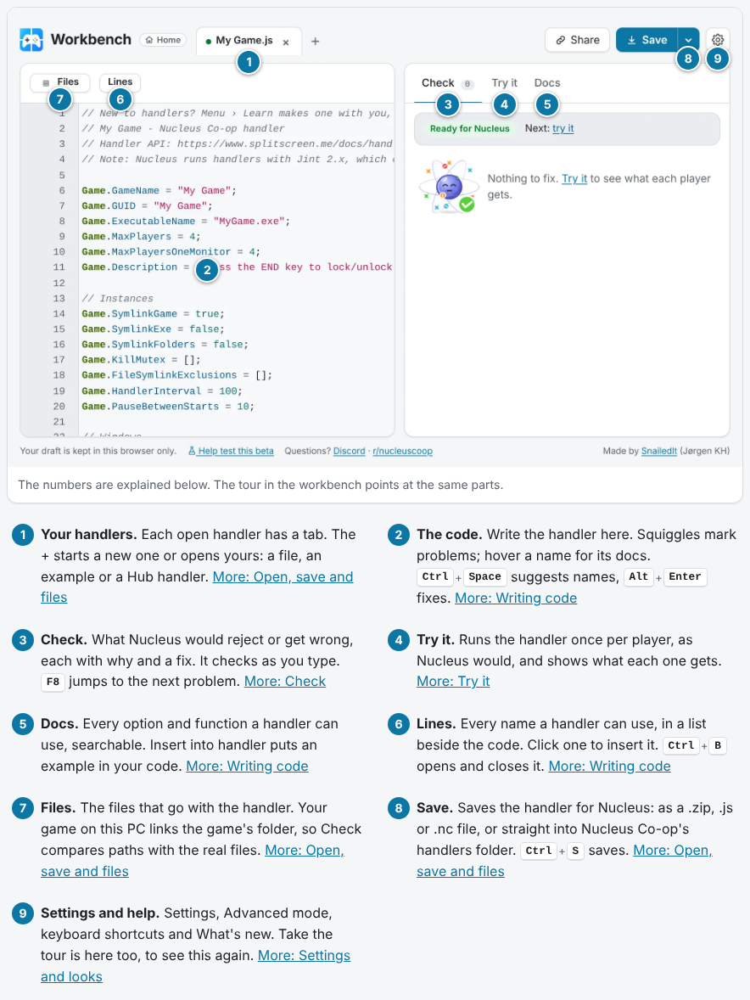

  

### 🛠️ Improved
- **Next, previous and close handler are in the command palette.** They show their shortcuts there, and the tour names your own keys for Check, Lines and Save if you changed them, without a reload.
- **Animations: All, Balanced, Some or None.** Settings › Motion has one simple choice. *Balanced*, the default, moves everything except Nucli editing your code during fixes. *Some* keeps the interface easing into place and holds Duo and Nucli still. *None* moves nothing. "Play once, then rest" is gone: anyone who had it gets lively mascots. The switches underneath are still there.
- **Messages where you're looking.** When *Insert into handler* can't place an example, the reason shows under the button instead of in a toast; Alt+Z's word wrap note shows in the code, and names the key you've bound it to. Toasts are left for things whose place is gone (a closed menu).
- **Duo and Nucli keep moving while they're on screen.** "Nothing to fix", "Oops" and "Fixed" loop as long as their message is up, and loaders keep moving while you wait. Test all's ring is the new one from the concept sheet: the electrons ride the front of the ring as it fills. *Still* now shows each scene's own pose (a reaction its ending) rather than a frozen moment, also when it's your device that asks for less motion: there "All good" and "Oops" used to show their first frame, before the badge comes up.
### ⚡ Faster
- **The workbench and Learn open faster.** The site now loads their code as files your browser keeps, shared between the two pages, instead of everything inside each page: about a third less to download the first time, and almost nothing when you go from one to the other. The Claude API part and the visual editor only load when they're used. The one-file workbench for offline use is the same as before.
- **Mascots move only where you can see them.** Ones that are scrolled away or in a hidden panel are paused, and each starts when it first comes into view. Check, Try it, Test all and Docs keep the mascot they show while they update, so typing no longer restarts it and Test all's ring runs smoothly through the run.
### 🐛 Fixed
- **Format keeps the lines a Hub install reads.** A `Game.GameName` or `Game.ExecutableName` line with a second string on it, or a name put together with `+`, was read differently by the Hub install after formatting. Format now leaves such a line as written.
- **A fix's green highlight stays until you're done with it.** After a quick fix or *Fix all*, the changed lines stay marked as long as the "Fixed" note is open: until you close it, undo, or edit the code.
- **Ctrl+Shift+[ folds again.** Inside the code it switched to another open handler instead of folding the block. Going to the next or previous handler is now Alt+PageDown and Alt+PageUp, closing one is still Alt+W, and all three are in Settings → Keyboard shortcuts, so you can change them. Alt+W in Find only toggles whole word now, it used to close the handler as well.
- **Format says what it changes.** The tip, the command palette and the shortcut list said Format only fixes indentation and spacing. It also switches to double quotes and adds missing semicolons, and they say so now.
- **Your own shortcuts, everywhere.** After you change a shortcut in Settings, the tips and the command palette show the new keys too (some still showed the defaults).
- **Nucli's worried and searching faces show again.** In "Oops" and "Nothing matches", the face change never played.

---

## 2026-11-19
### ✨ New
- **Options nothing reads are faded.** A `Game.AddOption` whose key the handler never reads (`Context.Options["fps"]`) is faded in the code, as VS Code fades unused code, with no squiggle, and Check lists it as a quiet row that isn't counted as a problem.
- **A short tour of the workbench.** It points out the parts one at a time (the handler tabs, the code, Check, Try it, Docs, Lines, Files, Save and Settings) with a sentence on each. It starts once on your first visit; Skip remembers where you stopped, and *Take the tour* (Menu, the ? dialog, Settings, the footer or the command palette) continues there or starts over. Arrow keys step, Esc skips.

- **Which hooks does your game need? Its files say.** With the game's folder linked (Files › *Your game on this PC*), Check reads the game's .exe and DLLs on this device and suggests the Proto Input hooks they call for (XInput, the cursor clip, raw input), each with one button to add it and how many Hub handlers use it. Nothing is uploaded. Suggested by messenils.
- **Learn has a second chapter: launch options and config files.** Nine short lessons build a handler for Codename CURE, a free Source engine co-op game on Steam: launch arguments, each window's size in `Game.Play`, a choice the players make (and why saved choices come back as text), a config file for each player, a "fix the mistakes" quiz checked by the real Check, a test in Nucleus Co-op and a comparison with the Hub handler.
- **A Hint button in Learn.** Next to *Show me*, *Hint* says what the lesson's check still misses and where to look (the line under `// The game`, say), and follows your code as you type. Nothing shows until you press it.
- **Each chapter starts with an overview.** What you'll build, what you need first, and every lesson with its minutes, marking the ones done on your PC.
- **Report from where you are.** *Report a problem* and *Request a feature* (menu, Ctrl+Shift+P) open the right form, workbench or extension, filled in with the build, your settings and where the handler came from, never your code. You see everything before it's sent, and you never pick a repository.
- **"This check is wrong" on every problem.** In Check (open a problem) and as the flag in the hover: the check, its message and the flagged line are filled in, and you can leave the code out.
- **"Nucleus did something different" in Try it.** The icon in the corner of Try it's result sends a short summary of what it showed (windows, arguments, file changes) next to what really happened.
- **Ask for what's missing.** A Docs search with no results offers *Ask for this to be documented*, and Learn has *I'm stuck here* (under a task's hint and in the lesson list), with the lesson and, if you want, your code.
- **Errors aren't silent any more.** When the workbench itself hits an error, a small note asks "Something went wrong. Report it?" with the error filled in. Nothing is sent by itself, and the same error shows once with a count.
- **Possible duplicates first, and no account needed.** Before a new report, the workbench shows open reports that may be the same, to 👍 instead. No GitHub account? *Copy the report* and paste it in the testers' Discord thread. A problem with one Hub handler goes to its Hub page, Discord or Reddit instead of our forms.
- **"In practice" and an example in Docs.** The most used options and calls have a second part, written by AI from Nucleus Co-op's source and the Hub handlers: what the option really does and how Hub handlers use it, labelled AI-written apart from the doc. Most names have an example too, saying where it comes from (the official docs, the value most Hub handlers use, AI-written, or made from the type).
- **"In practice" says where game engines differ.** Where handlers for Unreal Engine, Unity or Source games use an option notably more or less than all Hub handlers, Docs and the docs pages add a counted line ("By engine: Unity games 74% of 203 handlers (all Hub handlers 20%)"), also for options with no AI-written part yet. Engines come from Wikidata (by the game's Steam ID or IGDB page) and the handlers' own code.
- **Insert into handler.** Under a doc's example, *Insert into handler* puts it where it belongs: an option at the top with the others (or *Update in handler* when the handler sets it already: only the value changes), a call at the end of `Game.Play` or the Proto Input callback it goes in, inside the loop over `PlayerList`. One Ctrl+Z undoes it, and the changed line lights up.
- **Vote on both parts of a doc.** 👍/👎 on the doc and on its "In practice" part, here and on the docs pages, with the votes so far. AI-written parts that at least 10 people voted on, 90% 👍, say *Verified by people*; AI agents' votes show apart and never count towards it. A browser driven by a program no longer sends votes.

### ⚠️ Changed
- **The welcome page is gone.** With nothing open, the workbench now opens a new handler from the template, so the code is always there; closing the last handler does the same (Undo brings it back). *Getting started* is now *Take the tour*.

- **Changing a vote from 👍 to 👎 counts once.** Before, the old vote stayed counted too.
- **Docs in the workbench shows the same vote control as the docs pages.** [👍] score [👎], with people's and AIs' votes apart on hover, counted live.
- **Vote scores update within a minute.** The /docs pages read the counts live from GoatCounter instead of waiting for the daily snapshot (which stays as the fallback); previews show the real site's scores.
- **Previews are built by Vercel itself.** Every pushed branch gets one, with the extension's branch of the same name; the next release's site is rebuilt after each test build.
- **Form and Blocks are hidden for now.** The visual editor is being reworked and may not come back in this form, so the workbench shows only Code. A handler you had open in Form or Blocks opens in Code, unchanged; Lines still lists every name a handler can use.

### 🛠️ Improved
- **The tour is done by doing, at your pace.** Where a part opens something (+, Try it, Docs, Lines, Files, the Save arrow, the menu), the step asks you to click it and keeps what opened in view until you press Next; parts that are always on screen (the code, Check) are just pointed out. It never moves on by itself, puts back what it opened when you go on, never saves a file or changes a setting, and Next, Back and Skip always work. A last step shows how to help test the beta, and *Help test this beta* has a new task, *Take the tour*, ticked when you finish it.
- **Icons in the Menu.** Every Menu entry has a small icon in one column, so the labels line up: one plain set of line icons (Lucide) in the text colour, with the report flag and the feature bulb for reports. *Take the tour* has its compass in the footer, Settings and the ? dialog too, and *Help test this beta* its flask in the side rail.
- **Shortcuts look like keys everywhere.** Tips, What's new, notes in the code, Docs, the debugger and Learn draw shortcuts such as Ctrl+Z, Alt+Enter and F8 as keys, as the Keyboard shortcuts list does.
- **Hint only where there is something to work out.** Lessons that show the lines to add, with a Copy button, no longer have a Hint button: the lesson is the hint. Fix-it lessons keep it, and Show me stays everywhere.
- **Show me selects the problem and opens its card.** In Check, Show me moves to the exact code, selects it and opens the same card hovering it shows.
- **Start over a finished lesson in one click.** Once a lesson is done, by hand or with Show me, Start over sits where Hint and Show me were.
- **Learn's hints point to the next step.** A lesson's Hint now says where in the code to look and what to add there, then names the option or call and the kind of value it takes, in the lesson's own game, instead of repeating what Check says is missing.
- **AI-written docs are easy to tell apart, without a label.** In Docs and on the docs pages each AI-written part (a doc, "How handlers use it", an example) sits in a lightly tinted frame with a sparkle in its corner, whose tooltip says what it is based on; a search result gets a small sparkle. Human-written docs stay plain, and "Checked by …" and "Verified by people" still show.
- **Where AI-written docs come from, at a glance, with links.** The sparkle's tooltip in Docs and on the docs pages is now a short list instead of one long sentence: "✨ AI-written" (with *Checked by …* or *Verified by people* when they apply), then **Based on** and one line per source: each Nucleus or Proto Input file links to it on GitHub, a docs page to the page, the Hub handlers to the Hub and the engine data to its file. It stays open while you point at it or tab into it, so the links can be clicked, and Escape closes it. Behind it, what each AI-written part is based on is data and the links come from one table of source repositories, so every tool shows it the same way.
- **Docs shows what you need to write a handler.** A search lists short results (the signature, the first sentence and its tags) with *Open full doc ›*; a full entry goes from the doc and its tags to the example and *Insert into handler*, then "How handlers use it" folded, and 👍/👎 at the bottom. Where an AI-written part comes from is in its tag's tooltip, and the counted engine numbers are on the docs pages (`/docs/`); Docs says only which engines use it more or less.
- **Doc votes sit where you've read the part they rate, and their link shows after you vote.** On the docs pages (`/docs/`) the doc's 👍/👎 is at the bottom of the doc, after the example, and "In practice"'s is inside its box, as in the workbench's Docs. In both, *Tell us what's wrong* shows after a 👎 and *Give feedback* after a 👍.
- **Doc votes are one compact control, as on Reddit.** Each part has [👍] score [👎]: on the docs pages the score is people's 👍 minus 👎 (AI votes never count), and hovering or focusing it shows people's and AIs' votes apart; your own vote highlights its button and moves the score by one. Workbench Docs has the same control.
- **The vote control is quieter.** Smaller grey 👍 and 👎, closer together in a lighter pill, and the score in muted text; they colour in on hover, focus or once you've voted.
- **Learn's lesson list shows one chapter at a time.** Each chapter is its own group with its number, title and how many lessons you've done (3/15), its sections indented under it; only the current chapter is open, and the others open with a click or Enter.
- **"Show in handler" when the handler sets the option already.** Under a doc's example, the button now goes to that line and keeps your value; *Replace with the example's value* next to it changes it (Ctrl+Z undoes it). "Insert into handler" is unchanged for options the handler doesn't set.
- **The flag means "report" everywhere.** *Tell us what's wrong* in Docs and on the docs and checks pages, *Nucleus did something different* in Try it, *Report it* after an error, *Report what you found* in Help test this beta, and Learn's report links all show the same flag as *This check is wrong*.
- **Hub examples say "From Hub handlers".** An example's source is a short label in Docs and on the docs pages, without counts that go stale.

- **Linking your game's folder shows its progress.** While the folder is read, Files › *Your game on this PC* shows how far it is (the files listed, then the game's .exe and DLLs, n of m), with Cancel, and Check says it's still reading them until their hints arrive.
- **A short hover, and parameter hints when you ask.** Hovering a name shows its signature, the doc's first sentence and *More in Docs*, which opens the whole card (In practice, votes, the example); *Explain this line* stays in the line's menu and Ctrl+Alt+E. Parameter hints open as you type `(` or `,`, pick a call from the suggestions or press Ctrl+Shift+Space, not when you click into a call.
- **AI-written docs stand out on the Docs pages too.** On the site's Docs pages (`/docs/`), "In practice" has its own tinted section with an *AI-written* tag, and AI-written docs end with a marked note saying what they're based on, as in the workbench's Docs. Long names in a page's title wrap on a phone.
- **Less on screen until you ask.** The window-message names and the "+" buttons in `BlockedMessages` and the game-folder lists show for the list your cursor is in, or when you point at its line. Try it's explanation is folded into *How this works*. The footer keeps only the beta guide and where to ask; the rest is in the ⋯ menu and the command palette. The AI-written docs call to action in Docs is one line.
- **Credit lines are off for people who write code.** In Advanced mode, saved handlers get no credit lines unless you turn them on in Settings; Guided mode keeps them.
- **Move around with the keyboard, as in VS Code.** F6 and Shift+F6 go from the header to the files, the code and the results; Ctrl+Shift+M goes to Check. Skip links (*Skip to the code*, *Skip to Check*) appear on the first Tab. Press Shift twice to open Open, as in JetBrains editors (Settings › Keyboard shortcuts turns it off). All of them can be changed in Settings.
- **Settings shows every section.** The dialog is taller, so the last sections are in view.
- **Long file names in Files wrap.** They go on to a second line instead of being cut off.
- **Share and Save wait for a handler.** With nothing open they're greyed out and say why.
- **The start page shows the workbench at work.** *Try it in the browser* opens the handler with common mistakes, so Check has something to show at once, and *Make your first handler* is a button that says what it takes.
- **Right-click a pane's edge for its layout menu.** Reset that pane's size (double-click still does it too), move Files or Lines to the other side, hide it, reset every size, or switch to the side rail. The Menu key or Shift+F10 opens it on a focused edge.
- **Code looks the same everywhere.** Every code block on the site (the start page, Tools, Docs, Checks, Learn, the beta test guide) now uses the workbench editor's own colours and background, generated from the same theme, so nothing drifts. The editor setups on the Tools page (Neovim, Helix, Sublime Text, Emacs, Kate) and the `ncdev` commands are coloured for their own language.
- **Controllers are optional in Learn's second chapter.** The *Keyboard or controller* lesson is marked optional in the lesson list and the overview (its minutes counted apart), and *Skip: no controllers* goes past it in one click; the test says what a keyboard alone can check. Have a controller? The lesson invites you to do it and try it in the game.
- **"Different for you? Tell us" next to Learn's untested tips.** Tips we haven't checked on every PC (allowing `cure.exe` through the firewall, Steam's first-start installs) have a small report button with the lesson and the tip filled in.
- **Why the frame rate cap goes in the arguments.** The option lesson explains that a Source game runs `config.cfg`, then `autoexec.cfg`, then the `+` commands from the arguments, so `+fps_max` wins; the recap says when the Hub handler's way (in `autoexec.cfg`) works.
- **Form names options in plain words.** In Guided mode each option shows a plain name (*Handler update interval*) with its API name (`Game.HandlerInterval`) under it, so you learn the names the code uses; Advanced mode keeps the API name first, with the plain name on hover. Numbers show their unit where the docs make it certain (*100 ms*, *25 seconds*), and *Add an option* finds options by their plain names too.
- **Blocks is more compact.** Repeated steps next to each other (several `Context.RunAdditionalFiles`, a dozen `Game.X = …` lines, the same copy-a-file lines again and again) are one group with a count and one line per step; a click on a line opens the group at that step. The *Action* and *Condition* tags are gone, and a value's kind picker (Text, Number, Property, …) shows only when that value is selected. Long Hub handlers are about a third shorter.
- **Long comments in Blocks take one line.** A comment of more than three lines above a step shows its first line and *… N more lines*, which unfolds it (a button, so the keyboard reaches it); point at it to read it all in a card. Short comments show as before.
- **The kind picker opens below the value.** In Blocks, *Text*, *Number*, *Property*… for the value you're editing now shows under it, like a suggestion list, and above it only when there's no room below, so it never covers what you type.
- **Learn's Check and Try it show the task apart from the problems.** "Task: 1 of 2 lines" sits above the problem list, so *No problems* no longer reads as done before the lesson's task is.
- **Learn's Try it draws each player's window.** A small screen shows every window where Nucleus puts it, with its size; under it each player's launch arguments, changes and the files they write, line by line.
- **Lesson code no longer runs off the right edge.** Long lines wrap, indented under their start, and a *Copy* button copies just the lines to add.
- **Steps done on your PC say what you should see.** Each step of the Nucleus Co-op tests has a *You should see* line and a folded *Not working?* list, and long notes open on request.
- **The lesson that wrote `Game.Play` in one go is now two.** First the function and each player's path, then the change to the settings file.

- **Identical problems show as one.** In Check, the same problem on lines next to each other (like `Player.ProtoController5` to `16`) is one row with a ×N count and a *Fix all N* button, and F8 steps through the rows.
- **Fix all leaves harmless lines for you to choose.** *Fix problems automatically* no longer counts or removes lines that only do nothing; afterwards it offers *Also fix N harmless warnings*, and when those are all that's left, the button says *Fix N harmless warnings*.
- **Tips for the way you work.** Guided mode shows the tips meant for newcomers and Advanced mode the ones for people who write code; switching mode swaps the tip. Choosing *I write code* at the start no longer turns tips off. Testers can read every tip, or one audience's, in the new **Settings › Testing** (beta only).
- **One problem count everywhere.** The Check tab, the Handler/Results switch, the *All* filter and the status line count the same problems (errors, warnings and info), and the phone's strip shows each kind.
- **The handler has Nucleus Co-op's logo as its file icon.** In the Files panel and the file tabs, `handler.js` shows the logo with a JS tag, as handlers do in VS Code; other files keep their type badge.

### 🐛 Fixed
- **Undo no longer jumps around the code.** Ctrl+Z and Ctrl+Y (or Ctrl+Shift+Z) put the cursor where the code changed and scroll only when that's off screen, as VS Code does. Before, undoing Format Document or a fix jumped to the top of the file or back to where the cursor had been.
- **Taking a vote back hides its link again.** Pressing the same 👍 or 👎 a second time no longer leaves *Tell us what's wrong* on screen.
- **Vote scores stay right.** A score no longer drops below zero or loses your vote when the counter is behind, reopening a doc keeps your vote counted once, and when the counter can't be read the day's snapshot stays instead of zeros.
- **A report from "How handlers use it" says so.** *Tell us what's wrong* and *Give feedback* under "In practice" open a report titled "(In practice)", in Docs and on the docs pages.
- **Old *Getting started* links lead to the tour.** An address ending in `#getting-started` or `#welcome` says the page is gone and starts the tour that replaced it.
- **The AI sparkle in Lines works like the one in Docs.** You can reach it with the keyboard, and its tooltip lists the sources the doc is based on.
- **After *Open full doc ›* with the keyboard, focus goes to the doc.** Enter on the link puts the keyboard on the full entry's heading instead of losing its place.
- ***Insert into handler* acts on every player.** When a callback's loop sets its player variable again (`p = PlayerList[0];`), the example goes in a loop of its own instead of using that variable.
- **Undo after closing the last handler keeps a new one you've used.** The template that took its place stays when you added package files to it or linked a game folder.
- **Cancel stops only the game folder being read.** Cancelling a folder read in one tab no longer stops another tab's, which lost its hook hints.
- **Your own two-key shortcut wins over a default.** A shortcut such as `F6` `A` now waits for the second key instead of running Next pane on `F6`.

- **A long fix button in Check stays in its row.** It ends in … and its tooltip has the whole title.
- **Learn's step numbers count steps only.** A step after a *Not working?* list no longer skips numbers, and a function's own variables in Learn's code are readable in dark mode.
- **One Escape closes the command palette.** The first one used to only clear the `>`.
- **After *Fix this*, the keyboard stays in the problem list.** Focus moves to the next problem instead of back to the top of the page.
- **The page fits the window.** It was a few pixels taller, so the whole page scrolled; with no handler open, the welcome screen also had extra space around it.
- **On phones, the handler's name shows again.** The row above the code was too wide, so the name shrank to its arrow and the save button was cut off; the name now has its own line.
- **The *All* filter's count is readable.** On the selected (blue) chip it now has enough contrast.
- **Moving a step in Blocks moves the focus with it.** After *Move up*, *Move down* or Alt+↑/↓, the keyboard and the open row stay on the step you moved, so pressing again keeps moving the same step.
- **Ctrl+Z works in Blocks.** Ctrl+Z, Ctrl+Y and Ctrl+Shift+Z undo and redo the handler's code from the Blocks view, and each Blocks action is its own undo step (typing in one field still undoes as one).
- ***Insert into handler* knows when the example is in already.** Examples of more than one line (such as `Context.ReplaceLinesInTextFile`'s) now turn the button into *Show in handler*, instead of adding a second copy.
- **"Add Game.ProtoInput…" from your game's files behaves like every other fix.** The changed lines light up with a note and Undo, and the keyboard stays in the list.
- **Importing settings restores them exactly.** A setting that was at its default when you exported goes back to its default; older settings files still import.
- **Check counts the notes about your game and package.** With a game folder linked, the tab, the filter chips and the summary counted only the code's problems and said *Nothing to fix* above the items under *Against your game*. They now count those and the package's, and the filter chips filter them too.
- **A settings file from another version changes nothing.** Importing one the workbench can't read, or one with none of its settings, now says so instead of putting your settings back to their defaults.
- **The credit setting follows the mode.** Switching between Guided and Advanced updates the *Add credit lines when saving* box when you haven't chosen yourself, so it shows what Save really does.
- **The Discord bot's engine templates open cleanly.** Source, Generic, Diesel and MT Framework no longer start with an invisible character.
- **Closing a report goes back to the menu.** After *Report a problem* or *Request a feature* from the menu, Esc or Cancel puts the keyboard back on the menu button.
- **A feature request without text says what's missing.** Continue shows a message under the box, read out by screen readers, not only a red border.
- **Learn's "Different for you? Tell us" asks about the tip.** The report it opens is titled *This tip is different for me* and asks what happens instead.
- **The 👍/👎 under a doc and under "In practice" have names of their own.** Screen readers say which part you vote on.
- **Settings › AI fits on a phone.** The provider list no longer runs off the screen.
- **Insert into handler, Learn's checks and a few smaller things behave as expected.** *Insert into handler* compares string values exactly, updates the assignment that counts, never lands inside a callback or after a `return;`, and finds a `Game.Play` set by name; Learn's checks no longer accept partial launch arguments, conflicting joystick lines or commented-out code. Problem reports never carry a `#share-` link (it holds your code), a vote made by an automated browser isn't saved, Blocks keeps the state of moved steps, and Esc closes a comment's popup.

### 🙏 Thanks
- **messenils** for the idea of reading the game's own program files to suggest hooks.

---

## 2026-11-17

### 🛠️ Improved

- **Code colours that tell Nucleus names apart.** The default code colours (now called *Nucleus (follows the look)*) give `Game`, `Context` and `Nucleus`, option groups like `Game.Hook`, fixed choices like `Nucleus.Folder.InstancedGameFolder`, and callbacks like `Game.Play` each their own colour, matched to your look. Pick a VS Code or JetBrains code theme in Settings to colour them as that editor colours JavaScript.
- **New screenshots on the start page.** Every picture in the gallery, for the workbench, VS Code and Notepad++, shows the tools as they are today, with the new code colours and real Hub handlers. The READMEs now show the same pictures.

### ⚠️ Changed

- **Anonymous counts now include which pages are opened.** With anonymous usage counts on, each page of the site counts as one page view, and the first page of a visit says which site or post linked to it. These are totals only: nothing follows one person from page to page, and Settings › Privacy still switches it all off. The answer to the start-up question (guided or code, and the layout) is counted the same way, so we can see who the workbench serves.

## 2026-11-15

### ✨ New

- **Share the file.** Share has a new choice for handlers a link can't carry: it saves the .zip (the code and every file with it) and copies a short message to post with it. It leads the dialog when the handler has other files, or when the link would be too long for a Discord message (2,000 characters). Whoever gets the file drops it on the workbench to open it, or onto Nucleus Co-op to play.

### 🛠️ Improved

- **Functions have a colour of their own.** `Game.Play`, the other callbacks Nucleus calls and `Context` methods now use each code theme's function colour (VS Code's yellow, for example) instead of the settings' colour.
- **Hub handlers say how fresh they are.** An opened Hub handler shows the date of the workbench's copy of the Hub next to its version, and the list says newer ones may be on the Hub.
- **A link to an unchanged Hub handler says it's short.** Share now tells you that link opens the whole handler, files included.
- **Share and Save say what a .zip leaves out.** For a Hub handler with files too big for the workbench's copy of the Hub, the Share dialog and the Save menu say so before you save, with a link to the Hub page to get them.
- **Drop a file anywhere to open it.** Dragging a .js, .zip or .nc over the workbench now shows one clear hint over the whole page, wherever the pointer is, and dropping it opens the handler. Over the open Files panel the drop adds the file to the handler's package instead, and the panel says so. The home page mentions it too.

### 🐛 Fixed

- **No flash of the editor on a first visit.** The home page shows from the first moment, behind the opening questions, instead of the empty editor appearing first.
- **A Hub handler that isn't verified no longer says "verified on the Hub".** It shows "not verified", as the list already did.
- **Learn keeps your code.** What you typed in a lesson is still there after a reload or a browser restart. Reset (above the code) goes back to the lesson's start and forgets it.
- **One Reset in Learn.** After Show me there used to be two Reset buttons; now Show me steps aside and the one above the code stays.
- **Learn's header fits on a phone.** The lesson count no longer gets cut off and the page no longer scrolls sideways; the chapter name gives way on narrow screens.
- **Copy no longer covers code in Learn.** The button has a row of its own above the code.
- **The lines to add are highlighted across the whole code block in Learn,** also when it scrolls sideways.
- **Learn's file name stays on one line** above the code; the shortcut hints give way instead.
- **Explain shows a template string as it's written** (backticks kept), in the workbench and in Learn.

---

## 2026-11-13

### ✨ New

- **A tools page: every tool in one place.** `tools/` has the workbench, VS Code, Notepad++, other editors through the language server, the `ncdev` command line and AI agents, with the downloads, the setup for each editor and the table comparing them. Each editor is a tile that opens its steps, one line each, labelled *Recommended* (VS Code), *Full support* (Notepad++), *Tested* or *Untested*. Old links to the downloads on the start page lead there.
- **The start page shows what the tools do.** A few short lines beside an animation: a typo in a handler gets underlined, the fix is applied, and Try it shows four players' windows (with optional sound effects). Below, what the tools catch, the screenshots, then the editors and the workbench, each with its video.
- **Explain this line.** **Ctrl+Alt+E**, *Explain this line* in the command palette, or the link under a hover says what the line does in plain words, with the docs of its names and what Check says. With AI set up, *Explain with AI* gives a longer answer, labelled AI-written.
- **One header for the whole site.** The start page, Learn, Docs and the check pages share a bar with Workbench · Learn · Docs · Checks · Get the tools.
- **A docs list beside every docs page.** Like Learn's, it has groups that fold open (Game, Context, Player…), the page you're on marked, and a filter on top that finds names by name or by what they do ("save file" finds `Context.ModifySaveFile`). On a phone it folds into an **All docs** button.
- **Votes and "Tell us what's wrong" on every docs page.** They work as in the workbench, and editors' docs links now open these pages.
- **An edited handler shows a dot on its tab.** As in VS Code, the × comes back on hover. It replaces "· edited" next to a name that wasn't there.
- **Close every handler, the last one too.** Each tab has its ×; with nothing open, the workbench says so and offers New handler, Open, Learn and Reopen.
- **Docs as pages.** Every option, Context member, enum and .NET call has its own page (`docs/Context.ModifySaveFile/` and so on), easy to link to and found by search engines; Docs in the workbench has **Open as a page** under each name.
- **The workbench starts on a home page.** A first visit, or closing every handler, shows what a handler is, the four steps (start or open one, fix it, try it, save it) and the ways on: **New handler…**, **Open a handler or example…** and **Learn**. The New here box above the code is gone, and **Getting started** in the footer brings the home page back (Esc returns to the code). In Advanced mode the home page has just the buttons. The Fallout New Vegas Multiplayer example is gone: Hub handlers open with their files now, and its old link opens that Hub handler.
- **Learn: making your first handler.** A page of its own (`learn/`) that walks you through a handler for “Boring Man”, a free shooter game on Steam, doing what the tested one does in fewer lines (the last lesson shows the two side by side, and why each left-out line changes nothing): why a handler is needed (try it on screen), getting ready, then a few lines at a time with a code block of what to add, suggestions as you type and Check beside the code. The Show me button fills in the answer and marks its new lines. Try it in Nucleus Co-op along the way; Try it in the browser comes in when the first real test finds a bug. The lessons are in a list on the left. Menu › Learn, the command palette, Getting started or the start page; old `#learn` links lead there.
- **A page for every check.** "About this check" in a problem's details opens its page: what it means, why, a wrong and a right example, and the fix. The list of all of them (with a filter) is linked from the start page.
- **How to get started, on the start page.** VS Code and Notepad++ each have four short steps there, from download to Try it. For Neovim, Helix, Sublime Text, Emacs, Kate, JetBrains IDEs, Zed or any other editor with a language server, click it to see its setup, config included.
- **See every view in light and dark.** The start page's screenshots are now one gallery: pick the workbench, VS Code or Notepad++ and a view (and for the workbench, one of its four looks), then drag the slider across the picture to compare light and dark anywhere on it. ‹ › and a counter step through the views; light and dark load together.
- **Add text before or after every match.** In Find (Ctrl+F), Alt+Enter selects every match, as in VS Code; then → puts a cursor after each (← before each) and you type once for all of them. Ctrl+Shift+L does the same while Find is open, with its case, whole-word and regex options.
- **Pin what you're testing.** In Help test this beta, Pin keeps a task in a small window in the code editor's bottom-right corner, with what to try, what to look for and Report, and lists it at the top of Help test this beta too. Drag it anywhere (or move it with the arrow keys; double-click its header to put it back), collapse it, tick it off; it stays where you put it. On a narrow screen it docks at the bottom.
- **Notepad++ code colours.** *Settings › Theme and colours › Code colours* now has Notepad++: bold blue keywords, bold navy operators, green comments, and its dark mode's colours in dark (strings, numbers and dark comments adjusted a little for 4.5:1 contrast). VS Code's (Light+ / Dark+) is there too; point at a card to see what it is.
- **Suggestions as smart as VS Code's.** The code editor now suggests your own functions and variables (with their comments), the keys your `Game.AddOption` lines add after `Context.Options["` and their values after `== "`, snippets for what most handlers do (`iniset`, `startargs`, `eachplayer`…) and, in an empty file, the whole handler template; Tab moves through the parts to fill in. The highlighted suggestion's docs show beside the list, parameter hints say what to pass, and hovering your own function shows its comment.
- **Credit lines on handlers made here.** A handler made or changed in the workbench gets a few comment lines at the top when you save or copy it: made with the workbench (with a link), and plainly what was and wasn't done here (checked, simulated with Try it on this version, changed by Fix with AI), so people helping you see which tools were used. A handler you only opened and saved stays as it was; opened again, the lines are folded away. In Advanced mode, Settings › Feedback and privacy can turn them off.
- **Fold code blocks, as in VS Code.** Arrows next to the line numbers (on hover) fold functions, `if` blocks, lists and runs of comments; Ctrl+Shift+[ / ] folds or unfolds the block around the cursor, Ctrl+K Ctrl+0 folds all, Ctrl+K Ctrl+J unfolds all. In the code, Ctrl+K now starts these two-key shortcuts; Open is Ctrl+P (Ctrl+K still opens it elsewhere).
- **Coding keys as in VS Code.** Tab now indents a selection instead of replacing it; F2 renames a variable or function everywhere (every use selected, type the new name); Shift+F12 selects all its uses; Ctrl+Shift+L selects every occurrence; Ctrl+K Ctrl+C / Ctrl+K Ctrl+U comment and uncomment lines; Shift+Alt+A toggles a block comment; Ctrl+Shift+\\ jumps to the matching bracket; Shift+Alt+I puts a cursor at the end of each selected line; Ctrl+↑/↓ scroll. In the code, Ctrl+Shift+L is VS Code's (Lines is Ctrl+B).
- **Find and replace, go to line and run keys as in VS Code.** Ctrl+F opens a find box at the top right with the match count, match case / whole word / regex (Alt+C / W / R), and Ctrl+H adds replace (Enter replaces one, Ctrl+Alt+Enter all). Ctrl+G goes to a line (`42` or `42:7`). Try it is now Ctrl+F5 (VS Code's Run Without Debugging) and Test all Ctrl+; then A (Run All Tests); Ctrl+Enter adds a line below, as in VS Code.
- **Change any shortcut.** *Settings › Keyboard shortcuts* lists every shortcut (searchable): click Change and press the new keys (two in a row for a two-step one). Clashes are pointed out and moved, keys the browser keeps (Ctrl+W…) are refused, and Reset puts one or all back. The shortcut list (?) and the command palette show your keys, and *Export settings* takes them to another browser.
- **Shortcuts on every keyboard layout.** Shortcuts with `[ ] / \\ ;` go by the key's position, as in VS Code, so they work on German, Spanish, Portuguese, Nordic and other keyboards where those characters sit elsewhere (on German, Ctrl+- comments a line); AltGr still types them.
- **Go to definition (F12).** On a function or variable of the handler, F12 jumps to where it's declared; on `Game.Play` (or any option) to where it's set; on `Context.Options["key"]` to its `Game.AddOption`. Also in the command palette.
- **Common JavaScript mistakes caught.** Check now includes ESLint's rules for real bugs: `=` where `==` was meant, a backslash that disappears from a Windows path (`"C:\Games"`), the same key twice, code that never runs, a line that does nothing, and more, each explained in plain words.

### 🛠️ Improved

- **A new link preview.** Links to the site show the tools' new picture (Notepad++, VS Code and the workbench, "Catch it before Nucleus does") in Discord, Reddit and elsewhere.
- **The real Notepad++ logo.** The editor tiles show Notepad++'s chameleon (from Devicon) instead of a placeholder.
- **Fix with AI knows more.** It follows the same hard rules as the MCP server and Explain with AI, and can look up any check it doesn't understand before it answers.
- **Help is one click away.** The docs, check and Learn pages end with a small box linking the SplitScreen.Me Discord and r/nucleuscoop, the footers link both, and the tools page links the editor poll.
- **Feedback goes to the right place.** The workbench's *Report a problem*, the site's pages and Learn open a feedback form in the workbench's own repository, with *Where* filled in from where you are; a wrong or missing check goes to the checks' form.
- **Docs' start in the workbench shows what handlers really use.** The names every handler has come first, then the most used names of each object (Game, Context, Player…) with the share of the 896 Hub handlers that use them, and a link to all the docs as pages.
- **Nucleus names in their own colours everywhere.** As in VS Code, `Game`, `Context` and `Nucleus` are coloured as objects, with their properties and methods in their own colour, in the workbench's editor, Learn's editor, hovers and every code block on the docs and check pages.
- **The docs list's levels are easier to tell apart.** Its sections (*Handler API*, *Checks*) are headings in the accent colour, the groups under them are bold, and the names are indented under a line.
- **Shortcuts look like keys, and code has a Copy button.** Every keyboard shortcut on the site and in Learn is drawn as keys (<kbd>Ctrl</kbd>+<kbd>Space</kbd>), and code blocks and commands (such as the Notepad++ setup, portable one included) have a Copy button.
- **Docs and checks in one list.** The list beside the docs has two sections, *Handler API* and *Checks*, which fold (and stay folded), and each check's page shows it too, with that check marked. The header's *Docs* covers both.
- **The same header everywhere.** Every page has the way home (the logo) and to the workbench, Learn, Docs and the tools; Learn's bar has the same links and keeps them on narrower windows.
- **Learn's code editor works like the workbench's.** Hovering a problem shows it with its fixes; **Ctrl+.** lists the fixes for the line; parameter hints show while you type a call; **Ctrl+Alt+E** explains a line; **F8** goes to the next problem; **Shift+Alt+F** formats; and the workbench's keys work too (**Ctrl+/**, **Alt+↑/↓**, **Ctrl+F** and the rest). Each problem in Check has its fix as a button.
- **Learn mentions two more options.** `Game.StartArguments` (a game's command line, often `-windowed`) and `Game.KeepSymLinkOnExit` are explained where they matter. The last lesson also says why the tutorial handler leaves default values out.
- **Learn and Guided mode list the same checks as the editors.** Notes such as `"true"` where `true` belongs now show in Learn's Check and in the workbench's Guided mode, as they already did in Advanced mode, VS Code and the other editors. Notes never stop a lesson.
- **Learn has things to try.** In "Point it at the game", a *Try this* note asks you to put the player count in quotes and see what Check says, with the answer folded away until you want it. "Give it a name" now says why each handler needs a GUID of its own.
- **Votes and "Tell us what's wrong" on every check's page.** They work as on the docs pages, and the report opens the feedback form with the check filled in.
- **Visits to the start page, Learn, docs and checks are counted too.** One anonymous count per visit, with the site or link it came from, under the same rules as the workbench (off with Do Not Track or Settings › Privacy).
- **An honest note on the start page.** It now says up front that the tools are vibe-coded (written mostly by an AI, with a person steering) and not yet tested much by people, what the automated tests do cover, and where to report what you find.
- **A shorter start page.** What it catches, the demo videos and the ways to get it come first; the screenshots, the language server (`ncdev lsp`: what it is, what your editor gets, what you need), the editor comparison and the workbench extras are one click away. Old section links still work and open their part.
- **A tidier, more consistent workbench.** A link that opens a handler now shows which results tab is selected, and the code and results headers line up. Files, Lines and Code/Form/Blocks share one size and pressed look; Keyboard shortcuts and Help test this beta keep Close/Done in view; menu labels, dialog titles and the Open palette's corners match the rest, and the problem icons are easier to read.
- **Beta testing in the anonymous counts.** When counts are on, opening Help test this beta and pinning, trying, opening and reporting a task are counted by the task's public id, so we see which tasks get tested and which get skipped. Nothing else about you or your code.
- **Help test this beta, for this release.** New things to try: the Notepad++ plugin, your own editor through `ncdev lsp`, Docs links from hovers, an endless loop that no longer freezes the editor, and the first-visit choice. Developers' items come first, and nothing asks for phone testing any more.
- **A saved handler is named the way Nucleus names its folder.** The file name comes from `Game.GameName` read exactly as a Hub install reads it, so the .js matches `Game.Folder`.
- **New screenshots of Check and Lines on the start page.** They show the current workbench, sharper on high-DPI screens.
- **A clear privacy switch.** Settings › Feedback and privacy now has a Privacy section with one switch for the anonymous usage counts (GoatCounter), what they are in plain words, and links to the public numbers and the open-source code that sends them. Opening the workbench with `#toggle-goatcounter` at the end of the address also turns them off for that browser.
- **The UI kit and the Duo and Nucli overview are online.** Their links from the mascot pages led to a "404" (and *Overview* to the workbench): they're now at `/ui-kit/` and `/duo-nucli/`.
- **Short demo videos.** The start page shows the workbench, VS Code and Notepad++ in a minute or two each (captioned, no sound).
- **Compare the editors.** The start page has a table of what VS Code, Notepad++, the workbench and other editors (through `ncdev lsp`) can each do.
- **Every editor on the start page.** *Works in your editor* shows VS Code, Notepad++ and the browser, and for experienced developers the editors that can use the language server (Neovim, Helix, Sublime Text, Emacs, Kate, JetBrains IDEs, Zed), each with its icon and how much setup it takes.
- **Old links keep working.** A link from before a change (an old `#reference-…` from before Docs) opens the same thing and says it moved; a link to something that isn't here any more says so and offers the way on (a Hub handler not among the examples opens on the Hub).
- **Neater code in the docs.** Examples and long signatures are laid out the way prettier would: one parameter, array item or argument per line when they don't fit, a last list hugged by its call (`f(a, b, [` … `])`), long `+` chains broken after `=`. Short code stays on one line, and nothing about what the code does changes.
- **Word wrap everywhere, as in VS Code.** *Settings › Wrap long lines* (or **Alt+Z**, also in the command palette) now applies to every place code shows: the handler, the package's files, hovers, Docs, Check, the debugger. Wrapped lines keep their indent, like VS Code's. With it off, long lines scroll sideways and are never cut off.
- **Package files in colour everywhere.** *Show the package's files* (Ctrl+K) now shows INI, CFG, JSON and XML in the code colours, as the Files panel's editor already did.
- **Link to a part of the start page.** Point at a heading and click the 🔗 next to it (always shown on phones): the address gets the section's name (`#what-it-catches`, `#try-it-in-5-minutes`), ready to paste, like on GitHub. Old links such as `#install` still work.
- **Reference is now Docs, with links you can share.** The tab is called Docs, and the address follows it: `#docs-Context.ModifySaveFile` opens that name, `#docs-Context` the Context list, so a link to a doc can go in Discord. A quiet path at the top (*Docs / Context / ModifySaveFile*) takes you to the main page or the whole list in one click, ← (or Alt+←) goes back, and names in the docs open their own page.
- **Hovers and hints like VS Code's.** The hover over code is now one small flat box above the line: each problem in a line or two, the docs under a thin divider, the fixes as links at the bottom. Parameter hints sit just above the line you type, show one overload at a time (1/2, Alt+↑/↓) and what to pass. Suggestions are denser, with the typed letters highlighted and the signature on top of their docs. Every API name in them is a link: click it (or Enter) to open it in Docs.
- **Expert settings only in Advanced mode.** Settings shows newcomers only what they need: credit lines, the developer bar, WakaTime and the Lines list's finer controls now appear (marked *Advanced*) when Advanced mode is on. Nothing changes value when it's hidden, and WakaTime stays in view while it's on.
- **Anonymous counts include screen size, language and where people come from.** When sharing counts is on (Settings › General), each count now also says the screen size, the browser's language and the site the visit came from (just the site, e.g. discord.com), so we can see what to design for and where people find the workbench. Still no code, names or cookies.
- **JavaScript's own methods in suggestions.** After a string (`Context.StartArguments.`), a list, `Math.` or `JSON.`, suggestions and hover cover JavaScript's built-in methods, only the ones Nucleus's engine has.

### 🐛 Fixed

- **Small layout fixes.** The editor tiles' badges no longer cover a long name ("Anything with LSP"), the "Help test this beta" questions are left-aligned everywhere, and Esc closes Learn's lesson list wherever the focus is.
- **Fix with AI stays with its handler.** Switching tabs while the AI works no longer applies its fix to the other handler, and a huge AI rewrite no longer freezes the page while its changes are listed.
- **Replace uses the newest matches.** Replace and Replace all right after an edit no longer overwrite the wrong text.
- **Stopping Test all says so.** It shows how many combinations ran, instead of "All combinations work".
- **A shortcut can't half-match a two-step one.** Settings › Keyboard reports Ctrl+K as clashing with Ctrl+K Ctrl+0, which used to break the editor's keys on the next visit.
- **Snippets fill in repeated placeholders.** A placeholder used twice gets its default text in both places.
- **No more dark box above the docs filter.** The list beside the docs now has a plain background, so nothing shows above its filter box.
- **Find no longer freezes on long handlers.** Thousands of matches used to be marked one by one on every keystroke; now only the lines on screen are highlighted and typing in Find stays quick. Moving the cursor near the end of a very long handler froze the editor too; fixed.
- **Header buttons line up.** Share, Save and the menu are one height, and the ▾ and + beside the tabs sit level with them; the tabs no longer grow a scroll bar (scroll them with the wheel or a trackpad, or pick one from ▾).
- **The ▾ beside the tabs shows when it should.** The list of open handlers is there whenever two or more are open; it used to show on first load even with one tab, then come and go.
- **The page no longer shrinks on touch-screen laptops.** Opening Examples and Hub handlers (or any text field) in the preview made room for an on-screen keyboard that isn't there; now that only happens when touch is the only way in.
- **The workbench always starts.** Now and then (when the first tip was the one about sharing) the page stopped while starting: no handler, and Settings did nothing.
- **Save is readable in every look.** In the Mac and alpha 8 looks the Save button's text was nearly invisible.
- **"I write code" starts compact.** That first-visit answer now also turns tips off and keeps the home page to its buttons (Settings brings tips back).
- **Lines waits to be asked.** On wide screens the Lines list no longer opens by itself; Lines or Ctrl+B opens it, and it stays as you leave it.
- **Share links say what they leave out.** A link carries the code only; with package files it now says so and how to share them (Save ▾ › .zip).
- **Links to probes 100 and up open the right probe.** `#probe-112` used to open probe 11; probe links now use the full number.
- **The command-line link in llms.txt works again.** It pointed at a README heading that was renamed.
---

## 2026-11-08

### ✨ New

- **Fix with AI, with the AI you choose.** Settings › AI: Claude on claude.ai as before, the Anthropic API or OpenAI with your own key, or any OpenAI-compatible service: OpenRouter, Google Gemini, or a free model on your own PC with Ollama or LM Studio. Keys stay in your browser and go only to that provider; the code is sent only when you press Fix with AI.
- **Save straight into Nucleus Co-op.** Ctrl+Alt+S (or Save ▾ › Into Nucleus Co-op) writes the handler and its files into Nucleus' handlers folder, laid out the way a Hub install does it. Pick the folder once and it's remembered. Chrome and Edge only; Firefox and Safari save the .zip, which you drag onto Nucleus' window.
- **Pick a value instead of typing it.** Put the cursor on a value like the `false` in `Game.SymlinkGame = false;` and a small ▾ appears after it (Alt+↓ from the keyboard): it lists what the option takes, true or false, its choices, or − and + for numbers. A value of the wrong kind, like `"true"` in quotes, says so and offers the right one. Suggested by messenils.

### 🛠️ Improved

- **Every Hub handler, not just 600.** The Hub's handler list stops at the 600 with the most stars; the daily sync now also reads the rest the way the Hub's own website does, so Open (Ctrl+K), the checks and the counts see all of them (about 900).
- **Fewer false alarms on package files.** Keys set twice in an INI file are fine now (Unreal Engine games list values that way), and a file the handler uses but the package doesn't have is only flagged when it looks like a typo, since many handlers download or create files when they run. The same checks now run in VS Code too.

### 🙏 Thanks

- **messenils** for the idea of picking values like in the old game editors.

---

## 2026-11-07 21:41

### 🛠️ Improved

- **A note for phones before reporting.** On a phone, Tell us what's wrong and Help test this beta say to open GitHub in the browser: the GitHub app leaves out the form and the details the workbench filled in.

---

## 2026-11-07

**The biggest workbench update yet.** Step through a handler line by line, build one with Form and Blocks instead of code, open whole packages (Hub handlers too, with all their files), and work on several handlers at once. Plus Settings with search and Accessibility, Nucli and Duo, and a lot of polish. Testing the beta? Thank you! Help test this beta (at the bottom) has what to try, and you can compare with the previous version.

### ✨ New

- **Step through a handler, and back.** Click beside a line number for a breakpoint, then Try it › Step through (F5): it pauses there for each player, says in plain words where it is, highlights the line, and shows the variables, Context, the options set so far and what Nucleus would have done up to that point. Next line (F10), Back (Alt+F10) and a timeline go through the whole run; Advanced mode adds Step into/out, watches, the call stack and conditional breakpoints.
  

Screenshot

  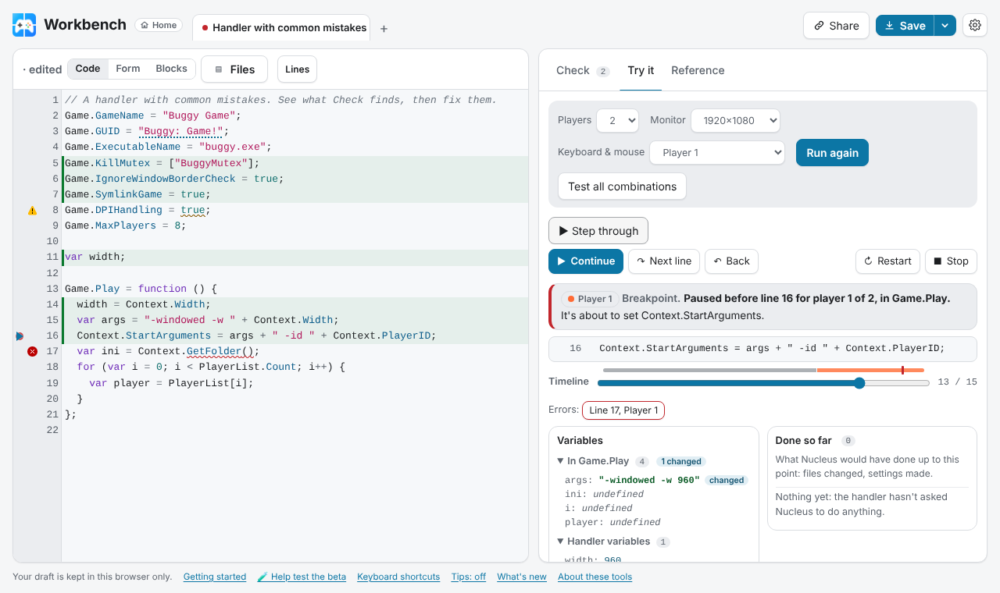

  

- **Form and Blocks: a handler without writing code.** Next to Code, **Form** shows the options as switches, lists and fields, and **Blocks** shows Game.Play and the other callbacks as plain steps ("If … then", "Set … to", "Do …") with pickers for values and conditions. Each shows one line per option or step, with its main problem and a Fix button; the arrow opens the rest. Every change edits the code itself, comments stay, and Lines adds options and steps there too.
  

Screenshot

  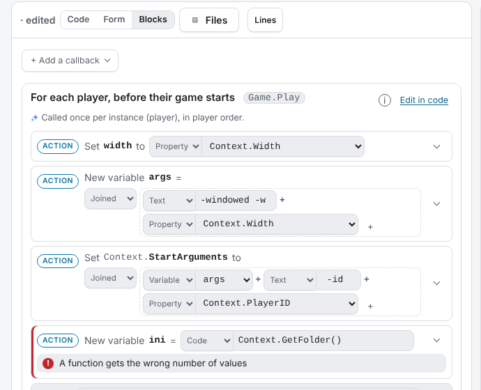

  

- **Whole packages, Hub handlers included.** Files (above the code) shows a .zip or .nc as Nucleus installs it: open its ini, cfg, json, xml, txt or bat files in tabs with highlighting and checks, add and remove files, and save the whole package. Hub handlers that ship files open with all of them (the Open list says "+ N files"); big ones show their size and a link to the Hub package. Check warns about files a Hub install drops and files the handler uses that aren't there.
- **Several handlers at once.** Open handlers are tabs above the code, each with its own code, undo history, package files and a dot for its state (red: Nucleus can't load it, yellow: warnings, green: ready). Opening something while your handler has changes opens it in a new tab instead of replacing your work; closing one can be undone. Ctrl+Shift+[ and ] switch, Alt+W closes. On phones, the handler's name switches between them.
- **Your game on this PC.** In Files, link the folder your game is installed in: Check then compares `ExecutableName`, `BinariesFolder` and the symlink options with the real files, and those lists get a picker for the game's files. Only names and sizes are read, in your browser. Suggested by messenils.
- **Save and Share are two buttons.** Save (Ctrl+S) downloads straight away, as a .zip for Nucleus unless you pick .js or .nc under its arrow (Ctrl+Shift+S), and shows how to install it the first times. Share copies a link, the code, or a Discord-ready code block.
- **Settings, rebuilt, with Accessibility.** Sections in a sidebar and a search box that finds any setting. The new Accessibility section has colour-blind-friendly colours, other underlines for problems, a strong focus ring, larger buttons, an easier-to-read font, notes that stay until you close them, and problems read out as you move. Export your settings to a file and import them elsewhere.
  

Screenshot

  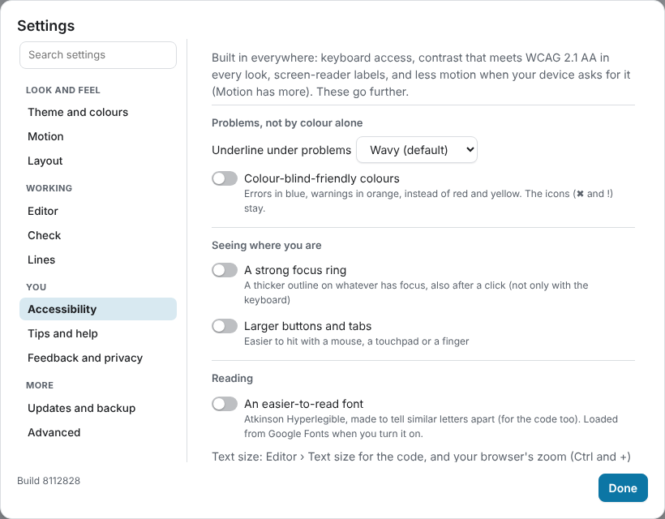

  

- **Make the layout yours.** A slim bar on top or a side rail (› shows its labels), Files and Lines on either side of the code, and every panel edge draggable.
- **Lines: a tree by default, grouped your way.** View picks Tree (open one group at a time, the default) or List (everything with headings), and Group sorts names by object, topic, type, or where they work (top level or inside Game.Play and other callbacks), in either view.
- **Check the AI-written docs.** Reference › "Help check AI-written docs" lists every doc AI wrote from the Nucleus source that no person has checked yet. Confirm one with 👍, or 👎 and "Tell us what's wrong"; checked ones say who checked them.
- **Window messages by name.** In `Game.ProtoInput.BlockedMessages`, each number shows its name (`0x0008` WM_KILLFOCUS), hovering one says what blocking it does, and a **+** before the `]` lists the messages handlers block, most used first. Check now also tells you when Proto Input never starts, when blocked messages need the message filter hook, and when a setting needs another one turned on. Suggested by messenils.

  

Screenshot

  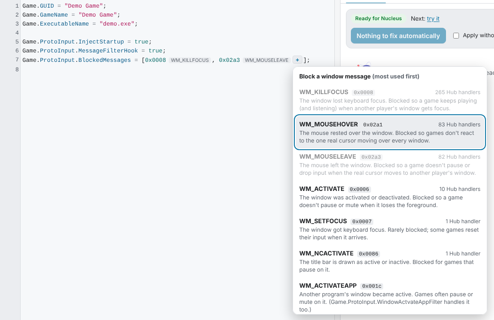

  

- **Help test this beta, first.** New visitors start with two quick questions (how much you code, how well you know Nucleus handlers) as big, easy choices, then get what to test: the items that fit you, quickest and most needed first, each with how long it takes. Your answers also pick guided or Advanced mode; Change brings the questions back, and Everything else lists the rest.
- **Compare with the previous version.** During the beta, Help test this beta (and the command palette) opens the handler you're on in the previous release, so you can say what got better or worse. It keeps its own settings and drafts.
- **Feedback that fills itself in.** Send feedback (menu and Ctrl+Shift+P), Report what you found and Tell us what's wrong now fill in the build, browser, screen, your settings and which handler is open (by name and link, never your code). A bot keeps that block as the issue's first comment, which only maintainers can change, and flags it if it was edited.
- **Tell us what helps.** 👍/👎 on tips, and on AI-written docs (with a link to say what's wrong). Votes are counted anonymously: no code, no names, no cookies; off in Settings › General, and off when your browser asks not to be tracked.
- **Nucli says hi.** On your first visit, Nucli asks two things: how much help you want (Guide me, or I write code for Advanced mode) and where the tools go (a slim bar on top, or a rail on the side, shown as you pick). Settings › Tips and help asks again.
- **Messages where it happened.** A quick fix, Format and F8 say what they did in a small note right under the line in the code, with Undo there too, instead of a note in the corner. Saving the .zip or creating a handler says what's next above the code (with a Try it button), and confirmations show on the button you pressed.

  

Screenshot

  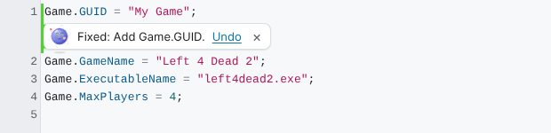

  

- **Duo and Nucli move in.** Nucli, the tools' quiet atom, is the workbench's: he dozes in Check until there's code, cheers when there's nothing to fix, runs Test all, reads along while Fix with AI works, spins while a Hub handler downloads, frets when something won't load and tells you how Try it went. Every spinner and loading state is his now. Duo, splitscreen.me's split-screen ball, greets you with him on the start page. Both follow Settings → Theme → Motion and stay out of the Nucleus Co-op alpha 8 look.

  

Animation

  

  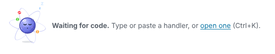

  

- **Duo and Nucli to download.** The mascot page (linked from the start page) has packs to take away: everything, Duo, Nucli, Discord emoji, loaders and spinners, avatars and a web kit, each with how to use it on a website or in an app.
- **Choose how much moves.** Settings → Theme → Motion: a preset (All, Default, Calm, Still, Off) and its switches: a moving interface, Duo and Nucli (lively, play once then rest, still or off), Nucli editing the code during fixes, and What's new playing animations by itself. Default keeps out anything that slows you down or covers the code; reduced motion on your device caps it at Still.

  

Screenshot

  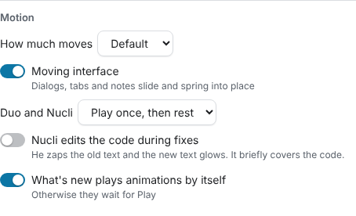

  

  

Animation

  

  

- **Nucli can fix it in front of you.** Turn on Settings → Theme → Motion → Nucli edits the code: when a quick fix, Fix all or Fix with AI changes the code, Nucli flies to each changed line and zaps it: the old text flashes red and shrinks away, the new text glows green. The edit itself happens at once, so typing and Undo are never held up. Off by default (it briefly covers the code): the changed lines just light up.
- **What's new can show animations.** An item can carry a GIF, a short video or an SVG (animated or not) as well as screenshots, in light and dark. It loads only when you open the item, then plays; if your device asks for less motion, it shows a still frame with a Play button instead. A button pauses it either way.

### 🛠️ Improved

- **Package files in colour, also in dark mode.** .bat and .cmd files, PowerShell scripts, Lua, .reg and Steam's .vdf and .acf files are highlighted like the rest, each with its own badge, and the editor for a package's other files follows the dark themes instead of staying white.
- **Engine probes, explained.** The tab now says what a probe is (a tiny handler run in Nucleus' real JavaScript engine), why it matters (the proof behind Check and Try it) and how to use it (look up whether Nucleus accepts some JavaScript, or ask for a new probe).
- **One handler per tab.** Opening an example, a Hub handler or a link always opens a new tab, and one that's already open switches to its tab (with Open a fresh copy if you changed it). With three or more tabs, ▾ lists them all.
- **Save in the side rail works like Save in the bar.** Right-click, Shift+click or a long press picks .zip, .js or .nc, and confirmations show on the button you can see in either layout.
- **Code in its colours everywhere, and real code editors in Form and Blocks.** Hover cards, Reference, Check's technical details, Try it, the debugger, What's new and the start page show code in your code colours. Code steps and code values in Blocks and Form are small code editors with suggestions, hover docs, squiggles, Shift+Alt+F and undo.
- **Long values fit in Form and Blocks.** Text fields grow to a few lines as you type, so a long `Game.Description` is readable in full; the expand button (or Alt+Enter) opens a larger editor with the option's docs, a dialog on phones.
- **Getting started where you start reading.** The "New here?" steps sit at the top of the code instead of in Check, and closing them is no longer forever: they fly down into Getting started in the footer (or the command palette), which brings them back.
- **Fixes go straight into the code.** Fix problems (and Fix with AI) apply right away and light up the changed lines in the editor; a one-line note has Undo, and what changed is folded under it. Only an AI fix that looks risky (new problems, a big rewrite, or you typed meanwhile) waits for you to apply it. "Apply without review" is gone.
- **A Home button by the title.** The title is the workbench's own link now, and Home next to it goes to the home page (what the tools do, how to get them).
- **Check fits more on screen.** Each problem is one row (its colour, line, what's wrong and the fix); click it for the why, other fixes and the technical details. Settings › General › Check switches to Comfortable or Detailed.
- **One box when you hover a problem.** The problem, its fixes (all of them: "set twice" lets you keep either value) and Ctrl+. come first; the name's docs fold away below it.
- **Reference entries stand apart.** Each name is its own card, and the `Hub.*` lines the Hub writes on upload are in Reference too (marked "written by the Hub"), with what Nucleus uses them for.
- **Nicer docs on hover.** The signature is coloured (name, parameters, types), defaults and categories are small labels, and AI-written docs say so at the bottom, with what they're based on. 150 more names have docs now.
- **Shortcuts where you look.** Hover a button (or reach it with Tab) to see its keyboard shortcut, also outside Advanced mode.
- **Tips point at the real button.** A tip about Lines, Try it or Save or copy highlights that button while it shows; the tip's own arrows are both ‹ and ›.
- **Suggestions after `=`.** Typing `Game.SymlinkGame = ` offers `true` and `false`, an option with fixed values lists them (`Nucleus.DPIHandling.…`), `Game.Play = ` writes the function with the cursor inside, and `Game.ProtoInput.BlockedMessages = ` offers the set most Hub handlers block.
- **Problems explained right where they are.** Hovering underlined code (or a marker in the margin) opens a card under it, not on top of it: an icon in the problem's colour, a plain title, the exact message with names shown as code, and the fix as a button you can click. The name's docs follow below.

  

Screenshot

  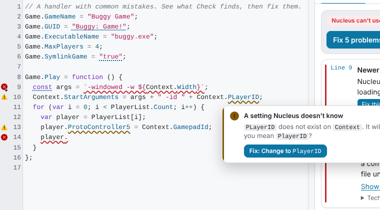

  

- **The colour glow is for AI only.** Pointing at an everyday button no longer makes it glow; only Fix with AI does.

### 🐛 Fixed

- **Share… on the phone keyboard row.** The key above the phone keyboard opened Save, which now saves straight away; it's Share… now, so a link to the selected lines is still one tap away.
- **Settings no longer empties the results.** Switching tabs in Settings left Check blank until you picked a tab again.
- **Keyboard users can leave the editor.** Tab still indents; Esc then Tab moves on to the rest of the page. Esc also closes a line's problem list, and Ctrl+. puts you on its Fix button.
- **Smaller fixes.** New handler starts empty (with examples as hints) instead of filled with Deep Rock Galactic; Try it offers up to your handler's `Game.MaxPlayers` players; Test all waits until the handler loads; the AI review's Accept and Reject sit above the changes; the shortcuts list opens at the top; no Fix button when there's nothing to fix; problem texts line up; on phones Lines no longer pops up the keyboard and the ⋯ menu skips keyboard shortcuts.
- **Red squiggles are back.** Problems are underlined again exactly where they are in the code (a thin VS Code-style wave: red for errors, yellow for warnings; dotted for tips); the style that drew them had stopped working.
- **A typo no longer hides every other problem.** While a line doesn't parse yet (say you're halfway through `player.`), the rest is still checked, and the error sits on the unfinished code instead of on the next line.

### 🙏 Thanks

- **messenils** for the idea of naming the window messages in `BlockedMessages`, picking the game folder to check paths, and a trigger-editor style way of editing handlers.

---

## 2026-11-06

### ✨ New

- **Two looks from Nucleus Co-op's past, and code colours of your choice.** **Mac style** looks like macOS, after vlxst's Mac style for Nucleus Co-op: panes as windows with traffic lights, a frosted toolbar over a wallpaper, segmented tabs, push buttons and system blue. **Nucleus Co-op alpha 8** is the original 2019 app: flat greys, square corners, white-bordered buttons and no animation. Both come in light and dark. Code colours are now their own choice, under the looks: the look's own, GitHub, VS Code, Xcode, One, Monokai or Dracula, each shown as a few lines of handler. All of it now has its own Theme tab in Settings.

  

Screenshots

  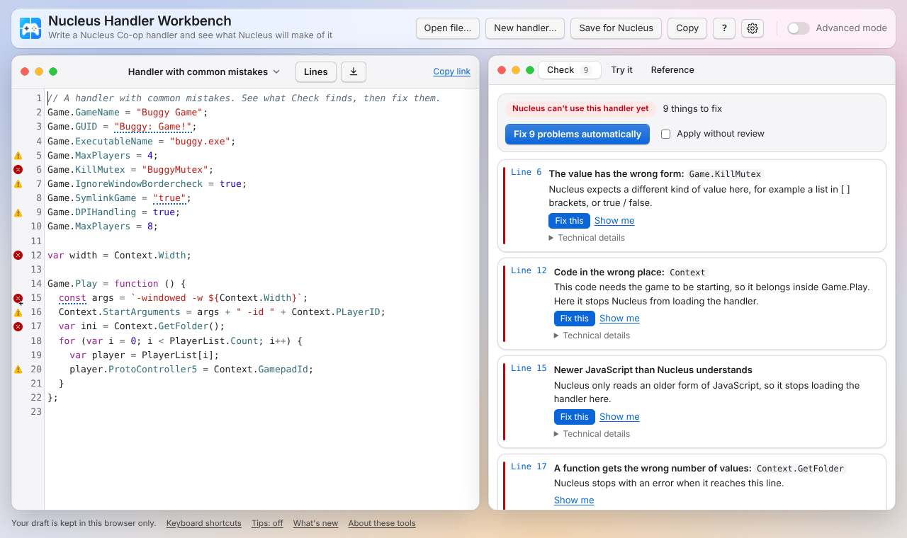

  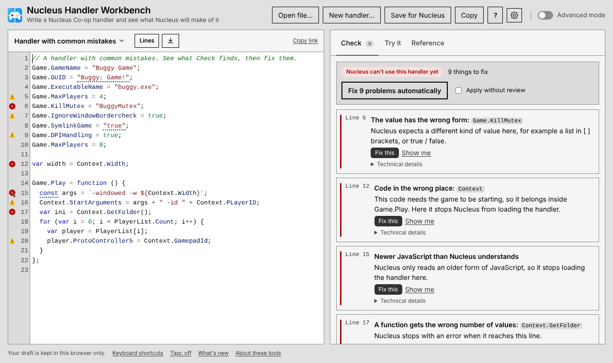

  

- **Livelier motion.** Inspired by BSManager: dialogs rise with a little spring, the main button glows in the player colours when you point at it, icons turn under the pointer, Open's rows show "Open →" as you move over them and arrive one after another, the marker under Check, Try it and Reference glides between tabs, and main buttons widen a little under the pointer. The start page fades in with a glow and its buttons widen too, after bsmanager.io. None of it plays if your device asks for less motion.
- **Feedback you can see and touch.** After the BSManager app: Test all shows a progress bar while it runs and the logo beats until it's done, a toast can be swiped away to the right (a short drag springs back), and a notice slides in at the top of the code instead of just appearing.
- **Every Hub handler, not just 40.** Open (Ctrl+K) lists all of the Hub's handlers, about 600, most downloaded first, each with its cover, players, downloads and a clean or warning badge; search finds any of them. They come from our own daily copy, so opening one never waits on the Hub, and the Hub only sees a few requests a day however many people use the workbench.
- **Pick a look, or make your own.** Settings → Theme → Look shows splitscreen.me, v3.splitscreen.me and your own theme files (JSON) as cards, each with a small picture of the workbench in its colours; "Add a theme file" is the last card. A theme builds on one of the built-in looks and only lists what it changes: colours for light and dark, plus corners, shadows and fonts for both; tiles, borders and status colours follow the colours it sets. "Download this look as a theme file" gives you a file to start from, and the workbench says which values it left out and which text gets hard to read. Keep as many as you like.

  

Screenshot

  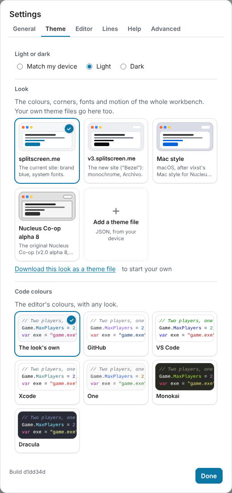

  

- **Reference shows what's in it.** With nothing typed, the Reference tab lists what you can look up: Game, Game.Hook, Context, Player, ProtoInput and .NET, each with a count (click one for all its names), the names Hub handlers use most, the Nucleus enums, and a few searches to try.
- **A sneak peek at Duo and Nucli.** The start page links to the mascots we're sketching for splitscreen.me (Duo) and these tools (Nucli): their animations, loaders and a concept for player setup in a future Nucleus Co-op. Early concepts; they'll move into the workbench soon.

### 🛠️ Improved

- **The logo takes you home.** Clicking it opens the start of the Open dialog (new handler, open a file, examples) instead of leaving the workbench. The start page, with the VS Code extension and how to install it, is now "About these tools" at the bottom (in More on phones, and in the command palette).
- **One look across the workbench and the start page.** Rounder panes, cards and dialogs with soft shadows, buttons that react when you point at them, Check cards with a rounded colour bar, Try it with one card per player (their colour by the name), switches in Settings, and dialogs that fade in (or slide up on phones). The sizes come from one shared scale, and nothing moves if your device asks for less motion. The v3 look is lighter in light mode, and its code has colours again: keywords, names, text and numbers each their own.
- **Lines shows docs in Reference.** With the Reference tab open on a wide screen, pointing at a name in Lines shows its full docs there, not squeezed under the list. Suggested by messenils.
- **A cleaner Open dialog.** Ctrl+K now opens a palette near the top of the screen: the start actions as tiles with icons, engine templates as chips, and Hub handlers as rows with the game's cover (from the Hub), players, downloads and a clean or warning badge (hover it to see what it means). Hub handlers sit in two compact columns on wide screens (about 14 at once on a laptop, 22 on a full-HD screen). Searching groups the results with a count and highlights what you typed, and the arrow keys move through every layout.

  

Screenshot

  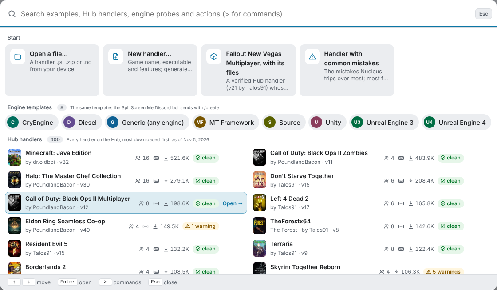

  

- **Numbered releases in What's new.** Each release shows its number, with a link to its notes on GitHub, and screenshots open only when you click Screenshot.
- **Problems stay where you can read them.** A link that opens nothing, a file or Hub handler that won't load, a failed save or a file Format can't read now shows at the top of the code until you close it or open another handler, with Try again where it helps. Copy and Copy link answer on the button itself ("Copied ✓"), and notes that only repeated what's on screen are gone.
- **Toasts in a stack.** Notes such as "Fixed" or "Link copied" pile up at the bottom right (above the bottom bar on phones): the newest in front, older ones peeking out behind it. Hover the stack to fan it out (it waits while you read), close one with ×, and use Undo on "Fixed" and "Formatted". Each shows whether it's good news or a problem.
  

Screenshot

  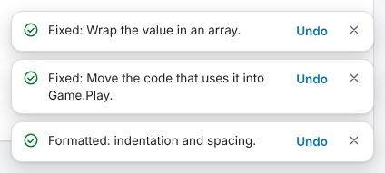

  

### 🐛 Fixed

- **The keyboard no longer covers search fields on phones.** Only the code made room for the on-screen keyboard; now everything does: Lines' filter, the Reference search, Open, New handler and the other sheets move up above it, and the field you tap stays in view.
- **Lines no longer flickers between two names.** Moving the pointer slowly over the list could make it jump back and forth between two rows, because the description under the list changed height. It now keeps one height, and Full docs has the rest. Reported by messenils.

### 🙏 Thanks

- **messenils** for the video of Lines flickering, the idea of showing its docs in Reference, and for spotting that `Game.SetupSse` is never called.

---

## 2026-11-05 23:00

### ✨ New

- **Command palette, as in VS Code.** Ctrl+Shift+P (or F1) lists every command with its shortcut: format, fix, Try it, Test all, go to line, download, theme, settings and more. Ctrl+P still opens the examples and Hub handlers, and typing `>` there switches to commands.
  

Screenshot

  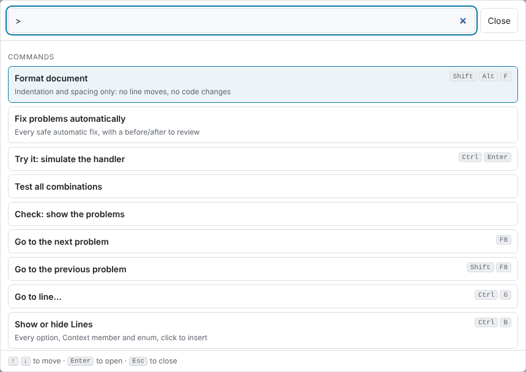

  

- **Format document.** Shift+Alt+F (or the command palette) tidies indentation and spacing. No line moves and no token changes, so Nucleus reads the handler exactly as before.
- **Tips for handler authors.** About 60 tips in five kinds, each labelled: best practices, common pitfalls, shortcuts, settings and features. Plus heads-ups for `Game.GUID`, `Game.AddOption` and `Game.CustomHotkeys` lines.
- **See what's in a package.** The "+ N files" next to the handler's name lists the package's other files, where Nucleus installs each one (`handlers\<GameName>\…`) and what's in the text files. To try it, open **Fallout New Vegas Multiplayer, with its files**, a verified Hub handler whose package adds the scripts its `Game.Play` runs.
  

Screenshot

  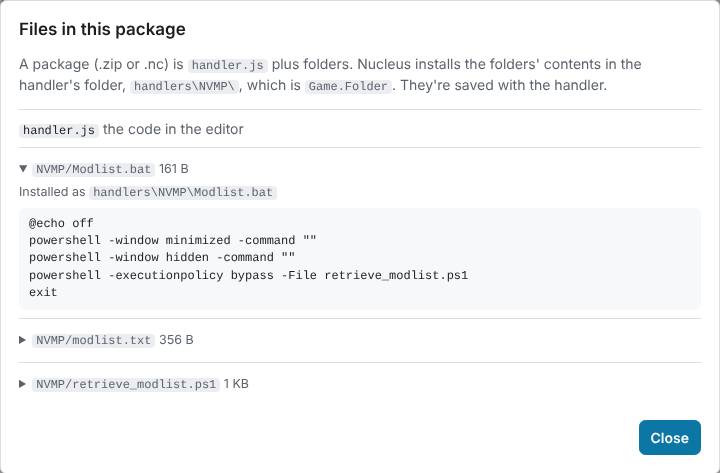

  

- **More checks from the Nucleus source.** Check warns when `Game.GUID` changed from the Hub version (players would lose the game and their profiles), when option values are `true`/`false` or numbers (a saved profile turns them into text), when the file isn't UTF-8, and when `Game.GameName` has a backslash (the Hub install fails).
- **Names that don't exist.** Check now catches a stray word or a typo of a variable (`"system.cfg", sdfsdf`), which stops Nucleus from loading the handler. Before, only Try it noticed. Plugins listed in a package's `pluginsInfo.txt` count as defined, in Check and in Try it.
- **System.IO and other .NET calls in Lines.** `System.IO.File.Copy`, `Exists`, `Delete`, `Path.Combine`, `Directory.CreateDirectory`, `Thread.Sleep` and more, with docs, completion and how many Hub handlers use them. Suggested by messenils.
- **WakaTime, if you use it.** Add your API key in Settings › Advanced and the time you spend on handlers shows up in your WakaTime dashboard (or a self-hosted Wakapi), as the Nucleus Workbench editor on your system, with a computer name you choose. Writing, testing in Try it and reading the docs count as separate categories, with line numbers and the lines you changed. Never the code; it's off until you turn it on.
- **VS Code's shortcuts in the editor.** Ctrl+/ comments a line, Alt+↑/↓ moves it, Shift+Alt+↑/↓ copies it, Ctrl+Shift+K deletes it, Ctrl+D selects the next match, Alt+click adds a cursor, Ctrl+F / Ctrl+H / Ctrl+G find, replace and go to a line, and Ctrl+. shows the fixes for a line. Ctrl+P and F1 open the examples and actions, Ctrl+S saves for Nucleus, Ctrl+B shows Lines. Press ? for the full list.
- **Lines greys out what doesn't work where you are, both ways.** Inside `Game.Play`, options Nucleus reads before the session (`Game.GUID`, `Game.MaxPlayers`, `Game.AddOption`...) are greyed out, with the reason; outside it, `Context` and `Player` are, as before.
- **Lines as a tree.** Lines now opens as a tree (Group › by object or by topic for the long list), starting at Game, Context, Player, System and Nucleus; tap one to go a level deeper (System › IO › File), and back with the path at the top. With the list wider (Settings › Lines › Wider column, or drag its edge), it shows two columns, like a file browser. Typing a filter still searches everything. Idea: messenils.

### 🛠️ Improved

- **The code editor is one stop for the keyboard.** Tab reaches the code once, and screen readers name it "Handler code".
- **Screenshots in your theme.** The pictures on the start page and in What's new are shown light or dark, following your system or the theme you picked in Settings.
- **Easier with a screen reader and a keyboard.** The code editor, the resize handles and the change list have names and positions screen readers announce, headings are in order, and a few low-contrast labels are darker.
- **Easier to find.** Clearer page titles and descriptions, link previews with a picture, and a sitemap for search engines.
- **One Settings window, with tabs.** General, Editor, Lines, Help and Advanced; the Lines list's ⚙️ opens it on the Lines tab, so every setting is in one place.
- **The logo goes home.** Clicking the logo or title opens the Nucleus Handler Tools start page, with the VS Code extension and how to install it.
- **A misspelled function is an error, not a skipped setting.** Calling a name that doesn't exist stops Nucleus, and Check now says so.
- **Game.ForceFinishOnPlay is flagged as historical.** It comes from the original Nucleus Coop; today's Nucleus doesn't read it and closes leftover copies of the game by itself. Check says so in a warning, with a fix that removes the line.

### 🐛 Fixed

- **No more "Save password?" from the browser.** The WakaTime key field was a password field, so picking a result in the Open dialog looked like a login to Chrome.
- **The fix box closes when you keep editing.** After Fix all, the before/after box stayed open with an old result while you typed; it now closes, and the list below shows what's left.
- **WakaTime shows the editor as Nucleus-Workbench.** It showed "Nucleusworkbench".
- **Lines writes functions as functions.** Clicking Game.Play, Game.OnStop and other callbacks inserts `Game.Play = function () { … };` with the cursor inside, instead of `Game.Play = ;`. Reported by messenils.
- **Packages keep their other files.** Opening a .zip or .nc with more than handler.js (Goldberg files, configs, DLLs) and saving it again used to drop them. Now they're kept, shown as "+ 3 files" next to the name, and saved back unchanged in .zip and .nc.

### ⚠️ Changed

- **Shift+Alt+F formats the code now, as in VS Code.** Fix all is in the command palette (Ctrl+Shift+P) and on its button.

### 🙏 Thanks

- **messenils** for the System.IO lines, the tree idea and reporting how Lines inserted Game.Play.

---

## 2026-11-05 18:33

### ✨ New

- **Tap a warning next to the code.** Its problem opens right there, with Fix this. Works on phones too, where there's no hover.
  

Screenshot

  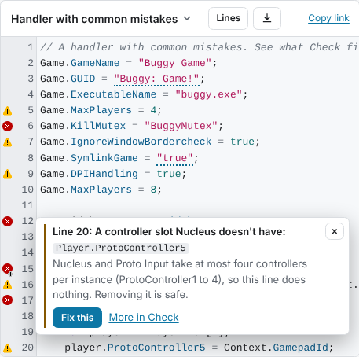

  

- **Problems under the code on phones.** A strip shows how many problems there are and steps through them (‹ ›), so you can fix things without switching to Results.
- **Docs for each name in Lines.** The (i) button opens what a name does, its default and how many Hub handlers use it, with Insert and Full docs.
- **Test all combinations in Try it.** One button runs every player count (up to the handler's maximum), input setup and monitor size, and shows which combinations fail and why. Pick a cell to see that run. It takes about half a second.
  

Screenshot

  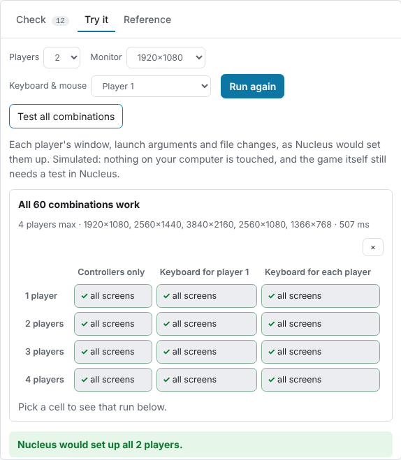

  

- **Copy or download right next to the code.** The new button beside Lines copies the code or a link, or downloads the handler as a .zip for Nucleus, a plain .js or an .nc package. Open a file from your device straight from the handler's name. While typing on a phone, Copy… in the symbol keys does the same. On phones, a link opens on the handler, and the phone's own Select all, copy and delete reach every line.
- **Try it with a keyboard and mouse for every player.** Choose "Each player their own" under Keyboard & mouse, as in Nucleus' multiple keyboards and mice mode. Try it says so when the handler doesn't support it.

### 🛠️ Improved

- **Resize the panels.** Drag the edge between the code and the results, the left edge of the Lines list, or (on phones) the top of the Lines sheet. Double-click an edge to reset it, or use Settings › Reset panel sizes. Sizes are kept in your browser.
- **Much more room on phones.** All the buttons share one row at the bottom, in thumb reach (Handler and Results, the menu, Settings), hidden while you type, and Lines opens as a sheet over the lower part so the code stays in view.
- **The line you type stays in view on phones.** When the on-screen keyboard opens, the workbench fits the space above it (it reads the keyboard's height): the header and the tip bar step aside, and the cursor line stays visible above the symbol keys.
- **The symbol keys always sit just above the keyboard.** When the browser can't tell how tall the on-screen keyboard is (some browsers, or the workbench inside another page), they use the height measured last time on that phone, or a careful estimate.
- **Phone-friendly menus.** The menu, Settings and other dialogs rise from the bottom as sheets, as tall as their content; drag one down or tap outside to close. Settings has bigger rows, a one-tap theme switch and Done always in reach. The examples list no longer pops up the keyboard or shows keyboard hints.
- **Tidier tips on phones.** One line with a large ×; tap it for the whole tip, back, next and Turn off.
- **Switch handlers from the handler's name.** Click the name above the code to open an example or a Hub handler. It replaces the Examples button.
- **Docs and problems by tap on touch screens.** Tap an underlined word to see its problem and fix; the docs of the name under the cursor show under the code. Holding still selects text as usual. Hold a button to read what it does without pressing it. The mouse-only pop-ups no longer get stuck on phones.
- **More tips, on both handlers and the workbench.** Next now takes turns between a tip for writing handlers (when `Game.Play` runs, per-player launch arguments, `Game.Folder` and more) and one for the workbench (Test all combinations, resizing panels, the (i) in Lines and more).
- **The developer bar fits on phones.** One scrollable row at the top instead of three rows over the page.
- **The verdict comes first.** Check opens with whether Nucleus can use the handler and the fix button; the welcome note is a short card under it, with a × to dismiss.
- **Try it helps when the handler doesn't load.** Fix the problems from there with one click, or jump to them.
- **More room for the code.** The Lines list opens by default only on very wide screens (1680 px and up), and the code gets more of the width while it's open.
- **A shorter Try it intro.** One sentence instead of a paragraph.

---

## 2026-11-05 15:43

### ✨ New

- **What's new, in the workbench.** After an update, a short note says what changed, with a link to this list (also in the footer, the ⋯ menu, Settings and Ctrl+K). Turn it off in Settings.
  

Screenshot

  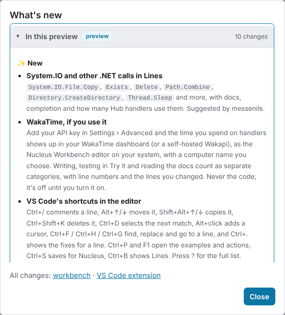

  

- **The workbench as one offline file.** `workbench.html` in the extension's releases (or `nucleus workbench`) is the whole workbench in a single file: open it locally or host it yourself.
- **`llms.txt` for AI agents.** It tells agents where to find the MCP server, the agent skill and the API reference, and asks them to run the tools themselves instead of using this site.

### 🛠️ Improved

- **Go back a tip.** The tip bar has ‹ and › to go back and forth.

### ⚡ Faster

- **Loads about half as much.** A visit downloads about 235 KB instead of 433 KB: Hub examples load when you open one, and the checker is no longer sent twice.
- **Easier on the Hub.** One daily job is the only thing that reads the Hub's list; everything else (the site, the weekly check, people's tools) reads our copy of it. Only new handler versions are downloaded, the full Hub check runs weekly, and the site is only redeployed when something changed.

---

## 2026-11-05

### ✨ New

- **Lines list beside the code.** Every name a handler can use, click to insert. It shows what the handler already sets (and jumps there instead of adding a second line), dims names that don't work where the cursor is, suggests values, and sorts by how many of the 600 Hub handlers use each name. Its ⚙️ has the list settings. Idea: messenils.
  

Screenshot

  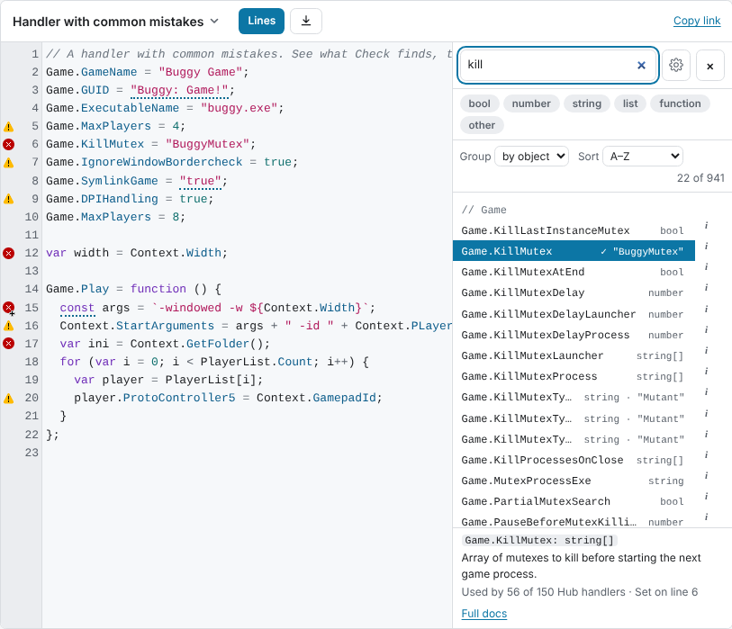

  

- **Tips while you write.** Loading-screen-style tips under the code, and a heads-up when the code makes one relevant (each shown once). Turn them off with ×.
- **Settings.** ⚙️ in the header: theme, text size, line wrap, symbol keys, tips and the Lines list; Advanced mode and the developer bar under Advanced.
- **Works on phones.** A slim header with a ⋯ menu, Lines full screen, wrapped lines and symbol keys above the on-screen keyboard.
  

Screenshot

  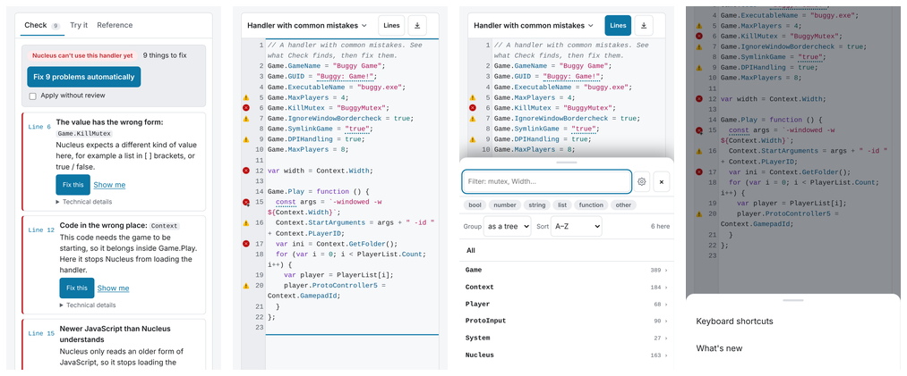

  

- **Intro page for testers.** [The intro page](https://snailedlt.github.io/nucleuscoop-handler-testbench/start/) has screenshots, the install guide and a download link that always points to the newest release.

### 🐛 Fixed

- **The Lines scrollbar no longer hides values.** On Windows it covered the values on the right. Reported by Horah.
- **Two false flags gone.** Found by checking all 600 Hub handlers: a syntax error on `let x` followed by `var x`, and a Proto Input warning on 11 handlers.

### 🙏 Thanks

- **messenils** for the idea of a list of every name, like Pawno's.
- **Horah** for reporting the scrollbar that hid values.

---

## 2026-11-02

### ✨ New

- **The workbench on GitHub Pages.** Rebuilt daily with the newest verified Hub handlers.
- **Share links.** Copy link puts the handler (or the selected lines) in the address.
- **The splitscreen.me look.** Light and dark.
- **Weekly check against the real engine.** Every verified Hub handler runs in Nucleus' script engine (Jint 2.11.58) and is compared with Try it.

---

## 2026-11-01

### ✨ New

- **First version.** Check a handler, fix it automatically, and Try it: what Nucleus sets up for each player.
